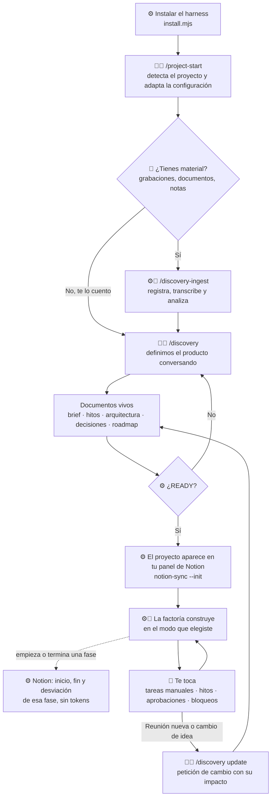
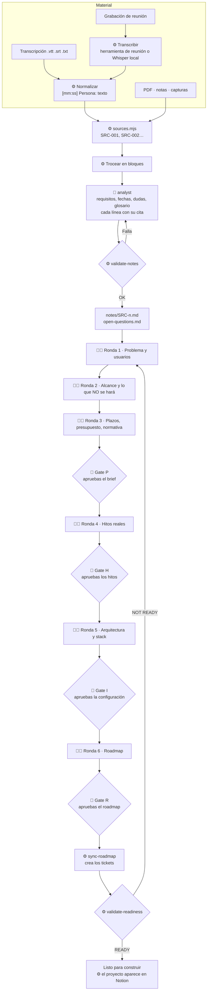
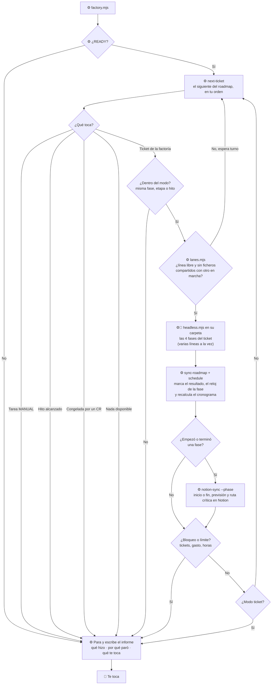
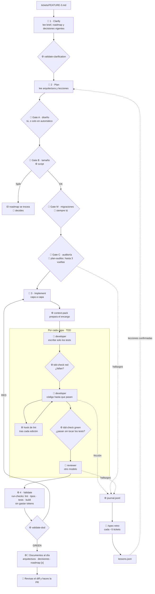
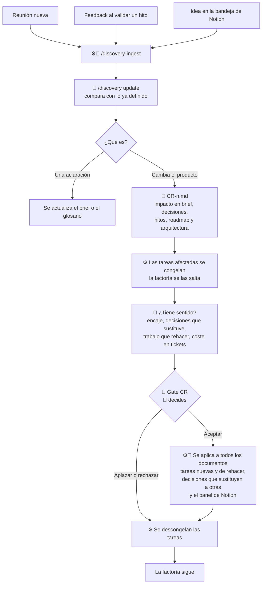

# 📈 Flujo de trabajo de mi factoría

Cómo trabaja tu factoría de principio a fin, en 6 diagramas. Del más general al más detallado.

> 💡 **En Notion:** los diagramas están en bloques de código `mermaid`. Al importarlos, en cada bloque elige la vista **Preview** (o **Split**) para verlos dibujados.

**Leyenda de los diagramas:** 🧑 = intervienes tú · 🤖 = lo hace el agente · ⚙️ = lo hace un script (sin IA) · 🚪 = puerta donde se para hasta que decides.

---

## 1. La vista general

Un proyecto pasa por tres grandes momentos: **arrancar** (una vez), **construir** (en bucle) y **cambiar de rumbo** (cuando haga falta).

---

## 2. Arrancar un proyecto: el descubrimiento

La parte más larga y donde más te implicas. Puede durar varias sesiones: se guarda por dónde vais.

**Cómo detecta los hitos reales** (ronda 4): busca en las notas fechas y compromisos, el primer momento en que alguien puede usar el producto de punta a punta, demos o pruebas con alguien de fuera, pasos sin vuelta atrás (salir a producción, migrar datos) y dependencias de terceros. Cada hito propuesto cita la fuente de la que sale.

---

## 3. La factoría y sus modos

Cada vuelta del bucle es un ticket. El modo decide cuántas vueltas da antes de parar.

| Modo | Hasta dónde llega sola |
|---|---|
| `manual` | Nada: lanzas tú cada fase de cada ticket |
| `ticket` | Un ticket por sesión |
| `phase` | Hasta acabar la fase del roadmap en curso |
| `stage` | Hasta acabar la etapa del roadmap en curso |
| `milestone` | Hasta el siguiente hito |
| `continuous` | Hasta que haga falta una persona (o un límite) |

**Varias líneas a la vez.** En cualquier modo, la factoría puede llevar varios tickets en paralelo (`lanes`), cada uno en su propia carpeta (`git worktree`). Entran a la vez solo los que no dependen el uno del otro y no tocan los mismos ficheros; el resto espera su turno. Si una línea se para por una puerta tuya, las demás siguen. Al final, `integration-check.mjs` junta todo lo terminado y vuelve a pasar las comprobaciones, porque dos tickets que funcionan por separado pueden romperse juntos.

Con `designApproval: "human"`, en cualquier modo la factoría prepara el diseño de cada ticket y espera a que lo apruebes antes de programar.

**Qué llega a Notion:** solo dos avisos por fase. Cuando arranca su primera tarea, `sync-roadmap` apunta la fecha y hora de inicio en `roadmap.md` y Notion la copia; cuando termina la última, lo mismo con el fin, y Notion calcula la duración y la desviación frente a tu estimación. Cada aviso lleva también la previsión nueva que calcula `schedule.mjs` (dependencias, recursos y ruta crítica), así que el Gantt de Notion siempre está al día y la línea base se queda quieta para comparar. Todos tus proyectos van al mismo panel, "🏭 Factoría". Los agentes nunca leen Notion: si mañana lo quitas, la factoría sigue igual.

---

## 4. Un ticket por dentro

Lo que pasa en cada vuelta del bucle anterior. Es **SDD** (las fases 1 y 2 dejan la especificación aprobada antes de tocar código) y **TDD** (en cada capa, primero los tests que fallan y después el código que los hace pasar, comprobado por `tdd-check`).

---

## 5. Cambiar de rumbo a mitad de proyecto

Cambiar de idea es normal. La regla es que nunca se cambia sin ver antes qué rompe.

---

## 6. Dónde intervienes tú

Todo lo demás lo hacen los agentes y los scripts.

| Momento | Qué haces | Comando o puerta |
|---|---|---|
| Arranque | Das el material o lo cuentas; respondes las rondas | `/project-start`, `/discovery` |
| Definición | Apruebas brief, hitos, configuración y roadmap | Gate P, Gate H, Gate I, Gate R |
| Cada ticket | Apruebas el diseño (si así lo configuras) y las migraciones | Gate A, Gate M |
| Ticket grande | Decides cómo trocearlo | Gate B |
| Cuando para la factoría | Lees el informe y haces lo que te toca | `specs/runs/<fecha>.md` |
| Tareas manuales | Las haces y las marcas en el roadmap | Tareas `MANUAL-n` |
| Hitos | Enseñas la demo y validas | `/milestone-review H1` |
| Bloqueos | Lees el motivo, lo resuelves y borras el fichero | `BLOCKED.md` |
| Cambios | Decides si se hacen | `/discovery update`, Gate CR |
| Decisiones fuera de un ticket | Las apuntas | `/decision` |
| Antes de mergear | Revisas el diff y abres la PR | Commit y PR siempre tuyos |
| Cada ~5 tickets | Lees la retro y aplicas las mejoras | `/spec-retro` |
| Cuando quieras ver cómo va todo | Abres el panel y miras, sin tocar nada | "🏭 Factoría" en Notion |
