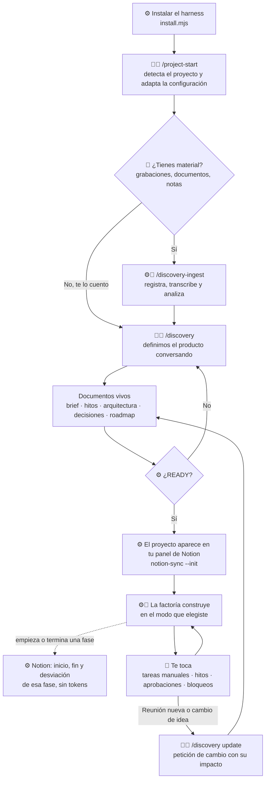
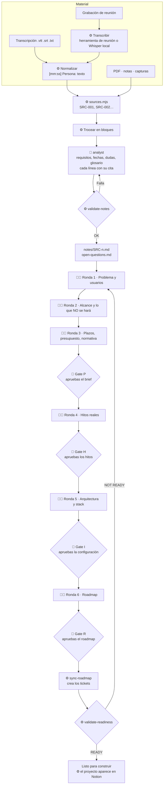
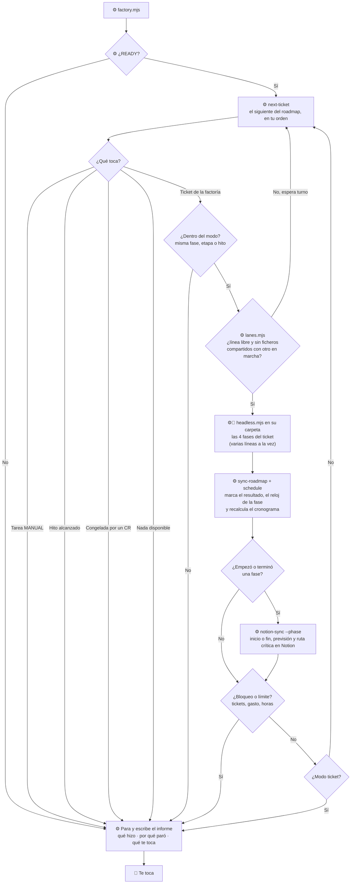
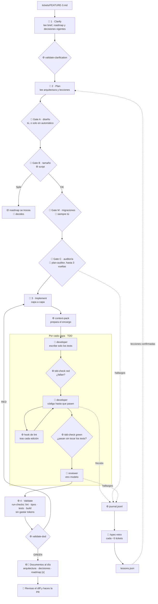
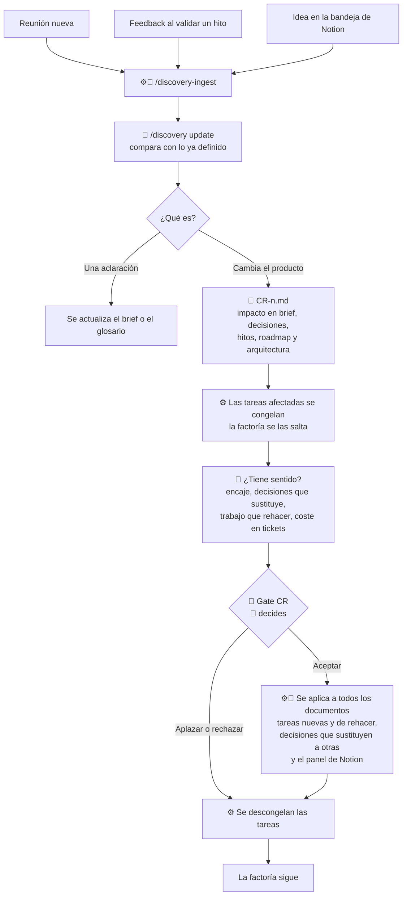

# 🏭 Roadmap · Mi factoría harness

Plan completo para construir **tu propio harness de Claude Code**: una factoría reutilizable que convierte un ticket en código validado, inspirada en la charla "Harness Engineering" del BiznagaFest 2026 (Joan León y Carlos Villuendas) y adaptada a tu forma de trabajar.

Este roadmap es **solo del harness**. El proyecto real donde lo probaremos (el banco de pruebas) tendrá su propio roadmap más adelante. Mientras tanto, cada pieza se prueba en un **sandbox mínimo** que creas en la Etapa 0.

📈 **Para ver cómo trabajará tu factoría de principio a fin, empieza por `01-flujo-de-trabajo.md`**: tiene los diagramas del flujo completo.

---

## 🧭 Cómo usar este roadmap

- **Etapa → Fase → Tarea.** Las etapas son bloques grandes con un hito al final. Las fases agrupan tareas de un mismo tema. Las tareas duran entre 15 y 90 minutos.
- **Cada tarea tiene 5 partes:**
  - **Qué:** lo que vas a construir.
  - **Por qué:** para qué sirve dentro del sistema. Si no entiendes el porqué, para y pregúntalo antes de seguir.
  - **Cómo:** los pasos concretos.
  - **Hecho cuando:** la prueba que demuestra que está terminada. Si no se cumple, no está hecha.
  - **Referencia:** el fichero del repo original que puedes mirar como ejemplo.
- **✅ Checkpoint** al final de cada fase: una comprobación que tienes que pasar antes de empezar la siguiente fase. Es lo que hace el roadmap "seguro": los errores se pillan pronto, cuando son baratos.
- **🏁 Hito** al final de cada etapa: algo que funciona, un commit con etiqueta en Git (`etapa-0`, `etapa-1`…) y una línea en el `CHANGELOG.md`. Si algo se rompe más adelante, siempre puedes volver al último hito.
- **⚠️ Riesgos**: lo que suele fallar en esa etapa y qué hacer.
- **No te saltes etapas.** Cada una usa lo que construiste en la anterior.

**Repo de referencia:** [nucliweb/harness-engineering-biznagafest](https://github.com/nucliweb/harness-engineering-biznagafest) (licencia MIT, puedes reutilizar piezas). Cuando una tarea dice "Referencia: `ruta`", es una ruta dentro de ese repo.

---

## 🎯 Qué vas a tener al final

Un repositorio `harness` en tu GitHub que:

1. Se instala en **cualquier proyecto** tuyo o de un cliente con un comando.
2. Se configura con **un solo fichero** (`harness.config.json`): capas, comandos, umbrales y modelos.
3. Te deja cambiar entre **perfil Pro y perfil Max** con un comando, sin tocar los agentes a mano.
4. Funciona en **Windows directo** (todo en Node, sin depender de bash).
5. Lleva un ticket por **4 fases** (clarify, plan, implement, validate) con puertas, validadores por script y memoria de errores. Trabaja con **SDD** (nada de código sin especificación aprobada) y **TDD comprobado por script** (en cada capa, primero los tests que fallan y después el código que los hace pasar, sin tocarlos).
6. Puede correr **solo** (modo headless) y medir tiempo y coste de cada fase.
7. Mantiene **vivos los documentos de cada proyecto**: brief, arquitectura, registro de decisiones con fecha y hora, y un roadmap cuyas tareas **son los tickets de la factoría**.
8. **Arranca cada proyecto definiendo el producto contigo**: analiza grabaciones de reuniones, documentos y notas, detecta los hitos reales y deja todo trazado hasta el minuto de la reunión del que sale. Y gestiona los cambios a mitad de proyecto con su análisis de impacto.
9. Trabaja en el **modo que elijas**: un ticket por sesión, una fase o una etapa del roadmap, hasta el siguiente hito, o sin parar hasta que haga falta una persona. Y con **varias líneas a la vez**: los tickets que no dependen entre sí ni tocan los mismos ficheros avanzan en paralelo, cada uno en su carpeta, y un script comprueba que juntos también funcionan.
10. **Gasta solo donde aporta**: todo lo mecánico (preparar encargos, ejecutar comprobaciones, recortar logs, avisar a Notion) lo hacen scripts sin gastar tokens, y un informe te dice dónde se va el cupo.
11. Te enseña el avance de **todos tus proyectos en un solo panel de Notion**: cada proyecto aparece cuando queda definido, y cada fase muestra su estimación en horas, cuándo empezó, cuándo terminó y cuánto te desviaste. Lo ves como un **diagrama de Gantt al estilo Microsoft Project**: dependencias con flechas, recursos (tú y la factoría) con su capacidad, ruta crítica y línea base frente a previsión. Notion solo mira: las fechas las calcula un script y el trabajo vive en el repo.

---

## 🧱 Decisiones de diseño (y por qué)

| Decisión | Por qué |
|---|---|
| **El harness vive en su propio repo** y se instala en los proyectos | Lo escribes una vez y lo reutilizas en todos tus proyectos y en tu agencia |
| **Todo configurable desde `harness.config.json`** | Cada proyecto tiene capas y comandos distintos. El harness no debe saber nada de un proyecto concreto |
| **Hooks y scripts en Node (`.mjs`)** | Funcionan igual en Windows, Mac y Linux. Nada de `.sh` |
| **Scripts sin dependencias externas** | Funcionan nada más clonar, sin `pnpm install` ni programas extra. Igual que en el original |
| **Para buscar, ripgrep (`rg`); dentro de los scripts, Node** | `rg` es más rápido que `grep` y se salta lo que ignora Git, así que el agente no llena su contexto con `node_modules`. Claude Code ya lo usa por dentro. Los scripts buscan con `fs` para no depender de nada instalado |
| **Perfiles de modelo Pro y Max** | Puedes cambiar de plan el día de mañana sin reescribir nada |
| **Validadores antes que fases** | Primero construyes "el juez" y luego a los agentes. Así cada fase nace ya validada |
| **Contrato primero** | Ellos lo escribieron antes que cualquier agente. Si contrato y código no coinciden, el código está mal |
| **Stack por defecto: Next.js + TypeScript + Supabase + Vercel** | Es tu stack, pero todo se puede cambiar en la configuración |
| **El roadmap del proyecto manda sobre los tickets** | Planificas una vez, en un solo sitio. Los tickets salen del roadmap y su estado vuelve a él solo |
| **Cada documento tiene un dueño y un validador** | La documentación que se actualiza a mano se desfasa. Aquí la actualiza el proceso |
| **Las fechas las pone un script, nunca un modelo** | Un modelo no sabe qué hora es. Todo lo fechado pasa por `stamp()` |
| **Lo mecánico, siempre por script** | Los tokens se van en leer textos largos y en escribir lo que un script podría generar. El modelo solo hace lo que necesita criterio: entender, diseñar, programar y revisar |
| **SDD + TDD, comprobados por script** | El agente no puede programar sin plan aprobado ni escribir código antes que sus tests: lo impiden los validadores y `tdd-check.mjs`. Es la forma más eficaz de que no se invente que algo funciona |
| **El cronograma lo calcula un script, no Notion ni el modelo** | Notion dibuja Gantts pero no calcula dependencias, recursos ni ruta crítica. `schedule.mjs` lo hace igual siempre con los mismos datos |
| **Notion solo muestra el avance; el trabajo vive en el repo** | Los agentes nunca leen Notion, así no gastan cupo yendo y viniendo. Un script avisa a Notion solo cuando una fase empieza o termina, y un único panel recoge todos tus repos |
| **El propio harness usa sus documentos** | Desde la Etapa 1 el repo `harness` tiene su `decisions.md` y su `architecture.md`. Si el formato sirve para él, sirve para cualquiera |

---

## 🔒 Determinista por diseño

Un modelo nunca es 100 % determinista: con la misma pregunta puede responder distinto, y si le falta información, la rellena. Lo que sí se puede hacer determinista es **todo lo que lo rodea**. La regla de la factoría es: **el modelo propone, un script comprueba y solo un script cambia el estado.**

| Qué | Quién lo decide | Por qué no puede alucinar |
|---|---|---|
| Fechas y horas | `stamp()` | El modelo no sabe qué hora es; el script, sí |
| IDs de tickets, decisiones, fuentes y CR | Scripts: el siguiente número libre | Nunca se inventa un ID ni se repite |
| Estado de tareas y fases, reloj de cada fase, hitos `reached` | `sync-roadmap.mjs` | Sale de ficheros que existen: `04-dod.md` en `GREEN`, `BLOCKED.md` |
| Qué ticket toca ahora | `next-ticket.mjs` | Orden y dependencias del roadmap, no lo que "le parezca" al agente |
| Si un documento está bien hecho | Los validadores | Títulos, campos y citas comprobados por código |
| Si el código funciona | `run-checks.mjs`: lint, tipos, tests y build | El modelo no dice "funciona": lo dice la salida del comando |
| Si los tests se escribieron antes que el código y nadie los tocó | `tdd-check.mjs` | Exige un rojo antes de cada verde y compara la huella de cada test |
| Fechas del cronograma, ruta crítica y retrasos | `schedule.mjs` | Con el mismo roadmap y la misma capacidad, siempre las mismas fechas |
| Qué tickets van en paralelo | `lanes.mjs` | Dependencias del roadmap y ficheros de cada plan: si se cruzan, esperan |
| Si los tickets hechos en paralelo funcionan juntos | `integration-check.mjs` | Los junta todos y vuelve a pasar lint, tipos, tests y build |
| Si un ticket es demasiado grande | Gate B, por script | Cuenta ficheros y capas, no opina |
| Qué contexto recibe cada agente | `context-pack.mjs` y `repo-map.mjs` | El agente no busca a ciegas ni "recuerda" cosas del proyecto |
| Notion | `notion-sync.mjs` | Copia del repo, nunca al revés |
| Commit, push y PR | Tú (o `publish.mjs` en la Etapa 11) | El agente tiene prohibido hacerlo |

**Lo que sí hace el modelo:** entender, preguntar, diseñar, programar y revisar. Ahí está su valor, y por eso cada una de esas salidas va atada:
1. **Formato fijo** definido en el contrato: el modelo rellena una plantilla, no escribe libre.
2. **Validador antes de seguir**: si falta un campo o un título, la fase no avanza.
3. **Reintentos limitados**: si falla varias veces, se para con un `BLOCKED.md` que explica el motivo, en vez de improvisar.
4. **Citas comprobables**: todo lo que se afirma del producto lleva su fuente (`[SRC-003 @ 12:40]`) y el validador comprueba que esa fuente y ese minuto existen.
5. **Memoria solo en ficheros**: decisiones, arquitectura y lecciones están escritas en el repo. Nada depende de "lo que el agente recuerde" de otra sesión.

---

## 🗺️ Arquitectura del harness

```
harness/
├─ harness.config.json        ← lo único que cambia entre proyectos
├─ docs/
│  ├─ contracts.md            ← la única fuente de verdad
│  ├─ architecture.md         ← la arquitectura del propio harness
│  ├─ decisions.md            ← las decisiones del propio harness
│  └─ run-metrics.md          ← tiempo y coste medidos
├─ .claude/
│  ├─ settings.json           ← permisos y hooks
│  ├─ agents/                 ← 6 subagentes
│  ├─ skills/                 ← 4 fases, arranque, descubrimiento, hitos, roadmap, decisiones, retro y apoyo
│  ├─ hooks/                  ← lint tras editar, captura del journal
│  └─ scripts/                ← validadores, journal, decisiones, roadmap, perfiles, ahorro de tokens, Notion (Node puro)
├─ scripts/
│  ├─ factory.mjs             ← la factoría: encadena tickets según el modo
│  ├─ headless.mjs            ← piloto automático de un ticket
│  ├─ adversarial-review.mjs  ← dos modelos discuten
│  └─ install.mjs             ← instala el harness en otro proyecto
├─ templates/                 ← plantillas de ticket, CLAUDE.md por capa y docs/ del proyecto
└─ sandbox/                   ← proyecto mínimo para probar el harness
```

**Lo que produce cada ticket** (dentro del proyecto donde se instala):

```
specs/FEATURE-1/
├─ 00-clarification.md   qué hay que hacer (producto)
├─ 01-research.md        qué existe ya (inventario)
├─ 02-design.md          cómo hacerlo (decisiones cerradas)
├─ 03-plan.md            pasos con fichero y pseudocódigo, se marca [x]
├─ 04-dod.md             resultado de lint, tipos, tests y build
├─ 05-design-qa.md       revisión visual (solo si cambia la interfaz)
├─ journal.jsonl         diario de fricción
└─ BLOCKED.md            solo si algo paró la factoría
```

---

## 📁 Lo que se crea en cada proyecto

Al instalar el harness en un proyecto, se crea siempre la misma estructura. **Lo que se adapta es el código**, no las carpetas del harness: que todo esté siempre en el mismo sitio es lo que permite a los agentes encontrarlo.

```
mi-proyecto/
├─ harness.config.json     ← lo que se adapta: capas, comandos, modo, perfil
├─ .claude/                ← el harness (agentes, skills, hooks, scripts)
├─ discovery/              ← lo que se sabe del producto y de dónde sale (Etapa 7)
│  ├─ inbox/               ← aquí dejas grabaciones, transcripciones, documentos (no va a Git)
│  ├─ transcripts/         ← texto de cada grabación (no va a Git)
│  ├─ notes/SRC-001.md     ← lo extraído de cada fuente, citando el minuto
│  ├─ sources.md · open-questions.md · session.md
│  └─ changes/CR-001.md    ← peticiones de cambio a mitad de proyecto
├─ docs/                   ← los documentos vivos (Etapa 6)
│  ├─ brief.md             ← qué es el producto, para quién y qué no hará
│  ├─ roadmap.md           ← etapas → fases → tareas, con sus hitos. Cada tarea de la factoría ES un ticket
│  ├─ architecture.md      ← cómo está construido ahora mismo
│  ├─ decisions.md         ← decisiones con fecha y hora; solo se añade
│  └─ contracts.md         ← el contrato del harness (lo actualiza el instalador)
├─ tickets/                ← un fichero por ticket, generados desde el roadmap
├─ specs/                  ← el trabajo de cada ticket, informes de ejecución, lecciones y notion-map.json (dónde está el proyecto en tu panel)
└─ src/…                   ← tu código, con las capas que diga la configuración
```

Fuera de los repos, en tu usuario, solo hay un fichero: `~/.harness/notion.json`, con los IDs del panel "🏭 Factoría" que comparten todos tus proyectos. La clave de Notion va en la variable de entorno `NOTION_TOKEN`, nunca en un fichero.

| Siempre igual | Se adapta a cada proyecto |
|---|---|
| `.claude/`, `discovery/`, `docs/`, `tickets/`, `specs/` | Capas, carpetas de código y comandos (los detecta `/project-start`) |
| Nombres y formatos de documentos y artefactos | Migraciones, perfil de modelo y modo de ejecución |
| El contrato | Si usas grabaciones o no: `discovery/` existe siempre, aunque se quede vacía |

**El orden en un proyecto nuevo:** instalar → `/project-start` → material y descubrimiento (la parte larga, contigo) → `READY` → la factoría trabaja en el modo que elijas → tú validas hitos, haces las tareas manuales y decides los cambios.

---

## 🎚️ Perfiles de modelo

Se eligen con `node .claude/scripts/set-profile.mjs pro` o `max`. Lo construyes en la Etapa 4.

| Pieza | Perfil Pro | Perfil Max | Por qué este modelo |
|---|---|---|---|
| Hilo principal (fases) | Sonnet | Opus | Conversa contigo y orquesta |
| explorer | Haiku | Haiku | Solo busca: volumen, no criterio. Lee antes el mapa del código |
| plan-auditor | Sonnet (esfuerzo alto) | Opus | Juzga un plan sin código que ejecutar |
| developer | Sonnet | Sonnet | Pasos concretos y validados por scripts |
| reviewer | Opus | Opus | Distinto del developer, para no compartir puntos ciegos |
| design-qa | Sonnet | Sonnet | Mira capturas y juzga |
| analyst | Sonnet | Sonnet | Lee transcripciones y documentos largos y extrae requisitos: comprensión, no razonamiento profundo |

En Pro, Opus solo se usa para revisar diffs, que son cortos. Es donde más aporta por token gastado.

**No hay agente validador:** el original usa uno (`validator-global`, con Haiku) para ejecutar las comprobaciones y rellenar `04-dod.md`. Aquí lo hace `run-checks.mjs`, que no gasta tokens. Y en la Etapa 9, los tickets pequeños van por un **carril rápido** con el modelo más barato.

---

## 📚 Las etapas

| Etapa | Qué consigues | Tiempo | Fichero |
|---|---|---|---|
| **0 · Preparación** | Entorno Windows listo, el original entendido, repo y sandbox creados | 6–8 h | `etapa-0-preparacion.md` |
| **1 · Contrato y configuración** | `contracts.md`, `harness.config.json`, normas, permisos y las primeras decisiones | 13–15 h | `etapa-1-contrato.md` |
| **2 · Feedback inmediato** | El agente ve sus errores de lint al instante | 4–5 h | `etapa-2-feedback.md` |
| **3 · El juez** | Validadores, journal, bloqueos y los scripts que ahorran tokens: todo por script, con tests | 17–20 h | `etapa-3-juez.md` |
| **4 · Perfiles y agentes** | Selector Pro/Max y los 5 subagentes | 9–11 h | `etapa-4-agentes.md` |
| **5 · Las 4 fases** | `/spec-clarify`, `/spec-plan`, `/spec-implement`, `/spec-validate`, con encargos preparados por script, SDD y TDD comprobado por script | 16–18 h | `etapa-5-fases.md` |
| **6 · Documentos vivos** | Brief, arquitectura, decisiones con fecha y hora, el roadmap como fuente de tickets, el reloj de cada fase, un planificador tipo Project y el panel de Notion con el Gantt de todos tus proyectos | 28–31 h | `etapa-6-documentos.md` |
| **7 · Descubrimiento** | Grabaciones y documentos analizados, el producto definido contigo, hitos reales y cambios a mitad de proyecto | 22–25 h | `etapa-7-descubrimiento.md` |
| **8 · Memoria** | Hook del journal, retro y lecciones | 8–10 h | `etapa-8-memoria.md` |
| **9 · Modo factoría** | Piloto automático, 6 modos de ejecución, informes, revisión adversarial, medir y recortar el gasto, y varios tickets en paralelo | 23–25 h | `etapa-9-factoria.md` |
| **10 · Plantilla reutilizable** | Instalador, `/project-start` que adapta el harness a cada proyecto, documentación y versión 1.0 | 13–15 h | `etapa-10-plantilla.md` |
| **11 · Producción** *(opcional)* | Bandeja de ideas en Notion, trabajador 24/7, triaje de PRs, release progresiva | 10–20 h | `etapa-11-produccion.md` |

**Total Etapas 0 a 10: unas 171 horas** (sumando el tiempo de cada tarea: 308 tareas en total, 298 sin la Etapa 11). A 12 horas por semana de lunes a jueves (3 h al día), **unas 15 semanas**; a 15 horas por semana, unas 12.

> 📅 **Tus días de trabajo cuentan.** No trabajas viernes, sábado ni domingo, así que las fechas del cronograma solo avanzan de lunes a jueves. Las semanas totales no cambian mientras metas tus 12 horas en esos 4 días; si un día no llegas a 3 horas, el cronograma se alarga solo.

**No tienes que esperar al final para usarla.** Hay tres puntos donde ya te sirve en proyectos reales:
- **Al acabar la Etapa 5 (semana 6):** una factoría que funciona, lanzando tú las 4 fases de cada ticket, y ya ahorrando tokens con scripts.
- **Al acabar la Etapa 7 (semana 11):** además, arrancas proyectos con reuniones y documentos, el roadmap genera los tickets y ves todos tus proyectos en Notion como un Gantt.
- **Al acabar la Etapa 9 (semana 13):** además, trabaja sola en el modo que elijas, con varios tickets a la vez, y sabes exactamente cuánto gasta.

Es bastante más que lo que te dije al principio (35–50 h), y prefiero decírtelo claro: aquella cifra era para copiar su harness. Este es **reutilizable** (configurable para cualquier proyecto), **funciona en Windows** sin bash, trae piezas que el original no tiene (selector Pro/Max, validador de `04-dod.md`, Gate M para migraciones, documentos vivos con roadmap como fuente de tickets, descubrimiento con reuniones y trazabilidad, hitos reales, modos de ejecución, scripts de ahorro de tokens, TDD comprobado por script, planificador tipo Project con Gantt en Notion para todos tus proyectos, instalador que se adapta a cada proyecto) y lleva **checkpoints** en cada fase. Esas horas extra son las que lo hacen seguro.

Las estimaciones son para alguien que está aprendiendo. Las tareas marcadas "Pídeselo a Claude" pueden ir bastante más rápido.

---

## 📋 Ritmo recomendado (12 h por semana, de lunes a jueves)

| Semana | Fases | Al acabar la semana |
|---|---|---|
| 1 | 0 y 1.1 a 1.2 | Entorno listo, el original entendido y el contrato escrito |
| 2 | 1.3 a 1.6, 2.1 y 2.2 | Configuración, capas, normas, permisos y el hook de lint escrito |
| 3 | 2.3 a 3.5 | El hook probado y los validadores principales con sus tests en verde |
| 4 | 3.6 a 4.2 | Journal, bloqueos, scripts que ahorran tokens y el selector Pro/Max |
| 5 | 4.3 a 5.2 | Los 5 agentes probados, `context-pack.mjs` y `/spec-clarify` |
| 6 | 5.3 a 6.1 | **Un ticket del sandbox llega a `GREEN` con TDD: ya tienes una factoría** |
| 7 | 6.2 a 6.6 | Plantillas, decisiones, arquitectura, roadmap y sus skills |
| 8 | 6.7 a 6.9 | **El primer ticket que sale solo del roadmap**, y tus proyectos en el panel de Notion |
| 9 | 6.10, 7.1 y 7.2 | El Gantt tipo Project en Notion, y las fuentes registradas y transcritas |
| 10 | 7.3 a 7.6 | Analista, `/discovery`, hitos reales y cambios a mitad de proyecto |
| 11 | 7.7 y 8 | **Una reunión simulada llega hasta `READY`**, y lecciones funcionando |
| 12 | 9.1 a 9.5 | Piloto automático, métricas, revisión adversarial y los 6 modos |
| 13 | 9.6 a 9.8 | Prueba real, informe de coste y **varios tickets a la vez** |
| 14 | 10.1 a 10.5 | Instalador, `/project-start`, prueba en un proyecto de verdad y documentación |
| 15 | 10.6 | **Versión 1.0** instalable, documentada y en tu portfolio |

Si una semana no llegas, no pasa nada: **el siguiente paso es siempre el siguiente checkpoint**, no la fecha.

---

## 🧰 Convenciones de este roadmap

- Las rutas como `.claude/scripts/validate-plan.mjs` son **dentro de tu repo `harness`**.
- `⏱️` es una estimación para alguien que está aprendiendo. Si vas más rápido, mejor.
- Los comandos de terminal son para **PowerShell** salvo que se diga otra cosa. Las órdenes que ejecuta el agente pasan por Git Bash, que instala Git for Windows.
- Cuando veas **"Pídeselo a Claude"**, puedes delegar el texto o el código en Claude Code, pero **la tarea no está hecha hasta que entiendas el resultado y pase el "Hecho cuando"**.
- Las tareas marcadas **(opcional)** se pueden saltar sin romper nada.

---

## 🔗 Glosario rápido

| Término | Qué es |
|---|---|
| **Harness (arnés)** | Todo lo que rodea al modelo: normas, agentes, skills, hooks, scripts y permisos |
| **Skill** | Un fichero de instrucciones que Claude Code carga cuando lo necesita o cuando tú lo lanzas con `/nombre` |
| **Subagente** | Un Claude con su propio contexto limpio, su modelo y sus herramientas, que hace una sola tarea |
| **Hook** | Un script que Claude Code ejecuta automáticamente en un momento concreto (tras editar, al acabar un agente…) |
| **Artefacto** | Un fichero que produce una fase (`00-clarification.md`, `03-plan.md`…) |
| **Validador** | Un script sin IA que dice si un artefacto cumple el contrato |
| **Gate (puerta)** | Un punto donde el proceso se para hasta que se cumple una condición o decides tú |
| **Journal** | El diario de un ticket: lo que falló, se desvió o decidiste tú |
| **Headless** | Ejecutar Claude Code sin interfaz, con `claude -p`, para que trabaje solo |
| **EARS** | Formato para criterios comprobables: `WHEN <algo> THE <capa> SHALL <resultado>` |
| **ADR** | Architecture Decision Record: una entrada del registro de decisiones, con fecha, contexto, decisión y consecuencias |
| **Roadmap vs plan** | El **roadmap** (`roadmap.md`) es la planificación de todo el proyecto. El **plan** (`03-plan.md`) son los pasos de un solo ticket. No los confundas |
| **Documento vivo** | Un documento con dueño, formato y validador, que el propio proceso mantiene al día |
| **Descubrimiento** | La etapa inicial de cada proyecto: recoger material, analizarlo y definir contigo qué se construye |
| **Fuente (`SRC-n`)** | Cada cosa de la que sale información: una reunión, un documento, unas notas o tus respuestas. Todo cita su fuente |
| **Hito real** | Un punto donde algo se entrega o se demuestra a alguien de fuera, que lo valida. La factoría se para en él |
| **CR (petición de cambio)** | Un cambio a mitad de proyecto, con su análisis de impacto, que aceptas, aplazas o rechazas tú |
| **Modo de ejecución** | Hasta dónde trabaja sola la factoría: un ticket, una fase, una etapa, hasta un hito o sin parar |
| **Economía de tokens** | Las 4 reglas para no gastar de más: nada de copiar a mano, nada de logs sin recortar, nada de agentes para rellenar plantillas, mapa antes que ficheros |
| **Carril rápido** | El camino corto para tickets pequeños: menos pasos de planificación y el modelo más barato, sin quitar las puertas importantes |
| **`READY`** | El proyecto está lo bastante definido para que la factoría empiece. Lo dice un script, no una opinión |


---

# 📈 Flujo de trabajo de mi factoría

Cómo trabaja tu factoría de principio a fin, en 6 diagramas. Del más general al más detallado.

> 💡 **En Notion:** los diagramas están en bloques de código `mermaid`. Al importarlos, en cada bloque elige la vista **Preview** (o **Split**) para verlos dibujados.

**Leyenda de los diagramas:** 🧑 = intervienes tú · 🤖 = lo hace el agente · ⚙️ = lo hace un script (sin IA) · 🚪 = puerta donde se para hasta que decides.

---

## 1. La vista general

Un proyecto pasa por tres grandes momentos: **arrancar** (una vez), **construir** (en bucle) y **cambiar de rumbo** (cuando haga falta).



---

## 2. Arrancar un proyecto: el descubrimiento

La parte más larga y donde más te implicas. Puede durar varias sesiones: se guarda por dónde vais.



**Cómo detecta los hitos reales** (ronda 4): busca en las notas fechas y compromisos, el primer momento en que alguien puede usar el producto de punta a punta, demos o pruebas con alguien de fuera, pasos sin vuelta atrás (salir a producción, migrar datos) y dependencias de terceros. Cada hito propuesto cita la fuente de la que sale.

---

## 3. La factoría y sus modos

Cada vuelta del bucle es un ticket. El modo decide cuántas vueltas da antes de parar.



| Modo | Hasta dónde llega sola |
|---|---|
| `manual` | Nada: lanzas tú cada fase de cada ticket |
| `ticket` | Un ticket por sesión |
| `phase` | Hasta acabar la fase del roadmap en curso |
| `stage` | Hasta acabar la etapa del roadmap en curso |
| `milestone` | Hasta el siguiente hito |
| `continuous` | Hasta que haga falta una persona (o un límite) |

**Varias líneas a la vez.** En cualquier modo, la factoría puede llevar varios tickets en paralelo (`lanes`), cada uno en su propia carpeta (`git worktree`). Entran a la vez solo los que no dependen el uno del otro y no tocan los mismos ficheros; el resto espera su turno. Si una línea se para por una puerta tuya, las demás siguen. Al final, `integration-check.mjs` junta todo lo terminado y vuelve a pasar las comprobaciones, porque dos tickets que funcionan por separado pueden romperse juntos.

Con `designApproval: "human"`, en cualquier modo la factoría prepara el diseño de cada ticket y espera a que lo apruebes antes de programar.

**Qué llega a Notion:** solo dos avisos por fase. Cuando arranca su primera tarea, `sync-roadmap` apunta la fecha y hora de inicio en `roadmap.md` y Notion la copia; cuando termina la última, lo mismo con el fin, y Notion calcula la duración y la desviación frente a tu estimación. Cada aviso lleva también la previsión nueva que calcula `schedule.mjs` (dependencias, recursos y ruta crítica), así que el Gantt de Notion siempre está al día y la línea base se queda quieta para comparar. Todos tus proyectos van al mismo panel, "🏭 Factoría". Los agentes nunca leen Notion: si mañana lo quitas, la factoría sigue igual.

---

## 4. Un ticket por dentro

Lo que pasa en cada vuelta del bucle anterior. Es **SDD** (las fases 1 y 2 dejan la especificación aprobada antes de tocar código) y **TDD** (en cada capa, primero los tests que fallan y después el código que los hace pasar, comprobado por `tdd-check`).



---

## 5. Cambiar de rumbo a mitad de proyecto

Cambiar de idea es normal. La regla es que nunca se cambia sin ver antes qué rompe.



---

## 6. Dónde intervienes tú

Todo lo demás lo hacen los agentes y los scripts.

| Momento | Qué haces | Comando o puerta |
|---|---|---|
| Arranque | Das el material o lo cuentas; respondes las rondas | `/project-start`, `/discovery` |
| Definición | Apruebas brief, hitos, configuración y roadmap | Gate P, Gate H, Gate I, Gate R |
| Cada ticket | Apruebas el diseño (si así lo configuras) y las migraciones | Gate A, Gate M |
| Ticket grande | Decides cómo trocearlo | Gate B |
| Cuando para la factoría | Lees el informe y haces lo que te toca | `specs/runs/<fecha>.md` |
| Tareas manuales | Las haces y las marcas en el roadmap | Tareas `MANUAL-n` |
| Hitos | Enseñas la demo y validas | `/milestone-review H1` |
| Bloqueos | Lees el motivo, lo resuelves y borras el fichero | `BLOCKED.md` |
| Cambios | Decides si se hacen | `/discovery update`, Gate CR |
| Decisiones fuera de un ticket | Las apuntas | `/decision` |
| Antes de mergear | Revisas el diff y abres la PR | Commit y PR siempre tuyos |
| Cada ~5 tickets | Lees la retro y aplicas las mejoras | `/spec-retro` |
| Cuando quieras ver cómo va todo | Abres el panel y miras, sin tocar nada | "🏭 Factoría" en Notion |


---

# 🧰 Etapa 0 · Preparación

**Objetivo:** tener el entorno de Windows listo, entender el harness original funcionando y crear tu repo `harness` con un sandbox para probarlo.

**Al acabar tendrás:** Claude Code funcionando en Windows, el repo original ejecutado de punta a punta, tu repo `harness` en GitHub y un sandbox mínimo de tres capas con lint y tests.

**Requisitos previos:** ninguno.
**Tiempo:** 6–8 h.

---

## Fase 0.1 · Entorno en Windows

Todo lo que necesitas instalado antes de tocar nada.

- [ ] **0.1.1 · Instalar Git for Windows** · ⏱️ 15 min
  - **Qué:** Git y Git Bash.
  - **Por qué:** Claude Code en Windows usa Git Bash para ejecutar los comandos del agente. Sin él, nada de lo demás funciona.
  - **Cómo:**
    1. Descarga el instalador desde git-scm.com.
    2. Deja las opciones por defecto.
    3. Configura tu identidad: `git config --global user.name "Tu Nombre"` y `git config --global user.email "tu@correo"`.
  - **Hecho cuando:** `git --version` responde en PowerShell y existe "Git Bash" en el menú de inicio.

- [ ] **0.1.2 · Instalar Node 24 y pnpm** · ⏱️ 20 min
  - **Qué:** el motor que ejecuta todos los scripts del harness y el gestor de paquetes.
  - **Por qué:** todos los hooks, validadores y el piloto automático son scripts de Node.
  - **Cómo:**
    1. Instala Node 24 LTS desde nodejs.org (o con nvm-windows si quieres cambiar de versión fácilmente).
    2. Activa pnpm con `corepack enable`.
    3. Comprueba: `node -v` y `pnpm -v`.
  - **Hecho cuando:** `node -v` empieza por `v24` y `pnpm -v` responde.
  - **Referencia:** `.nvmrc`

- [ ] **0.1.3 · Instalar Claude Code e iniciar sesión** · ⏱️ 15 min
  - **Qué:** Claude Code en su versión nativa para Windows.
  - **Por qué:** es el motor del harness. Todo lo demás son ficheros que él lee.
  - **Cómo:**
    1. Sigue la guía oficial de instalación para Windows (code.claude.com/docs, apartado de instalación).
    2. Abre una terminal nueva y ejecuta `claude`.
    3. Inicia sesión con tu plan con `/login`.
  - **Hecho cuando:** `claude --version` responde con 2.1 o superior y dentro de Claude Code `/status` muestra tu cuenta.

- [ ] **0.1.4 · Comprobar que no pagas por API sin querer** · ⏱️ 5 min
  - **Qué:** asegurarte de que no hay una clave de API suelta en tu sistema.
  - **Por qué:** si existe `ANTHROPIC_API_KEY`, Claude Code la usa en lugar de tu suscripción y te cobra por token.
  - **Cómo:**
    1. En PowerShell: `echo $env:ANTHROPIC_API_KEY`.
    2. Si sale algo, quítala de las variables de entorno de Windows (Configuración → Sistema → Variables de entorno).
  - **Hecho cuando:** el comando no imprime nada.

- [ ] **0.1.5 · Configurar el editor** · ⏱️ 15 min
  - **Qué:** VS Code (o Cursor) con las extensiones de ESLint y Markdown.
  - **Por qué:** vas a leer y escribir mucho Markdown y JSON. Ver los errores de lint en el editor te ahorra tiempo.
  - **Cómo:**
    1. Instala las extensiones "ESLint" y "Markdown All in One".
    2. Opcional: la extensión de Claude Code para VS Code.
  - **Hecho cuando:** al abrir un `.ts` con un error, el editor lo subraya.

- [ ] **0.1.6 · Instalar ripgrep** · ⏱️ 10 min
  - **Qué:** `rg`, el buscador de texto que usarás tú (y el agente cuando busque por terminal) en vez de `grep`.
  - **Por qué:** es mucho más rápido, busca en todas las carpetas sin que se lo pidas, se salta lo que ignora Git (`node_modules`, `dist`…) y funciona directo en PowerShell. Claude Code ya lo usa por dentro en su herramienta de búsqueda; así tú trabajas igual que él.
  - **Cómo:**
    1. `winget install BurntSushi.ripgrep.MSVC` y abre una terminal nueva.
    2. Pruébalo: `rg "TODO" -t js` busca "TODO" solo en ficheros JavaScript.
    3. Te va a venir bien en la Fase 0.2 para estudiar el repo original: `rg "SubagentStop"` te dice en un segundo dónde se usa cada hook.
  - **Hecho cuando:** `rg --version` responde.

### ✅ Checkpoint 0.1
En una terminal nueva de PowerShell, estos seis comandos responden sin error: `git --version`, `node -v`, `pnpm -v`, `claude --version`, `rg --version`, y `echo $env:ANTHROPIC_API_KEY` no imprime nada.

---

## Fase 0.2 · Entender el original

Antes de construir el tuyo, mira el suyo funcionando. Es la fase que más tiempo ahorra después.

- [ ] **0.2.1 · Clonar y arrancar el repo original** · ⏱️ 20 min
  - **Qué:** su repo funcionando en tu máquina.
  - **Por qué:** ver un harness real que funciona es la mejor documentación que existe.
  - **Cómo:**
    1. `git clone https://github.com/nucliweb/harness-engineering-biznagafest.git`
    2. `cd harness-engineering-biznagafest`
    3. `pnpm install` y `pnpm test`.
  - **Hecho cuando:** `pnpm test` termina en verde.
  - **Referencia:** `README.md`

- [ ] **0.2.2 · Leer el mapa de diapositivas a ficheros** · ⏱️ 20 min
  - **Qué:** `docs/slides-to-repo.md`.
  - **Por qué:** te dice qué fichero explica cada parte de la charla. Es tu guía de lectura para todo el roadmap.
  - **Cómo:** léelo entero y abre los ficheros de las tres primeras filas.
  - **Hecho cuando:** sabes decir en una frase qué hay en `.claude/agents`, `.claude/skills`, `.claude/hooks` y `.claude/scripts`.
  - **Referencia:** `docs/slides-to-repo.md`

- [ ] **0.2.3 · Leer el contrato** · ⏱️ 45 min
  - **Qué:** `docs/contracts.md`, de arriba a abajo.
  - **Por qué:** es el corazón del sistema. Tu Etapa 1 consiste en escribir el tuyo.
  - **Cómo:** léelo con calma. Apunta en un papel las 3 cosas que no entiendas y pregúntaselas a Claude.
  - **Hecho cuando:** sabes qué títulos lleva `00-clarification.md` y qué significa `Blocking: 0`.
  - **Referencia:** `docs/contracts.md`

- [ ] **0.2.4 · Leer un ticket completo ya hecho** · ⏱️ 30 min
  - **Qué:** los ficheros de `specs/FEATURE-1/` en orden, del `00` al `04`, y su `journal.jsonl`.
  - **Por qué:** es la "salida esperada". Ver el resultado final te ayuda a entender para qué sirve cada pieza.
  - **Cómo:** abre cada fichero y relaciónalo con su fase.
  - **Hecho cuando:** puedes explicar qué fase escribió cada fichero.
  - **Referencia:** `specs/FEATURE-1/`

- [ ] **0.2.5 · Ejecutar las 4 fases en su repo** · ⏱️ 60 min
  - **Qué:** un ticket completo con su harness, en modo interactivo.
  - **Por qué:** sentir las pausas, las puertas y las preguntas en primera persona.
  - **Cómo:**
    1. En el repo, abre `claude`.
    2. Ejecuta `/spec-clarify FIX-1` y responde a sus preguntas.
    3. Sigue con `/spec-plan FIX-1`, `/spec-implement FIX-1` y `/spec-validate FIX-1`.
    4. Antes y después, ejecuta `/usage` y apunta los porcentajes.
  - **Hecho cuando:** existe `specs/FIX-1/04-dod.md` y sabes cuánto cupo de tu plan gastó el ticket.
  - **Referencia:** `tickets/FIX-1.md`

- [ ] **0.2.6 · Apuntar lo que te sorprendió** · ⏱️ 15 min
  - **Qué:** una nota con 5 cosas que te llamaron la atención y 3 que cambiarías.
  - **Por qué:** esas notas son tus primeras decisiones de diseño. Las usarás en la Etapa 1.
  - **Cómo:** escríbelas en Notion o en tu vault de Obsidian.
  - **Hecho cuando:** la nota existe y tiene las 8 líneas.

### ✅ Checkpoint 0.2
Sin mirar, sabes explicar las 4 fases, las 3 puertas (A, B y C) y para qué sirve el journal. Y tienes apuntado cuánto cupo gasta un ticket en tu plan.

---

## Fase 0.3 · Tu repo `harness`

- [ ] **0.3.1 · Crear el repo en GitHub** · ⏱️ 10 min
  - **Qué:** un repo público llamado `harness` (o el nombre que quieras).
  - **Por qué:** será parte de tu portfolio y lo instalarás en otros proyectos desde aquí.
  - **Cómo:**
    1. Créalo en GitHub con licencia MIT y un `README.md`.
    2. Clónalo en tu carpeta de proyectos.
  - **Hecho cuando:** el repo está clonado y `git status` responde.

- [ ] **0.3.2 · Fijar finales de línea** · ⏱️ 10 min
  - **Qué:** un fichero `.gitattributes` que obliga a usar finales de línea de tipo Linux.
  - **Por qué:** en Windows, Git puede convertir los finales de línea y romper scripts y validadores que comparan texto exacto.
  - **Cómo:** crea `.gitattributes` con esta línea:
    ```
    * text=auto eol=lf
    ```
  - **Hecho cuando:** el fichero está en el repo y hecho commit.

- [ ] **0.3.3 · Crear la estructura de carpetas** · ⏱️ 15 min
  - **Qué:** las carpetas vacías de la arquitectura del índice.
  - **Por qué:** tener el esqueleto visible te ayuda a saber dónde va cada pieza.
  - **Cómo:** crea `docs/`, `.claude/agents/`, `.claude/skills/`, `.claude/hooks/`, `.claude/scripts/`, `scripts/`, `templates/` y `sandbox/`, cada una con un `.gitkeep`.
  - **Hecho cuando:** el árbol coincide con el del índice.

- [ ] **0.3.4 · Crear el `package.json` raíz** · ⏱️ 20 min
  - **Qué:** el fichero que define el proyecto y sus scripts.
  - **Por qué:** desde aquí lanzarás los tests de todos los scripts del harness.
  - **Cómo:**
    1. `pnpm init`.
    2. Añade `"type": "module"` para poder usar `import` en los scripts.
    3. Añade el script `"test": "node --test"`.
  - **Hecho cuando:** `pnpm test` se ejecuta (aunque todavía no haya tests).

- [ ] **0.3.5 · Crear `CHANGELOG.md`** · ⏱️ 10 min
  - **Qué:** un registro de lo que añades en cada etapa.
  - **Por qué:** cada hito deja una línea aquí. Para tu portfolio, demuestra que construiste por pasos.
  - **Cómo:** crea el fichero con un título y una sección `## etapa-0`.
  - **Hecho cuando:** existe y tiene la sección.

### ✅ Checkpoint 0.3
El repo está en GitHub con `.gitattributes`, la estructura de carpetas, `package.json` con `"type": "module"` y `CHANGELOG.md`. `pnpm test` se ejecuta sin error.

---

## Fase 0.4 · Sandbox mínimo

Un proyecto pequeño **de usar y tirar**, solo para probar el harness hasta que tengamos el banco de pruebas real.

- [ ] **0.4.1 · Crear el proyecto** · ⏱️ 20 min
  - **Qué:** una app React + TypeScript mínima dentro de `sandbox/`.
  - **Por qué:** el harness necesita código con capas sobre el que trabajar. Este sandbox es su campo de entrenamiento.
  - **Cómo:**
    1. En la carpeta del repo: `pnpm create vite sandbox --template react-ts`.
    2. `cd sandbox` y `pnpm install`.
  - **Hecho cuando:** `pnpm dev` dentro de `sandbox/` abre la app en el navegador.

- [ ] **0.4.2 · Crear las tres capas** · ⏱️ 30 min
  - **Qué:** tres carpetas: `src/core` (lógica pura), `src/ui` (componentes) y `src/app` (páginas y estado).
  - **Por qué:** es la estructura mínima donde "capa a capa" y las fronteras de lint tienen sentido.
  - **Cómo:**
    1. Crea las tres carpetas.
    2. En `src/core/sum.ts` escribe una función pura de ejemplo, `sum(a, b)`, y expórtala desde `src/core/index.ts`.
    3. En `src/ui/Total.tsx`, un componente que recibe un número por props y lo muestra.
    4. En `src/app/App.tsx`, usa los dos.
  - **Hecho cuando:** la app muestra el total y cada capa tiene al menos un fichero.

- [ ] **0.4.3 · Añadir tests** · ⏱️ 30 min
  - **Qué:** Vitest con un test para `sum`.
  - **Por qué:** sin tests, ningún validador puede decir si el trabajo del agente está bien. Es el requisito número uno.
  - **Cómo:**
    1. `pnpm add -D vitest`.
    2. Crea `src/core/sum.test.ts` junto a `sum.ts`.
    3. Añade `"test": "vitest run"` a los scripts de `sandbox/package.json`.
  - **Hecho cuando:** `pnpm test` pasa, y si cambias el resultado esperado, falla con código distinto de 0.

- [ ] **0.4.4 · Añadir typecheck y lint de un fichero** · ⏱️ 20 min
  - **Qué:** los scripts `typecheck` y `lint:file`.
  - **Por qué:** el hook de la Etapa 2 necesita poder lintar un solo fichero, y el validador global necesita el typecheck.
  - **Cómo:** añade a `sandbox/package.json`:
    ```json
    "typecheck": "tsc --noEmit -p tsconfig.app.json",
    "lint:file": "eslint"
    ```
    `pnpm lint:file src/core/sum.ts` pasará la ruta al final del comando.
  - **Hecho cuando:** `pnpm lint`, `pnpm lint:file src/core/sum.ts`, `pnpm typecheck`, `pnpm test` y `pnpm build` funcionan en `sandbox/`.

### ✅ Checkpoint 0.4
Dentro de `sandbox/`, los cinco comandos (`lint`, `lint:file`, `typecheck`, `test`, `build`) pasan. Y si metes un error a propósito en `sum.ts`, al menos uno de ellos falla.

---

## 🏁 Hito Etapa 0

- Commit con el mensaje `etapa-0: entorno, repo y sandbox` y etiqueta: `git tag etapa-0` y `git push --tags`.
- Línea en `CHANGELOG.md`: qué tienes y cuánto cupo gastó el ticket de prueba del repo original.

## ⚠️ Riesgos de esta etapa

| Riesgo | Qué hacer |
|---|---|
| `claude` no se reconoce tras instalar | Cierra y abre la terminal. Si sigue, revisa que la carpeta de instalación esté en el PATH |
| Claude Code se queja de que no encuentra bash | Reinstala Git for Windows y asegúrate de que Git Bash está en la ruta por defecto |
| `pnpm` no se reconoce | Ejecuta `corepack enable` en una terminal como administrador |
| Ejecutar el ticket de prueba se come tu cupo de 5 horas | Hazlo al empezar una sesión, no al final. Si se corta, `/rate-limit-options` te deja esperar y continuar |


---

# 📜 Etapa 1 · Contrato y configuración

**Objetivo:** escribir las reglas del juego antes de construir a ningún jugador. El contrato dice qué forma tiene cada cosa; la configuración dice cómo es cada proyecto concreto.

**Al acabar tendrás:** `docs/contracts.md`, `harness.config.json` con su lector y sus tests, fronteras de capas generadas desde la configuración, las normas para el agente y los permisos.

**Requisitos previos:** Etapa 0 terminada.
**Tiempo:** 13–15 h.

> 💡 **La idea clave de esta etapa:** en el original, todo lo específico del proyecto (capas, comandos, umbrales) está escrito a mano dentro de skills y scripts. En el tuyo, todo eso sale de `harness.config.json`. Así el mismo harness sirve para cualquier proyecto.

---

## Fase 1.1 · Decidir antes de escribir

- [ ] **1.1.1 · Decidir el idioma de cada cosa** · ⏱️ 15 min
  - **Qué:** en qué idioma van los prompts de los agentes, los artefactos, el código y los mensajes al usuario.
  - **Por qué:** el idioma es parte del contexto. Mezclarlo confunde al modelo y a los validadores, que buscan títulos por texto exacto.
  - **Cómo:** decide y apúntalo. Recomendación: prompts, artefactos y código en inglés (los modelos rinden mejor y los títulos son estables); las conversaciones contigo, en español.
  - **Hecho cuando:** tienes la decisión escrita en una línea.

- [ ] **1.1.2 · Decidir los nombres de todo** · ⏱️ 20 min
  - **Qué:** la lista de nombres que usarás: fases, agentes, artefactos, carpetas y tipos de ticket.
  - **Por qué:** un nombre cambiado a mitad del proyecto rompe validadores, hooks y skills a la vez. Mejor fijarlos ahora.
  - **Cómo:** parte de los del original (`spec-clarify`, `explorer`, `00-clarification.md`…) y cambia solo lo que tenga un motivo claro.
  - **Hecho cuando:** tienes la lista completa en tu nota de diseño.

- [ ] **1.1.3 · Repasar tus notas de la Etapa 0** · ⏱️ 15 min
  - **Qué:** las 3 cosas que cambiarías del original.
  - **Por qué:** es el momento de decidir si las cambias. Después sale caro.
  - **Cómo:** para cada una, decide sí o no y apunta el motivo.
  - **Hecho cuando:** las 3 tienen decisión.

- [ ] **1.1.4 · Abrir el registro de decisiones del harness** · ⏱️ 15 min
  - **Qué:** `docs/decisions.md` en el repo `harness`, con una entrada por cada decisión de esta fase.
  - **Por qué:** desde hoy tomas decisiones (idioma, nombres, tus 3 cambios). Si no las apuntas con fecha y motivo, dentro de un mes no sabrás por qué el harness es como es. En la Etapa 6 un script lo hará por ti; hasta entonces, a mano.
  - **Cómo:** una entrada por decisión con este formato (es el mismo que automatizarás en la Etapa 6):
    ```markdown
    ## ADR-001 · Prompts y artefactos en inglés
    - Date: 2026-11-08 12:08 (Europe/Madrid)
    - Status: accepted
    - Source: manual

    ### Context        por qué hubo que decidir
    ### Decision       qué se decidió
    ### Consequences   qué implica
    ```
    Mete también las filas de la tabla "Decisiones de diseño" del índice.
  - **Hecho cuando:** cada decisión de esta fase y del índice tiene su entrada con fecha.

- [ ] **1.1.5 · Abrir el documento de arquitectura del harness** · ⏱️ 20 min
  - **Qué:** `docs/architecture.md` en el repo `harness`.
  - **Por qué:** es el mapa del propio harness. Lo irás ampliando al terminar cada etapa, y en el portfolio explica de un vistazo cómo está hecho.
  - **Cómo:** secciones `Overview` (qué es, con el árbol de carpetas del índice), `Components` (una línea por pieza, la irás llenando), `Constraints` (las reglas de "Decisiones de diseño", citando su `ADR-n`) y `Changelog` (una línea por etapa terminada).
  - **Hecho cuando:** existe con las 4 secciones y una primera línea en el `Changelog`.

### ✅ Checkpoint 1.1
Tienes escritos el idioma de cada cosa, la lista de nombres y la decisión sobre tus 3 cambios, y todas están en `docs/decisions.md` con su fecha.

---

## Fase 1.2 · Escribir `docs/contracts.md`

Una tarea por sección. Copia la estructura del original y adáptala. **Pídeselo a Claude sección por sección**, pasándole el contrato original y tus decisiones, y revisa cada una.

- [ ] **1.2.1 · Sección 1: estructura del harness** · ⏱️ 20 min
  - **Qué:** qué hay en cada carpeta del repo `harness` y qué carpetas crea en un proyecto al instalarse (`specs/`, `tickets/`).
  - **Por qué:** los agentes buscan las cosas donde el contrato dice que están.
  - **Cómo:** escribe el árbol de carpetas con una línea por carpeta.
  - **Hecho cuando:** cada carpeta del índice tiene su línea.
  - **Referencia:** `docs/contracts.md` §1

- [ ] **1.2.2 · Sección 2: configuración** · ⏱️ 30 min
  - **Qué:** qué campos tiene `harness.config.json` y qué significa cada uno (lo construyes en la Fase 1.3).
  - **Por qué:** es lo que sustituye a todo lo que en el original está escrito a mano.
  - **Cómo:** una tabla campo | tipo | ejemplo | para qué sirve.
  - **Hecho cuando:** la tabla cubre capas, comandos, umbrales, extensiones de interfaz, ruta de migraciones y modelos.

- [ ] **1.2.3 · Sección 3: reglas de capas** · ⏱️ 20 min
  - **Qué:** cómo se definen las capas y las reglas que siempre se cumplen.
  - **Por qué:** "código predecible, agente fiable" empieza aquí.
  - **Cómo:** escribe las reglas generales: dependencias solo hacia abajo, tests junto al fichero, orden de implementación según el orden de capas en la configuración, un `CLAUDE.md` por capa.
  - **Hecho cuando:** las reglas no mencionan ningún proyecto concreto.
  - **Referencia:** `docs/contracts.md` §2

- [ ] **1.2.4 · Sección 4: tickets** · ⏱️ 15 min
  - **Qué:** el formato de un ticket.
  - **Por qué:** es la entrada de la factoría. Si la entrada es mala, todo lo demás también.
  - **Cómo:** copia el formato del original y guárdalo además como plantilla en `templates/ticket.md`:
    ```markdown
    ---
    id: FEATURE-1
    title: Título corto
    type: feature        # feature o fix
    ---

    ## Description
    Qué se quiere y por qué, como lo contaría alguien de producto.

    ## Acceptance criteria
    - Comportamientos observables, uno por línea.
    ```
  - **Hecho cuando:** la sección y la plantilla existen.
  - **Referencia:** `docs/contracts.md` §3

- [ ] **1.2.5 · Sección 5: artefactos** · ⏱️ 45 min
  - **Qué:** los títulos exactos, en orden, de cada artefacto (`00` a `05`) y qué va en cada uno.
  - **Por qué:** los validadores de la Etapa 3 comprobarán exactamente esto. Si aquí hay ambigüedad, el validador no se puede escribir.
  - **Cómo:** una subsección por artefacto con sus títulos de nivel 2 y una línea de explicación. Incluye el formato de paso del plan y la línea EARS:
    ```
    - [ ] S1 `ruta/al/fichero.ts` — instrucción en una línea
    WHEN <disparador> THE <capa> SHALL <resultado observable>
    ```
  - **Hecho cuando:** los 6 artefactos tienen sus títulos y no hay ninguna palabra como "más o menos" o "normalmente".
  - **Referencia:** `docs/contracts.md` §4

- [ ] **1.2.6 · Sección 6: puertas** · ⏱️ 20 min
  - **Qué:** las puertas A (diseño), B (tamaño), C (auditoría) y una nueva, **M (migraciones)**: si el plan toca la carpeta de migraciones de la base de datos, decides tú siempre.
  - **Por qué:** con Supabase, una migración mal hecha puede borrar datos de un cliente. Merece su propia puerta.
  - **Cómo:** para cada puerta: cuándo salta, quién decide, qué pasa en modo automático. Para Gate B, define exactamente qué cuenta como fichero, línea y símbolo nuevo.
  - **Hecho cuando:** las 4 puertas tienen las tres respuestas.
  - **Referencia:** `.claude/skills/spec-help/references/gates.md`

- [ ] **1.2.7 · Sección 7: journal y lecciones** · ⏱️ 30 min
  - **Qué:** el esquema de cada línea del journal, los valores permitidos de `phase`, `actor` y `kind`, el bloque `JOURNAL` de los agentes y el esquema de `lessons.json`.
  - **Por qué:** el script que escribe el journal (Etapa 3) y el hook que lo captura (Etapa 8) dependen de esto.
  - **Cómo:** copia el original y añade `actor` para tus agentes si cambiaste nombres.
  - **Hecho cuando:** hay un ejemplo JSON válido de una línea y de una lección.
  - **Referencia:** `docs/contracts.md` §5 y §6

- [ ] **1.2.8 · Sección 8: bloqueos** · ⏱️ 10 min
  - **Qué:** los motivos de bloqueo y el formato de `BLOCKED.md`.
  - **Por qué:** todos los agentes paran de la misma forma. Así el piloto automático sabe leer cualquier parada.
  - **Cómo:** los 4 motivos del original (`PLAN_MISMATCH`, `TEST_FAIL_BUDGET`, `SETUP_ERROR`, `NEEDS_DECISION`) y el formato del fichero.
  - **Hecho cuando:** la sección existe.
  - **Referencia:** `.claude/skills/spec-help/references/block-reasons.md`

- [ ] **1.2.9 · Secciones 9 a 12: agentes, skills, hooks y scripts** · ⏱️ 30 min
  - **Qué:** una tabla por tipo de pieza: nombre, qué hace, qué no puede hacer y en qué etapa se construye.
  - **Por qué:** es el índice de todo lo que vas a construir. Cuando dudes de qué hace una pieza, mira aquí.
  - **Cómo:** copia las tablas del original y añade tus piezas nuevas (`set-profile.mjs`, `validate-dod.mjs`, `install.mjs`).
  - **Hecho cuando:** cada pieza del índice aparece en alguna tabla.
  - **Referencia:** `docs/contracts.md` §8 a §12

- [ ] **1.2.10 · Primera línea del contrato** · ⏱️ 5 min
  - **Qué:** la frase que gobierna todo.
  - **Por qué:** cuando un agente, un script y el contrato no coincidan, esta frase dice quién tiene razón.
  - **Cómo:** escribe arriba del todo: "Este documento es la única fuente de verdad. Si una implementación y el contrato no coinciden, la implementación está mal."
  - **Hecho cuando:** está escrita.

### ✅ Checkpoint 1.2
Lee el contrato entero de una vez. Pídele a Claude que busque contradicciones, ambigüedades y referencias a proyectos concretos. Corrige todo lo que encuentre.

---

## Fase 1.3 · `harness.config.json`

- [ ] **1.3.1 · Escribir la configuración del sandbox** · ⏱️ 30 min
  - **Qué:** el fichero `harness.config.json` en la raíz del repo, configurado para el sandbox.
  - **Por qué:** es lo único que cambiará cuando instales el harness en otro proyecto.
  - **Cómo:** escríbelo con esta forma (los comentarios son para que lo entiendas; JSON no los admite, quítalos):
    ```jsonc
    {
      "project": "sandbox",
      "projectRoot": "sandbox",           // dónde vive el código ("." al instalarlo en un proyecto)
      "ticketPattern": "^[A-Z]+-\\d+$",   // formato de ID de ticket
      "dirs": { "tickets": "tickets", "specs": "specs" },
      "layers": [                         // en orden de implementación
        { "name": "core", "path": "src/core", "mayImport": [],
          "forbiddenPackages": ["react", "react-dom"] },
        { "name": "ui",   "path": "src/ui",   "mayImport": ["core"] },
        { "name": "app",  "path": "src/app",  "mayImport": ["ui", "core"] }
      ],
      "commands": {                       // se ejecutan dentro de projectRoot
        "lint": "pnpm lint",
        "lintFile": "pnpm lint:file",
        "typecheck": "pnpm typecheck",
        "test": "pnpm test",
        "build": "pnpm build",
        "dev": "pnpm dev"
      },
      "lintExtensions": [".ts", ".tsx"],  // qué ficheros revisa el hook
      "uiExtensions": [".tsx", ".css"],   // qué cambios disparan design-qa
      "migrationsPath": null,             // ej. "supabase/migrations" → Gate M
      "gateB": { "maxFiles": 15, "maxLines": 500, "maxNewExports": 6 },
      "models": { "active": "pro" }       // los perfiles se añaden en la Etapa 4
    }
    ```
  - **Hecho cuando:** el fichero existe y es JSON válido (`node -e "JSON.parse(require('fs').readFileSync('harness.config.json','utf8'))"` no da error).

- [ ] **1.3.2 · Escribir el lector de configuración** · ⏱️ 45 min
  - **Qué:** `.claude/scripts/lib/config.mjs`, una función `loadConfig()` que lee el fichero y comprueba que tiene todos los campos.
  - **Por qué:** todos los scripts leerán la configuración por aquí. Si falta un campo, mejor un error claro al principio que un fallo raro a mitad de un ticket.
  - **Cómo:**
    1. Lee la ruta de la variable de entorno `HARNESS_CONFIG` si existe; si no, `harness.config.json` en la raíz. La variable te servirá para los tests.
    2. Comprueba cada campo obligatorio y su tipo.
    3. Si algo falla, lanza un error que diga qué campo y qué se esperaba.
    4. Solo módulos internos de Node (`node:fs`, `node:path`). Nada de dependencias.
  - **Hecho cuando:** `node -e "import('./.claude/scripts/lib/config.mjs').then(m => console.log(m.loadConfig().project))"` imprime `sandbox`.

- [ ] **1.3.3 · Tests del lector** · ⏱️ 45 min
  - **Qué:** `.claude/scripts/lib/config.test.mjs` con fixtures en `.claude/scripts/fixtures/config/`.
  - **Por qué:** "valida con scripts" también aplica a tus propios scripts. Un lector roto rompe todo el harness.
  - **Cómo:** un fixture válido y uno por cada error (falta `layers`, capa sin `path`, `mayImport` con una capa que no existe…). Cada test usa `HARNESS_CONFIG` para apuntar a su fixture.
  - **Hecho cuando:** `pnpm test` pasa con al menos 5 tests.
  - **Referencia:** `.claude/scripts/validators.test.mjs` (estilo de test)

- [ ] **1.3.4 · Un único punto de entrada para los comandos: `run.mjs`** · ⏱️ 45 min
  - **Qué:** `.claude/scripts/run.mjs`, que recibe un nombre (`lint`, `test`, `build`…), busca el comando en la configuración y lo ejecuta dentro de `projectRoot`. Por ejemplo: `node .claude/scripts/run.mjs test`.
  - **Por qué:** resuelve tres problemas de golpe. Los agentes no necesitan saber dónde vive el código ni qué gestor de paquetes usas; basta un permiso (`node .claude/scripts/*`) para todo; y no hacen falta comandos encadenados como `cd sandbox && pnpm test`, que se saltan los permisos.
  - **Cómo:**
    1. Lee el nombre del primer argumento y el resto como argumentos extra (para `lintFile <ruta>`).
    2. Ejecuta con `spawnSync(comando, { cwd: projectRoot, shell: true, stdio: 'inherit' })`.
    3. Sal con el mismo código que el comando.
    4. Si el nombre no existe en la configuración, imprime los válidos y sal con 2.
  - **Hecho cuando:** `node .claude/scripts/run.mjs test` pasa los tests del sandbox, `node .claude/scripts/run.mjs nada` lista los nombres válidos, y el código de salida coincide con el del comando.

- [ ] **1.3.5 · Tests de `run.mjs`** · ⏱️ 30 min
  - **Qué:** tests con una configuración de prueba cuyos comandos son `node -e "process.exit(0)"` y `node -e "process.exit(3)"`.
  - **Por qué:** hooks, validadores y el piloto automático dependerán de que el código de salida llegue intacto.
  - **Cómo:** comprueba que devuelve 0, que devuelve 3 y que un nombre desconocido devuelve 2.
  - **Hecho cuando:** los 3 tests pasan.

### ✅ Checkpoint 1.3
Si borras un campo obligatorio de `harness.config.json`, el lector da un error que dice exactamente cuál falta. Vuelve a ponerlo y todo pasa. Y `node .claude/scripts/run.mjs test` ejecuta los tests del sandbox desde la raíz del repo.

---

## Fase 1.4 · Fronteras de capas desde la configuración

- [ ] **1.4.1 · Generar las reglas de ESLint** · ⏱️ 60 min
  - **Qué:** `.claude/scripts/lib/eslint-boundaries.mjs`, una función que lee las capas de la configuración y devuelve las reglas `no-restricted-imports` de cada una.
  - **Por qué:** en el original las fronteras están escritas a mano. En el tuyo, cambiar las capas en la configuración cambia las reglas solas.
  - **Cómo:**
    1. Para cada capa, calcula qué capas tiene prohibidas: todas las que no están en su `mayImport`, excepto ella misma.
    2. Devuelve un bloque de ESLint con `files` igual a la ruta de la capa (relativa a `projectRoot`, que es donde corre ESLint) y la regla `no-restricted-imports` con esos patrones y los `forbiddenPackages`.
    3. Mensaje de error claro, por ejemplo: "core no puede importar de ui (ver docs/contracts.md §3)".
  - **Hecho cuando:** la función devuelve un bloque por capa con las prohibiciones correctas.
  - **Referencia:** `eslint.config.js`

- [ ] **1.4.2 · Tests de las fronteras** · ⏱️ 30 min
  - **Qué:** tests que comprueban qué prohíbe cada capa.
  - **Por qué:** si esta función falla, el agente podría saltarse capas sin que nadie se entere.
  - **Cómo:** con la configuración del sandbox, comprueba que `core` prohíbe `ui`, `app` y `react`; que `ui` prohíbe `app`; y que `app` no prohíbe nada.
  - **Hecho cuando:** los tests pasan.

- [ ] **1.4.3 · Usarlas en el sandbox** · ⏱️ 30 min
  - **Qué:** importar la función en `sandbox/eslint.config.js` y añadir sus bloques.
  - **Por qué:** es la prueba real de que funciona.
  - **Cómo:** importa la función con una ruta relativa al repo y añade su resultado al array de configuración.
  - **Hecho cuando:** si en `sandbox/src/core/sum.ts` importas algo de `../ui`, `node .claude/scripts/run.mjs lint` falla con tu mensaje.

### ✅ Checkpoint 1.4
Prueba las tres fronteras a mano: un import prohibido en `core`, otro en `ui` y uno permitido en `app`. Los dos primeros fallan con tu mensaje y el tercero pasa. Deshaz los cambios.

---

## Fase 1.5 · Normas para el agente

- [ ] **1.5.1 · `CLAUDE.md` del repo `harness`** · ⏱️ 30 min
  - **Qué:** las normas para trabajar en el propio harness.
  - **Por qué:** vas a usar Claude Code para construir el harness. Necesita saber las reglas: Node puro, sin dependencias en `.claude/scripts`, tests con `node:test`, el contrato manda.
  - **Cómo:** menos de 100 líneas. Qué es el repo, dónde está cada cosa, las 5 reglas más importantes y cómo ejecutar los tests. Incluye la regla de búsqueda:
    - **Para buscar en el código:** primero la herramienta de búsqueda de Claude Code (ya usa ripgrep); si hace falta la terminal, `rg`, nunca `grep -r` ni `find`, que se meten en `node_modules` y llenan el contexto de basura.
    - **Dentro de los scripts del harness, nunca `rg`:** buscan con `fs` de Node, para que funcionen en cualquier ordenador sin instalar nada.
  - **Hecho cuando:** existe y le preguntas a Claude "¿dónde va un validador nuevo?" y responde bien sin buscar.
  - **Referencia:** `CLAUDE.md`

- [ ] **1.5.2 · Plantilla de `CLAUDE.md` por capa** · ⏱️ 20 min
  - **Qué:** `templates/CLAUDE.layer.md` con las secciones fijas.
  - **Por qué:** todas las capas de todos tus proyectos describirán sus normas igual, y los agentes sabrán dónde mirar.
  - **Cómo:** estas secciones:
    ```markdown
    # <nombre de la capa>
    Una frase: qué es esta capa.
    ## Belongs here            qué va aquí
    ## Never here              qué está prohibido
    ## Conventions             nombres, exports, tests
    ## How a feature lands here  orden de trabajo dentro de la capa
    ```
  - **Hecho cuando:** existe la plantilla.
  - **Referencia:** `packages/core/CLAUDE.md`

- [ ] **1.5.3 · `CLAUDE.md` de cada capa del sandbox** · ⏱️ 30 min
  - **Qué:** tres ficheros, uno en cada carpeta de capa del sandbox.
  - **Por qué:** es lo que leerá el developer antes de tocar una capa.
  - **Cómo:** rellena la plantilla para `core`, `ui` y `app`.
  - **Hecho cuando:** los tres existen y ninguno contradice las fronteras de ESLint.

- [ ] **1.5.4 · Lo que no está en el código** · ⏱️ 30 min
  - **Qué:** `templates/team-agreements.md`: acuerdos de trabajo, tu criterio al revisar una PR y el idioma.
  - **Por qué:** la charla insiste: el agente encuentra el código solo, lo que le falta es lo que no está escrito. Por ejemplo: "no añadas dependencias sin preguntar" o "prefiero funciones pequeñas a clases".
  - **Cómo:** escribe 10 reglas tuyas. Piensa en qué corregirías al revisar el código de otra persona.
  - **Hecho cuando:** tiene 10 reglas concretas, sin frases vagas como "código limpio".

- [ ] **1.5.5 · Skill `project-conventions`** · ⏱️ 45 min
  - **Qué:** `.claude/skills/project-conventions/SKILL.md`, que carga las capas de la configuración, el `CLAUDE.md` de cada capa y los acuerdos del equipo.
  - **Por qué:** todas las fases cargarán esta skill. Así las normas entran siempre en el contexto, de la misma forma.
  - **Cómo:** que indique leer `harness.config.json`, luego el `CLAUDE.md` de cada capa y luego los acuerdos. Añade `user-invocable: false` en la cabecera si solo la van a usar otras skills.
  - **Hecho cuando:** en Claude Code, al pedir "carga las convenciones del proyecto", lee los ficheros correctos.
  - **Referencia:** `.claude/skills/monorepo-conventions/SKILL.md`

### ✅ Checkpoint 1.5
Abre Claude Code en el repo y pídele: "Sin buscar en el código, ¿qué puede importar la capa ui y dónde van los tests?". Debe responder bien usando solo las normas.

---

## Fase 1.6 · Permisos

- [ ] **1.6.1 · `allow` en `.claude/settings.json`** · ⏱️ 30 min
  - **Qué:** la lista de comandos que el agente puede ejecutar sin preguntar.
  - **Por qué:** sin esto, el agente te pide permiso cada dos pasos. Con demasiado, puede hacer daño.
  - **Cómo:** gracias a `run.mjs`, un solo permiso cubre todos los comandos del proyecto. Añade los de solo lectura de Git:
    ```json
    {
      "permissions": {
        "allow": [
          "Read", "Grep", "Glob", "Edit", "Write", "Agent",
          "Bash(node .claude/scripts/*)",
          "Bash(node --test*)",
          "Bash(git diff*)", "Bash(git status*)", "Bash(git log*)",
          "Bash(rg *)"
        ]
      }
    }
    ```
    `rg` va permitido porque solo lee. `grep` y `find` no se permiten: si el agente los pide, te enterarás y verás que se está saltando la norma de 1.5.1.
  - **Hecho cuando:** el agente ejecuta `node .claude/scripts/run.mjs test` y `rg` sin pedirte permiso.
  - **Referencia:** `.claude/settings.json`

- [ ] **1.6.2 · `deny`** · ⏱️ 10 min
  - **Qué:** lo que el agente nunca puede hacer.
  - **Por qué:** el commit y el push son tuyos. Siempre das tú el último visto bueno.
  - **Cómo:** añade `"deny": ["Bash(git push*)", "Bash(git commit*)", "Bash(rm -rf*)"]`.
  - **Hecho cuando:** si le pides un commit, Claude Code lo bloquea.

- [ ] **1.6.3 · Probar la trampa de los comandos encadenados** · ⏱️ 15 min
  - **Qué:** comprobar que `node .claude/scripts/run.mjs test && git push` no se ejecuta solo.
  - **Por qué:** los permisos van por prefijo. Encadenar comandos con `&&`, `|` o `;` puede colar uno prohibido. Tienes que saber cómo se comporta.
  - **Cómo:** pídele al agente que ejecute el comando encadenado y mira si te pide permiso.
  - **Hecho cuando:** te pide permiso (o lo deniega). Apunta en el contrato la regla: "una orden por llamada a Bash".

### ✅ Checkpoint 1.6
El agente ejecuta los tests sin preguntar, no puede hacer commit ni push, y un comando encadenado no se cuela.

---

## 🏁 Hito Etapa 1

- Commit `etapa-1: contrato, configuración, capas, normas y permisos` y etiqueta `etapa-1`.
- Línea en el `Changelog` de `docs/architecture.md`, y en `docs/decisions.md` las decisiones que hayas tomado por el camino. **Haz lo mismo al cerrar cada etapa.**
- `CHANGELOG.md`: qué secciones tiene el contrato y cuántos tests pasan.

## ⚠️ Riesgos de esta etapa

| Riesgo | Qué hacer |
|---|---|
| El contrato se vuelve enorme y no lo terminas | Ciñete al original. Las mejoras van en una sección "Pendiente" al final |
| `eslint.config.js` del sandbox no encuentra tu función | Usa una ruta relativa con extensión `.mjs` y comprueba que el sandbox también es `"type": "module"` |
| Rutas con barras invertidas de Windows en los patrones | Escribe siempre las rutas con `/` en la configuración y normalízalas con `path.posix` en los scripts |
| Te bloqueas decidiendo nombres | Usa los del original. Cambiar después un nombre es buscar y reemplazar |


---

# ⚡ Etapa 2 · Feedback inmediato

**Objetivo:** que el agente vea sus errores de lint en el mismo momento en que edita un fichero, no al final del ticket.

**Al acabar tendrás:** un hook en Node que, tras cada edición, pasa ESLint al fichero tocado y le devuelve el error al agente para que lo arregle al instante. Probado y funcionando en Windows.

**Requisitos previos:** Etapa 1 (configuración, fronteras de capas y permisos).
**Tiempo:** 4–5 h.

> 💡 **Por qué importa tanto:** en la charla es la primera pieza "determinista" del arnés. Un error de capas detectado en la línea 3 cuesta un arreglo; detectado al final del ticket, cuesta rehacer media capa.

---

## Fase 2.1 · Entender los hooks

- [ ] **2.1.1 · Leer cómo funcionan** · ⏱️ 20 min
  - **Qué:** la parte de hooks de su chuleta de Claude Code.
  - **Por qué:** antes de escribir uno, necesitas saber qué recibe y qué tiene que devolver.
  - **Cómo:** lee el apartado de hooks. Quédate con tres cosas:
    1. Claude Code le pasa al hook un JSON por la entrada estándar con `tool_name` y `tool_input.file_path` (ruta absoluta).
    2. Si el hook sale con código 0, todo bien.
    3. Si sale con código 2, lo que escriba en la salida de error le llega al modelo como aviso. La edición ya se hizo: es feedback, no un bloqueo.
  - **Hecho cuando:** sabes explicar qué pasa si el hook sale con 0, con 1 y con 2.
  - **Referencia:** `docs/claude-code-reference.md`

- [ ] **2.1.2 · Leer el hook original** · ⏱️ 15 min
  - **Qué:** su `post-edit-eslint.sh` y su test.
  - **Por qué:** el tuyo hace lo mismo, pero en Node para que funcione en Windows.
  - **Cómo:** léelo línea a línea y apunta qué hace cada bloque.
  - **Hecho cuando:** puedes describir sus pasos en una lista de 5 puntos.
  - **Referencia:** `.claude/hooks/post-edit-eslint.sh`, `.claude/hooks/post-edit-eslint.test.mjs`

- [ ] **2.1.3 · Capturar una entrada real** · ⏱️ 20 min
  - **Qué:** un hook de prueba que solo guarda lo que recibe en un fichero.
  - **Por qué:** ver el JSON real que te manda Claude Code en tu Windows (con sus rutas con barras invertidas) evita sorpresas.
  - **Cómo:**
    1. Crea `.claude/hooks/dump.mjs` que lea la entrada estándar y la escriba en `hook-dump.json`.
    2. Regístralo en `PostToolUse` con `"command": "node \"$CLAUDE_PROJECT_DIR/.claude/hooks/dump.mjs\""`.
    3. Pídele a Claude que edite cualquier fichero del sandbox.
  - **Hecho cuando:** `hook-dump.json` contiene el JSON y has visto cómo viene la ruta. Después borra `dump.mjs`, su registro y el fichero.

### ✅ Checkpoint 2.1
Tienes delante un JSON real de tu máquina y sabes de dónde sacar la ruta del fichero editado.

---

## Fase 2.2 · Escribir el hook

- [ ] **2.2.1 · Leer la entrada y quedarse con la ruta** · ⏱️ 30 min
  - **Qué:** el comienzo de `.claude/hooks/post-edit-lint.mjs`.
  - **Por qué:** todo lo demás depende de saber qué fichero se ha editado.
  - **Cómo:** este es el esqueleto, con comentarios para que entiendas cada línea:
    ```js
    // post-edit-lint.mjs — se ejecuta tras cada Edit/Write del agente
    import { readFileSync } from 'node:fs';
    import path from 'node:path';

    // 1. Claude Code nos manda un JSON por la entrada estándar (fd 0)
    const input = JSON.parse(readFileSync(0, 'utf8'));

    // 2. La ruta viene absoluta y, en Windows, con barras invertidas
    const absPath = input.tool_input?.file_path;
    if (!absPath) process.exit(0); // nada que revisar: salimos en silencio

    // 3. La pasamos a relativa al proyecto y con barras normales
    const projectDir = process.env.CLAUDE_PROJECT_DIR ?? process.cwd();
    const relPath = path.relative(projectDir, absPath).split(path.sep).join('/');
    ```
  - **Hecho cuando:** si imprimes `relPath` en la salida de error, sale algo como `sandbox/src/core/sum.ts`.

- [ ] **2.2.2 · Decidir si hay que revisar el fichero** · ⏱️ 20 min
  - **Qué:** filtrar por extensión y por capa.
  - **Por qué:** pasar ESLint a un `.md` o a un fichero fuera de las capas es tiempo perdido y ruido para el agente.
  - **Cómo:**
    1. Carga la configuración con `loadConfig()`.
    2. Calcula la ruta relativa a `projectRoot` (en el sandbox, `src/core/sum.ts`). Si queda fuera de `projectRoot` (empieza por `..`), sal con 0.
    3. Si la extensión no está en `lintExtensions`, sal con 0.
    4. Si la ruta no empieza por el `path` de ninguna capa, sal con 0.
  - **Hecho cuando:** editar un `.md` no lanza ESLint y editar `sandbox/src/core/sum.ts` sí.

- [ ] **2.2.3 · Ejecutar el lint** · ⏱️ 30 min
  - **Qué:** lanzar el comando `lintFile` de la configuración con la ruta del fichero, dentro de `projectRoot`.
  - **Por qué:** es el corazón del hook.
  - **Cómo:**
    ```js
    import { spawnSync } from 'node:child_process';

    // ESLint corre dentro de la carpeta del proyecto (projectRoot),
    // así que le pasamos la ruta relativa a esa carpeta.
    const result = spawnSync(`${config.commands.lintFile} "${fileInProject}"`, {
      cwd: path.resolve(projectDir, config.projectRoot),
      shell: true,        // necesario en Windows para encontrar pnpm
      encoding: 'utf8',
      timeout: 60_000,    // nunca más de un minuto
    });
    ```
  - **Hecho cuando:** con un error de lint, `result.status` es distinto de 0 y `result.stdout` tiene el mensaje de ESLint.

- [ ] **2.2.4 · Devolver el resultado al agente** · ⏱️ 20 min
  - **Qué:** salir con el código correcto y un mensaje útil.
  - **Por qué:** el mensaje es lo que lee el modelo. Si es claro, lo arregla a la primera.
  - **Cómo:**
    ```js
    if (result.status === 0) process.exit(0);

    // Código 2: Claude Code le enseña al modelo lo que escribamos aquí
    process.stderr.write(
      `ESLint encontró problemas en ${relPath}. Arréglalos ahora:\n` +
      (result.stdout || result.stderr)
    );
    process.exit(2);
    ```
    Recorta el mensaje a 30 líneas como máximo (y usa el formato compacto de ESLint si tu versión lo permite): cada línea que lee el modelo cuesta tokens, y con los primeros errores le basta para arreglar. En la Etapa 3 harás un recortador general (`trim-output.mjs`) y el hook lo usará.
    Si el comando ni siquiera arranca (por ejemplo, `pnpm` no existe), sal con 0 y avisa en la salida de error: un fallo del entorno no debe bloquear al agente.
  - **Hecho cuando:** con un error de lint sale con 2 y el mensaje incluye la regla rota; sin errores sale con 0.

### ✅ Checkpoint 2.2
A mano, sin Claude Code: `echo {"tool_input":{"file_path":"<ruta absoluta a sum.ts>"}} | node .claude/hooks/post-edit-lint.mjs` sale con 0 si el fichero está bien y con 2 si tiene un import prohibido. (En PowerShell, guarda el JSON en un fichero y usa `Get-Content entrada.json | node ...`.)

---

## Fase 2.3 · Probarlo con tests

- [ ] **2.3.1 · Preparar la configuración de test** · ⏱️ 20 min
  - **Qué:** un `harness.config.json` de prueba en `.claude/hooks/fixtures/` donde `lintFile` es un comando falso.
  - **Por qué:** los tests no deben depender de ESLint ni del sandbox. Un comando falso que siempre falla o siempre pasa hace los tests rápidos y fiables.
  - **Cómo:** dos fixtures: uno con `"lintFile": "node -e \"process.exit(0)\""` y otro con `"lintFile": "node -e \"console.log('error de prueba'); process.exit(1)\""`.
  - **Hecho cuando:** existen los dos fixtures.

- [ ] **2.3.2 · Escribir los tests** · ⏱️ 45 min
  - **Qué:** `.claude/hooks/post-edit-lint.test.mjs` con `node:test`.
  - **Por qué:** el hook se ejecuta cientos de veces. Si se rompe, el agente pierde su red de seguridad sin que te enteres.
  - **Cómo:** lanza el hook con `spawnSync('node', [hookPath], { input: JSON.stringify(entrada), env: { ...process.env, HARNESS_CONFIG: fixture } })` y comprueba el código de salida. Casos mínimos:
    1. Fichero `.md` → sale con 0 y no ejecuta nada.
    2. Fichero fuera de las capas → 0.
    3. Fichero de capa con lint correcto → 0.
    4. Fichero de capa con lint fallido → 2 y el mensaje incluye "error de prueba".
    5. Entrada sin `file_path` → 0.
    6. Ruta de Windows con barras invertidas → se normaliza bien.
  - **Hecho cuando:** `pnpm test` pasa con los 6 casos.
  - **Referencia:** `.claude/hooks/post-edit-eslint.test.mjs`

### ✅ Checkpoint 2.3
`pnpm test` en verde. Rompe a propósito el hook (por ejemplo, que salga siempre con 0) y comprueba que el test 4 falla. Deshaz el cambio.

---

## Fase 2.4 · Conectarlo y probarlo de verdad

- [ ] **2.4.1 · Registrar el hook** · ⏱️ 10 min
  - **Qué:** la entrada en `.claude/settings.json`.
  - **Por qué:** sin registrarlo, Claude Code no lo ejecuta.
  - **Cómo:**
    ```json
    "hooks": {
      "PostToolUse": [{
        "matcher": "Edit|Write|MultiEdit",
        "hooks": [{
          "type": "command",
          "command": "node \"$CLAUDE_PROJECT_DIR/.claude/hooks/post-edit-lint.mjs\""
        }]
      }]
    }
    ```
  - **Hecho cuando:** dentro de Claude Code, `/hooks` muestra el hook en `PostToolUse`.
  - **Referencia:** `.claude/settings.json`

- [ ] **2.4.2 · Prueba real con un error de capas** · ⏱️ 15 min
  - **Qué:** pedirle al agente algo que rompa una frontera.
  - **Por qué:** es la prueba que de verdad importa: que el agente lo vea y lo corrija solo.
  - **Cómo:** en Claude Code: "En `sandbox/src/core/sum.ts`, importa el componente `Total` de la capa ui y úsalo en un comentario". Observa qué pasa.
  - **Hecho cuando:** el agente recibe el error del hook y deshace o corrige el import sin que se lo digas.

- [ ] **2.4.3 · Prueba de que no estorba** · ⏱️ 10 min
  - **Qué:** editar ficheros que no deberían disparar nada.
  - **Por qué:** un hook que salta cuando no toca hace perder tiempo y cupo.
  - **Cómo:** pídele que edite el `README.md` y un fichero `.css`.
  - **Hecho cuando:** ninguna de las dos ediciones produce aviso.

- [ ] **2.4.4 · Medir lo que tarda** · ⏱️ 10 min
  - **Qué:** cuánto tarda el hook en un fichero del sandbox.
  - **Por qué:** se ejecuta tras cada edición. Si tarda 10 segundos, un ticket con 40 ediciones pierde 7 minutos.
  - **Cómo:** en PowerShell, `Measure-Command { Get-Content entrada.json | node .claude/hooks/post-edit-lint.mjs }`.
  - **Hecho cuando:** sabes el tiempo y lo apuntas en el `CHANGELOG.md`. Si pasa de 5 segundos, apúntalo como mejora pendiente.

### ✅ Checkpoint 2.4
El agente corrige solo un import prohibido gracias al hook, y editar Markdown o CSS no dispara nada.

---

## 🏁 Hito Etapa 2

- Commit `etapa-2: hook de lint tras cada edición` y etiqueta `etapa-2`.
- `CHANGELOG.md`: tiempo medio del hook y el resultado de la prueba real.

## ⚠️ Riesgos de esta etapa

| Riesgo | Qué hacer |
|---|---|
| `$CLAUDE_PROJECT_DIR` no se expande en Windows | Prueba con la ruta relativa `node .claude/hooks/post-edit-lint.mjs`, o pon la ruta absoluta de tu repo en la configuración local |
| El hook no encuentra `pnpm` | Usa `shell: true` en `spawnSync`. Si sigue, prueba a lanzar `npx pnpm` |
| Bucle: el agente arregla, el hook vuelve a fallar, y así sin parar | Asegúrate de que el mensaje explica qué regla se rompió y por qué. Si en la prueba real pasa de 3 vueltas, revisa el mensaje |
| ESLint es lento en ficheros grandes | Lo normal es 1–3 segundos. Si es mucho más, revisa que no estés lintando todo el proyecto en vez de un fichero |


---

# ⚖️ Etapa 3 · El juez

**Objetivo:** construir todo lo que decide sin IA: los validadores de cada artefacto, el escritor del journal y el de bloqueos. Primero el juez, luego los jugadores.

**Al acabar tendrás:** 4 validadores, `journal-append.mjs`, `write-blocked.mjs` y los scripts que ahorran tokens (`trim-output`, `run-checks`, `plan-check`, `diff-pack` y `repo-map`), todos en Node puro, con fixtures y tests. Funcionan nada más clonar el repo, sin instalar nada.

**Requisitos previos:** Etapa 1 (contrato con los títulos de cada artefacto, lector de configuración).
**Tiempo:** 17–20 h.

> 💡 **La regla 3 de la charla:** "Si dices que un documento debe tener N campos, tiene que haber un script que los busque. La validación de un modelo no es una validación." Esta etapa es esa regla convertida en código.

> 🧪 **Cómo se trabaja aquí:** escribe primero los fixtures (ejemplos buenos y malos) y los tests, y después el validador. Es la forma más segura: sabes qué tiene que pasar antes de escribir el código.

---

## Fase 3.1 · Utilidades comunes

- [ ] **3.1.1 · Lector de Markdown por secciones** · ⏱️ 60 min
  - **Qué:** `.claude/scripts/lib/markdown.mjs`, con una función `parseSections(texto)` que devuelve el título de nivel 1 y la lista de secciones de nivel 2, cada una con su título y su contenido.
  - **Por qué:** todos los validadores necesitan saber qué títulos hay, en qué orden y qué hay dentro de cada uno. Escribirlo una vez evita 4 versiones con 4 fallos distintos.
  - **Cómo:**
    1. Recorre el texto línea a línea.
    2. Las líneas que empiezan por `## ` abren una sección nueva; lo que viene después, hasta la siguiente, es su contenido.
    3. Ignora los `##` que estén dentro de bloques de código (entre líneas de tres comillas invertidas).
    4. Normaliza los finales de línea de Windows (`\r\n`) antes de nada.
  - **Hecho cuando:** con el `00-clarification.md` del repo original devuelve las 6 secciones con su contenido.
  - **Referencia:** `.claude/scripts/lib/`

- [ ] **3.1.2 · Tests del lector de Markdown** · ⏱️ 30 min
  - **Qué:** tests para los casos difíciles.
  - **Por qué:** si este lector falla, fallan los 4 validadores.
  - **Cómo:** casos: texto con `\r\n`, `##` dentro de un bloque de código, sección vacía, título con espacios al final, sin título de nivel 1.
  - **Hecho cuando:** los 5 casos pasan.

- [ ] **3.1.3 · Ayudante de informe** · ⏱️ 20 min
  - **Qué:** `.claude/scripts/lib/report.mjs`, que recoge fallos y termina el script con 0 (válido) o 1 (inválido), imprimiendo cada fallo en una línea.
  - **Por qué:** todos los validadores responden igual. El agente y el piloto automático solo tienen que leer el código de salida.
  - **Cómo:** una función `createReport()` con `fail(mensaje)` y `finish()`. Cada fallo dice qué regla se rompió y en qué sección: `FAIL Open questions: debe ser "- None"`.
  - **Hecho cuando:** un script de prueba con un fallo imprime la línea y sale con 1; sin fallos, imprime `OK` y sale con 0.

### ✅ Checkpoint 3.1
`pnpm test` en verde con los tests del lector de Markdown y del informe.

---

## Fase 3.2 · `validate-clarification.mjs`

- [ ] **3.2.1 · Fixtures** · ⏱️ 30 min
  - **Qué:** en `.claude/scripts/fixtures/clarification/`, un fichero válido y uno inválido por cada regla.
  - **Por qué:** cada fixture inválido falla por **una sola** razón. Así, si un test falla, sabes exactamente qué regla está rota.
  - **Cómo:** `valid.md` y, por ejemplo: `missing-heading.md`, `wrong-order.md`, `empty-section.md`, `open-question.md`, `wrong-title.md`.
  - **Hecho cuando:** existen los 6 ficheros.
  - **Referencia:** `.claude/scripts/fixtures/clarification/`

- [ ] **3.2.2 · Tests** · ⏱️ 20 min
  - **Qué:** un test por fixture que comprueba el código de salida y el mensaje.
  - **Por qué:** los escribes antes del validador, así sabes cuándo has terminado.
  - **Cómo:** `valid.md` → 0; cada inválido → 1 y el mensaje menciona la regla.
  - **Hecho cuando:** los tests existen y fallan (todavía no hay validador).
  - **Referencia:** `.claude/scripts/validators.test.mjs`

- [ ] **3.2.3 · El validador** · ⏱️ 45 min
  - **Qué:** `.claude/scripts/validate-clarification.mjs <ruta>`.
  - **Por qué:** es lo que decide si la fase 1 ha terminado bien.
  - **Cómo:** comprueba con las utilidades de la Fase 3.1:
    1. El título de nivel 1 es `# <TICKET> · Clarification` y el ticket cumple `ticketPattern`.
    2. Están los 6 títulos de nivel 2 exactos y en orden.
    3. Ninguna sección está vacía.
    4. `Open questions` contiene exactamente `- None`.
  - **Hecho cuando:** los 6 tests pasan.
  - **Referencia:** `.claude/scripts/validate-clarification.mjs`

### ✅ Checkpoint 3.2
`node .claude/scripts/validate-clarification.mjs` sobre el `00-clarification.md` del repo original sale con 0 (si cambiaste títulos, adapta una copia).

---

## Fase 3.3 · `validate-design.mjs`

- [ ] **3.3.1 · Fixtures** · ⏱️ 30 min
  - **Qué:** `valid.md` y un inválido por regla en `fixtures/design/`.
  - **Por qué:** igual que antes: un fallo, una razón.
  - **Cómo:** casos: falta un título, una sola alternativa, una decisión sin `Status: closed.`, aparece `TBD`, aparece `TODO`, aparece `open question`.
  - **Hecho cuando:** existen los 7 ficheros.

- [ ] **3.3.2 · Tests y validador** · ⏱️ 60 min
  - **Qué:** los tests y `.claude/scripts/validate-design.mjs <ruta>`.
  - **Por qué:** garantiza que el diseño llega cerrado al plan. Si queda una decisión abierta, el developer acabará decidiendo por su cuenta.
  - **Cómo:**
    1. Títulos exactos y en orden.
    2. Cuenta los subtítulos `### A<n>` dentro de `Alternatives`: al menos 2.
    3. Cada línea de `Decisions` que empieza por `- D` termina en `Status: closed.`
    4. Busca `TBD`, `TODO` y `open question` en todo el texto, sin importar mayúsculas.
  - **Hecho cuando:** todos los tests pasan.
  - **Referencia:** `.claude/scripts/validate-design.mjs`

### ✅ Checkpoint 3.3
El `02-design.md` del original (o tu copia adaptada) pasa, y si cambias una decisión a `Status: open.` falla con un mensaje claro.

---

## Fase 3.4 · `validate-plan.mjs`

El validador más importante y el más largo. Por eso va troceado en cinco reglas.

- [ ] **3.4.1 · Fixtures** · ⏱️ 45 min
  - **Qué:** `valid.md` y un inválido por regla en `fixtures/plan/`.
  - **Por qué:** este validador tiene muchas reglas; sin un fixture por regla, es imposible saber qué falla.
  - **Cómo:** al menos: falta un título, paso sin ruta, paso con formato roto, capa con pasos pero sin interfaz, línea de DoD sin `WHEN`, `Blocking: 2` en la auditoría, tabla de alcance que miente sobre los ficheros, veredicto `Single PR` que debería ser `Split`.
  - **Hecho cuando:** existen los 9 ficheros.
  - **Referencia:** `.claude/scripts/fixtures/plan/`

- [ ] **3.4.2 · Regla 1: títulos y capas** · ⏱️ 30 min
  - **Qué:** títulos exactos y que cada `###` dentro de `Steps`, `Interfaces` y `Definition of done` sea una capa de la configuración.
  - **Por qué:** las capas salen de `harness.config.json`, no están escritas en el validador. Es lo que lo hace reutilizable.
  - **Cómo:** carga las capas con `loadConfig()` y compara.
  - **Hecho cuando:** pasan los tests de títulos y de capa desconocida.

- [ ] **3.4.3 · Regla 2: pasos** · ⏱️ 45 min
  - **Qué:** cada línea de `Steps` cumple el formato `- [ ] S<n> \`<ruta>\` — <instrucción>` (o `- [x]`, o `- None`).
  - **Por qué:** un paso sin fichero concreto obliga al developer a decidir, y eso es lo que el plan debía evitar.
  - **Cómo:** usa una expresión regular. Ejemplo para que la entiendas:
    ```js
    // - [ ] S3 `src/core/sum.ts` — devuelve a + b
    //   │    │   │                │
    //   │    │   │                └─ instrucción (al menos un carácter)
    //   │    │   └─ ruta entre comillas invertidas
    //   │    └─ número de paso
    //   └─ casilla vacía o marcada
    const STEP = /^- \[( |x)\] S(\d+) `([^`]+)` — (.+)$/;
    ```
    Comprueba también que cada capa con pasos tiene su bloque de interfaz, salvo si sus pasos son `- None`.
  - **Hecho cuando:** pasan los tests de paso sin ruta, formato roto y capa sin interfaz.

- [ ] **3.4.4 · Regla 3: Definition of done y auditoría** · ⏱️ 30 min
  - **Qué:** cada línea de `Definition of done` empieza por `WHEN`, y la línea de `Audit` tiene `Blocking: 0`.
  - **Por qué:** una DoD sin formato EARS no se puede comprobar; un plan con bloqueantes no puede pasar a implementar.
  - **Cómo:** para la auditoría, busca `Blocking: (\d+)` y exige que sea 0.
  - **Hecho cuando:** pasan los tests de DoD y de auditoría.

- [ ] **3.4.5 · Regla 4: Gate B por script** · ⏱️ 60 min
  - **Qué:** el validador recuenta los ficheros distintos de los pasos, lee la tabla de `Scope check` y comprueba que el veredicto es honesto.
  - **Por qué:** en la charla, el modelo quitó un fichero CSS del plan para pasar la puerta. La respuesta fue que el script recuente él mismo y rechace un plan cuyas cifras no cuadren.
  - **Cómo:**
    1. Cuenta rutas distintas en `Steps`.
    2. Lee la tabla de `Scope check`: ficheros, líneas, capas y símbolos nuevos.
    3. Si los ficheros de la tabla no coinciden con tu recuento → fallo.
    4. Calcula el veredicto con los umbrales de `gateB` en la configuración. Si no coincide con el escrito → fallo.
  - **Hecho cuando:** pasan los tests de "tabla que miente" y "veredicto equivocado".
  - **Referencia:** `.claude/scripts/validate-plan.mjs`

- [ ] **3.4.6 · Regla 5: Gate M (migraciones)** · ⏱️ 20 min
  - **Qué:** si `migrationsPath` está configurado y algún paso toca esa carpeta, el validador lo marca como `NEEDS_DECISION` (sale con 1 y lo dice), salvo que el plan tenga la línea `Migration approved: yes`.
  - **Por qué:** una migración de base de datos nunca debe colarse sin que la apruebes tú.
  - **Cómo:** compara cada ruta de los pasos con `migrationsPath`.
  - **Hecho cuando:** un fixture con un paso en `supabase/migrations/` falla, y el mismo con la línea de aprobación pasa.

### ✅ Checkpoint 3.4
`pnpm test` en verde con todos los casos del plan. Y el `03-plan.md` del original, con la configuración del original, pasa.

---

## Fase 3.5 · `validate-dod.mjs` (tuyo, no está en el original)

- [ ] **3.5.1 · Fixtures, tests y validador** · ⏱️ 60 min
  - **Qué:** un validador para `04-dod.md`.
  - **Por qué:** en el original lo rellena un agente barato (Haiku) y nadie comprueba que el veredicto cuadre con los resultados. Un `GREEN` con un `FAIL` en la tabla sería un desastre silencioso.
  - **Cómo:**
    1. Títulos exactos: `Checks`, `Suppressions`, `Verdict`.
    2. La tabla de `Checks` tiene las filas lint, typecheck, test, build y contracts, cada una con `PASS`, `FAIL` o `SKIPPED`.
    3. Veredicto coherente: cualquier `FAIL` → tiene que ser `RED`; sin fallos y con supresiones → `GREEN WITH SUPPRESSIONS`; sin nada → `GREEN`.
  - **Hecho cuando:** pasan los tests de veredicto incoherente, fila que falta y resultado inventado.

### ✅ Checkpoint 3.5
Un `04-dod.md` con un `FAIL` y veredicto `GREEN` es rechazado.

---

## Fase 3.6 · Journal y bloqueos

- [ ] **3.6.1 · `journal-append.mjs`: argumentos y validación** · ⏱️ 45 min
  - **Qué:** el script que añade una línea al journal: `node .claude/scripts/journal-append.mjs --ticket FEATURE-1 --phase implement --actor developer --kind autofix_failed --summary "..."`.
  - **Por qué:** en la charla, el journal nunca lo escribe un agente a mano. Así siempre tiene el formato correcto.
  - **Cómo:**
    1. Lee los argumentos con `parseArgs` de `node:util`.
    2. Valida `ticket` con `ticketPattern` y `phase`, `actor` y `kind` contra las listas del contrato.
    3. `summary` es obligatorio; `detail` y `files` son opcionales.
  - **Hecho cuando:** un `kind` inventado sale con 1 y dice cuáles son válidos.
  - **Referencia:** `.claude/scripts/journal-append.mjs`

- [ ] **3.6.2 · `journal-append.mjs`: fecha, privacidad y escritura** · ⏱️ 45 min
  - **Qué:** poner la fecha, ocultar datos sensibles y añadir la línea.
  - **Por qué:** la fecha la pone el script para que nadie la invente. Y el journal se sube a Git: no puede llevar correos ni claves.
  - **Cómo:**
    1. `ts` con `new Date().toISOString()`.
    2. Sustituye por `[redacted]` los correos y lo que parezca una clave (`sk-`, `ghp_`, `Bearer `, 32 o más caracteres hexadecimales seguidos).
    3. Crea la carpeta `specs/<TICKET>/` si no existe y añade la línea con `appendFileSync`. Nunca reescribas el fichero.
  - **Hecho cuando:** un `summary` con un correo queda guardado como `[redacted]`.

- [ ] **3.6.3 · Tests del journal** · ⏱️ 30 min
  - **Qué:** tests en una carpeta temporal.
  - **Por qué:** el journal es la memoria del sistema. Si escribe mal, las lecciones de la Etapa 8 salen mal.
  - **Cómo:** casos: línea válida, campo inválido, correo ocultado, clave ocultada, dos llamadas seguidas dejan dos líneas (nunca reescribe).
  - **Hecho cuando:** los 5 tests pasan.
  - **Referencia:** `.claude/scripts/journal-append.test.mjs`

- [ ] **3.6.4 · `write-blocked.mjs`** · ⏱️ 30 min
  - **Qué:** un script que escribe `specs/<TICKET>/BLOCKED.md` con el formato del contrato: `node .claude/scripts/write-blocked.mjs --ticket FEATURE-1 --reason NEEDS_DECISION --summary "..." --report-file informe.txt`.
  - **Por qué:** cuando algo para la factoría, siempre se para igual. El piloto automático solo tiene que mirar si existe este fichero.
  - **Cómo:** valida el motivo contra la lista del contrato, escribe el fichero y, además, añade una línea `blocked` al journal llamando a la función de `journal-append`.
  - **Hecho cuando:** genera el fichero con el formato exacto y un motivo inventado sale con 1.

- [ ] **3.6.5 · Tests de bloqueos** · ⏱️ 20 min
  - **Qué:** tests de `write-blocked.mjs`.
  - **Por qué:** igual que todo lo demás del juez.
  - **Cómo:** casos: motivo válido, motivo inválido, y que también deja la línea en el journal.
  - **Hecho cuando:** los 3 tests pasan.

### ✅ Checkpoint 3.6
Llama a mano a `journal-append.mjs` y a `write-blocked.mjs` para un ticket inventado y mira los ficheros que quedan en `specs/`. Bórralos después.

---

## Fase 3.7 · Scripts que ahorran tokens

> 💡 **Dónde se van los tokens:** no en ejecutar comandos, sino en que el modelo **lea textos largos** (logs, diffs, ficheros enteros) y **escriba texto que un script podría generar** (copiar pasos, marcar casillas, rellenar tablas). Lo que escribe un modelo cuesta varias veces más que lo que lee. Cada script de esta fase quita al modelo un trabajo mecánico.

- [ ] **3.7.1 · Las reglas de economía de tokens** · ⏱️ 15 min
  - **Qué:** una sección del contrato con 4 reglas que cumplirán todas las skills y agentes.
  - **Por qué:** sin reglas escritas, cada skill que escribas en las Etapas 5 a 7 volverá a hacer a mano cosas que ya tienes en script.
  - **Cómo:** escribe estas reglas:
    1. Ningún modelo copia texto que un script puede extraer (pasos del plan, interfaces, normas de una capa).
    2. Ninguna salida de un comando entra en el contexto sin recortar.
    3. Ningún agente ejecuta comandos solo para rellenar una plantilla: eso es un script.
    4. Antes de abrir ficheros, se lee el mapa del código.
  - **Hecho cuando:** la sección existe en el contrato.

- [ ] **3.7.2 · `trim-output.mjs`** · ⏱️ 45 min
  - **Qué:** un recortador que deja solo los fallos de la salida de Vitest, ESLint y TypeScript, con un máximo de líneas.
  - **Por qué:** una ejecución de tests en verde puede soltar cientos de líneas. El agente solo necesita saber qué falló y dónde.
  - **Cómo:**
    1. Lee la salida (de un fichero o de la entrada estándar) y detecta de qué herramienta es.
    2. Quédate con: qué test o fichero falló, el mensaje y las 5 primeras líneas de cada error.
    3. Máximo 60 líneas en total; si hay más, termina con "y N errores más".
    4. Añade a `run.mjs` la opción `--trim`, que pasa la salida por aquí. El hook de lint de la Etapa 2 también lo usa.
  - **Hecho cuando:** la salida de un test con 2 fallos entre 100 que pasan queda en menos de 20 líneas, con los 2 fallos.

- [ ] **3.7.3 · `run-checks.mjs`: la validación sin modelo** · ⏱️ 60 min
  - **Qué:** `node .claude/scripts/run-checks.mjs <ID>`, que ejecuta lint, typecheck, test, build y los validadores del ticket, y escribe `04-dod.md` él solo.
  - **Por qué:** en el original esto lo hace un agente (`validator-global`, con Haiku). Ejecutar comandos y rellenar una tabla no necesita un modelo: con un script, el coste es **cero**.
  - **Cómo:**
    1. Ejecuta cada comando con `run.mjs` y apunta `PASS` o `FAIL`.
    2. Fila `contracts`: pasa los validadores de los artefactos del ticket y comprueba que no queda ningún `[ ]` en el plan.
    3. Detecta supresiones de lint nuevas en el diff (`eslint-disable`) y las lista.
    4. Calcula el veredicto, escribe `04-dod.md` con la fecha de `stamp()` y pasa `validate-dod.mjs` sobre él.
    5. Si hay fallos, imprime un resumen recortado con `trim-output`. Sale con 0 si es `GREEN` y con 1 si es `RED`.
  - **Hecho cuando:** con un test roto escribe un `04-dod.md` en `RED` que pasa su validador.

- [ ] **3.7.4 · `plan-check.mjs`** · ⏱️ 20 min
  - **Qué:** `node .claude/scripts/plan-check.mjs <ID> S1 S2`, que marca esos pasos como `[x]` en `03-plan.md`.
  - **Por qué:** marcar casillas editando el plan obliga al modelo a leerlo y reescribir trozos. Con el script, una línea de comando.
  - **Cómo:** cambia solo esas casillas, nunca otra cosa del fichero. Si un paso no existe, sale con 1.
  - **Hecho cuando:** marca dos pasos y `git diff` muestra solo esas dos líneas.

- [ ] **3.7.5 · `diff-pack.mjs`** · ⏱️ 30 min
  - **Qué:** un diff limpio: `node .claude/scripts/diff-pack.mjs --layer core` o `--range main..HEAD`.
  - **Por qué:** los diffs incluyen ficheros de bloqueo de paquetes, ficheros generados y capturas que el revisor no necesita leer, y que pueden ocupar más que el código.
  - **Cómo:** empieza con un resumen (`git diff --stat`); excluye `pnpm-lock.yaml`, `package-lock.json`, `dist/`, `*.snap` y lo que añadas en `harness.config.json` (`diffExclude`); filtra por la ruta de la capa; máximo de líneas configurable, avisando de lo que se cortó.
  - **Hecho cuando:** un cambio que toca el `pnpm-lock.yaml` y un fichero de código muestra solo el código.

- [ ] **3.7.6 · `repo-map.mjs`** · ⏱️ 60 min
  - **Qué:** un mapa compacto del código: por cada capa, sus ficheros y lo que exporta cada uno, una línea por fichero.
  - **Por qué:** el `explorer` y `/spec-plan` se orientan leyendo el mapa en vez de abrir decenas de ficheros. Es la forma más barata de "conocer el repo".
  - **Cómo:**
    1. Recorre las carpetas de las capas de la configuración.
    2. Saca los `export` de cada fichero con una expresión regular (no hace falta entender TypeScript entero):
       ```js
       // export function sum(a, b)  ·  export const total = …  ·  export type Player = …
       const EXPORT = /^export\s+(?:default\s+)?(?:async\s+)?(function|const|class|type|interface)\s+(\w+)/gm;
       ```
    3. Escribe `specs/.cache/repo-map.md`: `src/core/sum.ts — function sum, function average`.
    4. Solo lo regenera si algún fichero cambió (compara fechas de modificación), así casi siempre es instantáneo.
  - **Hecho cuando:** sobre el sandbox, el mapa cabe en una pantalla y lista todas las funciones exportadas.

- [ ] **3.7.7 · Tests** · ⏱️ 60 min
  - **Qué:** tests de los cinco scripts con fixtures en `fixtures/tokens/`.
  - **Por qué:** si `trim-output` se come un error o `run-checks` pone `GREEN` con un fallo, ahorrar tokens sale carísimo.
  - **Cómo:** casos: salida de cada herramienta recortada sin perder fallos; `run-checks` en verde y en rojo con comandos falsos; `plan-check` con paso inexistente; `diff-pack` excluye lockfiles; `repo-map` encuentra los exports y no se regenera si nada cambió.
  - **Hecho cuando:** `pnpm test` en verde con al menos 10 casos nuevos.

### ✅ Checkpoint 3.7
Ejecuta `run-checks.mjs` sobre un ticket inventado del sandbox con un test roto: tienes un `04-dod.md` en `RED`, válido, y un resumen de fallos de pocas líneas, sin haber gastado un solo token.

---

## Fase 3.8 · Cierre del juez

- [ ] **3.8.1 · Todos los tests en un comando** · ⏱️ 15 min
  - **Qué:** que `pnpm test` en la raíz ejecute todos los tests de `.claude/`.
  - **Por qué:** un solo comando para saber si el juez está sano.
  - **Cómo:** en el `package.json` raíz, `"test": "node --test \".claude/**/*.test.mjs\" \"scripts/**/*.test.mjs\""`. La ruta explícita evita que Node intente ejecutar también los tests del sandbox, que son de Vitest.
  - **Hecho cuando:** `pnpm test` ejecuta todo y está en verde.

- [ ] **3.8.2 · Comprobar que no hay dependencias** · ⏱️ 10 min
  - **Qué:** que ningún script de `.claude/` importe paquetes externos.
  - **Por qué:** tienen que funcionar en cualquier proyecto nada más instalar el harness, antes de `pnpm install`.
  - **Cómo:** busca `from '` en `.claude/` y comprueba que todos los imports empiezan por `node:` o son rutas relativas.
  - **Hecho cuando:** no hay ningún import externo.

- [ ] **3.8.3 · README de los scripts** · ⏱️ 30 min
  - **Qué:** `.claude/scripts/README.md` con una tabla: script, cómo se llama, qué comprueba, qué devuelve.
  - **Por qué:** las skills de la Etapa 5 dirán a los agentes qué script usar. Esta tabla es su manual.
  - **Cómo:** una fila por script, con un ejemplo de uso.
  - **Hecho cuando:** cada script tiene su fila.
  - **Referencia:** `.claude/scripts/README.md`

### ✅ Checkpoint 3.8
`pnpm test` en verde. Cuenta cuántos tests tienes y apúntalo. Pídele a Claude que revise los validadores buscando una forma de "engañarlos" (un artefacto malo que pase): si encuentra una, añade el fixture y arréglalo.

---

## 🏁 Hito Etapa 3

- Commit `etapa-3: validadores, journal y bloqueos` y etiqueta `etapa-3`.
- `CHANGELOG.md`: número de tests y las trampas que encontró Claude en el checkpoint final.

## ⚠️ Riesgos de esta etapa

| Riesgo | Qué hacer |
|---|---|
| Los validadores fallan con artefactos buenos por los finales de línea de Windows | Normaliza `\r\n` a `\n` al leer, siempre, en el lector de Markdown |
| El guion largo `—` de los pasos no coincide | Los modelos a veces escriben `-` o `–`. Decide en el contrato si aceptas solo `—` o los tres, y que el validador lo diga claro |
| Te atascas en una expresión regular | Pide a Claude la expresión con 5 ejemplos que deben pasar y 5 que no, y conviértelos en tests |
| El validador del plan crece demasiado | Divide cada regla en una función propia en `lib/plan-rules.mjs`, con su test |


---

# 🤖 Etapa 4 · Perfiles de modelo y agentes

**Objetivo:** crear el equipo de 5 subagentes, cada uno con una sola tarea, y un selector para cambiar todos sus modelos entre perfil Pro y perfil Max con un comando.

**Al acabar tendrás:** `set-profile.mjs`, los 5 agentes en `.claude/agents/`, un test que comprueba que todos los agentes cumplen el contrato y la skill de ayuda `harness-help`.

**Requisitos previos:** Etapa 3 (los agentes usarán los validadores y el journal).
**Tiempo:** 9–11 h.

> 💡 **La regla 2 de la charla:** "Cada pieza en su sitio." Un subagente arranca con el contexto limpio, así que es más fácil que siga sus instrucciones. Cuanto más estrecha su tarea, mejor la hace.

---

## Fase 4.1 · Perfiles de modelo

- [ ] **4.1.1 · Definir los perfiles en la configuración** · ⏱️ 20 min
  - **Qué:** la sección `models` completa en `harness.config.json`.
  - **Por qué:** es lo que te permite cambiar de plan el día de mañana sin tocar ni un agente.
  - **Cómo:**
    ```json
    "models": {
      "active": "pro",
      "profiles": {
        "pro": {
          "main":             { "model": "sonnet", "effort": "medium" },
          "explorer":         { "model": "haiku",  "effort": "low" },
          "plan-auditor":     { "model": "sonnet", "effort": "high" },
          "developer":        { "model": "sonnet", "effort": "medium" },
          "reviewer":         { "model": "opus",   "effort": "high" },
          "design-qa":        { "model": "sonnet", "effort": "medium" }
        },
        "max": {
          "main":             { "model": "opus",   "effort": "high" },
          "explorer":         { "model": "haiku",  "effort": "low" },
          "plan-auditor":     { "model": "opus",   "effort": "high" },
          "developer":        { "model": "sonnet", "effort": "medium" },
          "reviewer":         { "model": "opus",   "effort": "high" },
          "design-qa":        { "model": "sonnet", "effort": "medium" }
        }
      }
    }
    ```
    Actualiza el lector de configuración y sus tests para que exija un perfil activo que exista y que todos los perfiles tengan las mismas piezas.
  - **Hecho cuando:** los tests del lector pasan y uno nuevo comprueba que `active: "ultra"` da error.

- [ ] **4.1.2 · `set-profile.mjs`** · ⏱️ 60 min
  - **Qué:** `node .claude/scripts/set-profile.mjs max`, que cambia `active` en la configuración y reescribe las líneas `model:` y `effort:` de la cabecera de cada agente y de cada skill de fase.
  - **Por qué:** Claude Code lee el modelo de la cabecera de cada fichero. Este script las mantiene sincronizadas con la configuración, así nunca editas 10 ficheros a mano.
  - **Cómo:**
    1. Lee el perfil pedido.
    2. Para cada fichero de `.claude/agents/`, busca su nombre en el perfil y sustituye solo las líneas `model:` y `effort:` de la cabecera (entre los dos `---`). No toques nada más.
    3. Haz lo mismo con las skills `spec-*` usando la entrada `main`.
    4. Cambia `active` en la configuración.
    5. Imprime un resumen: qué fichero cambió y de qué a qué.
    6. Opción `--check`: no cambia nada, solo dice si los ficheros coinciden con el perfil activo (sale con 1 si no).
  - **Hecho cuando:** `set-profile.mjs max` y luego `set-profile.mjs pro` dejan los ficheros exactamente como estaban (`git diff` vacío).

- [ ] **4.1.3 · Tests de `set-profile.mjs`** · ⏱️ 30 min
  - **Qué:** tests sobre copias de agentes en una carpeta temporal.
  - **Por qué:** un fallo aquí podría dejar un agente sin modelo o, peor, corromper su cabecera.
  - **Cómo:** casos: cambio de pro a max, ida y vuelta sin cambios, perfil que no existe, `--check` detecta un fichero desincronizado, el cuerpo del agente no cambia.
  - **Hecho cuando:** los 5 tests pasan.

### ✅ Checkpoint 4.1
Todavía no hay agentes: crea uno de prueba con cabecera mínima, cambia de perfil dos veces y comprueba con `git diff` que solo cambian las dos líneas esperadas. Bórralo.

---

## Fase 4.2 · La plantilla común de agente

- [ ] **4.2.1 · Escribir la plantilla** · ⏱️ 30 min
  - **Qué:** `templates/agent.md` con la estructura fija que tendrán todos los agentes.
  - **Por qué:** todos los agentes reciben y responden igual. Así el orquestador y el hook del journal saben leerlos todos.
  - **Cómo:**
    ```markdown
    ---
    name: <nombre>
    description: <qué hace y cuándo usarlo, una frase>
    tools: <solo las que necesita>
    model: <lo pone set-profile.mjs>
    effort: <lo pone set-profile.mjs>
    maxTurns: <freno anti-bucles>
    ---

    Una frase: qué haces y qué no haces nunca.

    ## Inputs        lo que el orquestador te pega, literal
    ## Procedure     pasos numerados
    ## Output        formato exacto de tu informe
    ## Hard limits   lo que no puedes hacer
    ## Block reasons cuándo parar y con qué motivo
    ## JOURNAL block obligatorio, últimas líneas del informe
    ```
  - **Hecho cuando:** la plantilla existe.
  - **Referencia:** `.claude/agents/developer-package.md`

- [ ] **4.2.2 · El pie común: bloqueos y journal** · ⏱️ 20 min
  - **Qué:** el texto exacto de las dos últimas secciones, igual en todos los agentes.
  - **Por qué:** el hook de la Etapa 8 rechazará cualquier informe que no acabe con el bloque `JOURNAL`. Tiene que estar escrito igual en todos.
  - **Cómo:** copia las secciones del original y apunta en el contrato que son obligatorias. El bloque:
    ```
    JOURNAL: none

    o bien:

    JOURNAL
    - kind: autofix_failed
      summary: <una frase>
      files: [ruta, ruta]
    END JOURNAL
    ```
  - **Hecho cuando:** el pie está en la plantilla.
  - **Referencia:** `docs/contracts.md` §5.1 y §7

- [ ] **4.2.3 · Test de agentes** · ⏱️ 45 min
  - **Qué:** `.claude/scripts/agents.test.mjs`, que comprueba cada fichero de `.claude/agents/`.
  - **Por qué:** "valida con scripts" también para tus agentes. Si un día editas uno y borras sin querer el pie del journal, el test te avisa.
  - **Cómo:** para cada agente comprueba: cabecera con `name`, `description`, `tools`, `model`, `effort` y `maxTurns`; que `name` coincide con el nombre del fichero; que está en todos los perfiles; que tiene las 6 secciones en orden; y que contiene el texto `END JOURNAL`.
  - **Hecho cuando:** el test existe. Fallará hasta que existan los agentes, y es lo esperado.

### ✅ Checkpoint 4.2
La plantilla está escrita y el test de agentes falla diciendo que no hay agentes que comprobar.

---

## Fase 4.3 · Los agentes que leen y deciden

Para cada agente: **pídele a Claude que lo escriba** a partir de tu plantilla, del agente equivalente del original y de tu contrato. Luego revísalo tú línea a línea.

- [ ] **4.3.1 · `explorer`** · ⏱️ 45 min
  - **Qué:** el buscador. Solo lectura: `Read`, `Grep`, `Glob`.
  - **Por qué:** el hilo principal nunca busca por todo el repo: se llenaría de contexto inútil. El explorer busca en su propio contexto y devuelve solo rutas y extractos.
  - **Cómo:**
    1. Inputs: el ticket, una sola pregunta y el formato de respuesta.
    2. Antes de buscar, lee el mapa del código (`repo-map.mjs`, Etapa 3): muchas preguntas se responden sin abrir ningún fichero.
    3. Output: lista de `ruta:línea` con una línea de por qué, más un resumen de 3 frases.
    4. Hard limits: no edita, no propone diseños, no opina.
    5. `maxTurns` bajo (por ejemplo 20).
  - **Hecho cuando:** pasa el test de agentes.
  - **Referencia:** `.claude/agents/explorer.md`

- [ ] **4.3.2 · `plan-auditor`** · ⏱️ 60 min
  - **Qué:** el auditor del plan, con las 13 familias de errores (F0 a F12).
  - **Por qué:** es Gate C. Revisa el plan contra la clarificación y el diseño antes de que se escriba una línea de código, que es cuando un error es más barato.
  - **Cómo:**
    1. Copia la tabla de familias del original, con cuándo bloquea cada una.
    2. Output: una línea por hallazgo `F<n> 🔴|🟡 <dónde> — <qué> — <arreglo>` y una línea final `Blocking: n · Recommendations: n`.
    3. Hard limits: no edita el plan, no escribe código.
  - **Hecho cuando:** pasa el test de agentes.
  - **Referencia:** `.claude/agents/plan-auditor.md`, `.claude/skills/spec-help/references/auditor-families.md`

### ✅ Checkpoint 4.3
Pídele al explorer, en una sesión normal de Claude Code: "Usa el agente explorer para encontrar dónde se calcula el total en el sandbox". Comprueba que responde con rutas y termina con un bloque `JOURNAL`.

---

## Fase 4.4 · Los agentes que construyen y revisan

- [ ] **4.4.1 · `developer`** · ⏱️ 60 min
  - **Qué:** el que programa. Implementa los pasos de **una sola capa**.
  - **Por qué:** con una sola capa y pasos explícitos, un modelo medio rinde como uno grande y cuesta mucho menos.
  - **Cómo:**
    1. Inputs: ticket, capa, pasos del plan literales, interfaces de esa capa, el `CLAUDE.md` de la capa, las lecciones confirmadas de esa capa y la cola del journal.
    2. Procedure: implementa paso a paso; tras cada paso, ejecuta `node .claude/scripts/run.mjs lintFile <ruta>`; al final, `typecheck` y `test`. Siempre con `--trim`, para leer solo los fallos.
    3. Hasta 3 intentos para arreglar fallos. Al tercero sin éxito: `BLOCKED TEST_FAIL_BUDGET`.
    4. Hard limits: no toca otra capa, no cambia el plan, no añade dependencias.
    5. `maxTurns` alrededor de 60.
  - **Hecho cuando:** pasa el test de agentes.
  - **Referencia:** `.claude/agents/developer-package.md`

- [ ] **4.4.2 · `reviewer`** · ⏱️ 45 min
  - **Qué:** el revisor. Solo lectura más el diff limpio de `diff-pack.mjs`.
  - **Por qué:** usa un modelo distinto al del developer para no compartir sus puntos ciegos.
  - **Cómo:**
    1. Inputs: capa, pasos del plan, reglas de la capa.
    2. Procedure: lee el diff de la capa con `node .claude/scripts/diff-pack.mjs --layer <capa>` y compáralo con el plan y las reglas.
    3. Output: hallazgos `BLOCKING` o `NOTE`, cada uno con fichero, problema y arreglo propuesto.
    4. Añade a `tools` solo `Bash`, y en Hard limits: "solo `diff-pack.mjs`, `git status` y `git log`".
  - **Hecho cuando:** pasa el test de agentes.
  - **Referencia:** `.claude/agents/reviewer-package.md`

- [ ] **4.4.3 · Comprobar que developer y reviewer usan modelos distintos** · ⏱️ 15 min
  - **Qué:** una regla en el lector de configuración.
  - **Por qué:** es una regla de la charla. Si algún día cambias un perfil y los igualas sin darte cuenta, pierdes la revisión independiente.
  - **Cómo:** el lector falla si en algún perfil `developer.model` es igual a `reviewer.model`. Añade su test.
  - **Hecho cuando:** un perfil con los dos en `sonnet` da error.

### ✅ Checkpoint 4.4
En el sandbox, pídele al developer que añada una función `multiply` en `core` con su test, y luego al reviewer que revise el diff. El developer debe usar `run.mjs` y el reviewer no debe editar nada.

---

## Fase 4.5 · Validar: un script y un agente

- [ ] **4.5.1 · Sin agente validador** · ⏱️ 15 min
  - **Qué:** decidir que **no** existe el agente `validator-global` del original, y apuntarlo.
  - **Por qué:** su trabajo (ejecutar comandos y rellenar `04-dod.md`) ya lo hace `run-checks.mjs` desde la Etapa 3, sin gastar tokens. Un agente aquí solo añadiría coste.
  - **Cómo:** apunta la decisión en `docs/decisions.md` del harness, quita `validator-global` de la tabla de agentes del contrato y comprueba que no aparece en los perfiles.
  - **Hecho cuando:** la decisión está apuntada y el contrato no menciona ese agente.

- [ ] **4.5.2 · `design-qa`** · ⏱️ 60 min
  - **Qué:** revisión visual con navegador: capturas en varios tamaños de pantalla comparadas con el diseño.
  - **Por qué:** lint y tests no ven que un botón se salga de la pantalla en el móvil.
  - **Cómo:**
    1. Instala Playwright en el sandbox: `pnpm --dir sandbox add -D playwright` y `pnpm --dir sandbox exec playwright install chromium`.
    2. Añade a la configuración un comando `screenshot` que haga capturas a 375, 768 y 1280 píxeles de ancho.
    3. El agente compara las capturas con `02-design.md` y escribe `05-design-qa.md` con hallazgos `GREEN`, `RED`, `FIX` o `DECIDE`.
    4. Hard limits: no edita código.
  - **Hecho cuando:** pasa el test de agentes y el comando `screenshot` genera 3 imágenes del sandbox.
  - **Referencia:** `.claude/agents/design-qa.md`

### ✅ Checkpoint 4.5
`pnpm test` en verde, **incluido el test de agentes**, que ahora encuentra los 5. Y `set-profile.mjs --check` sale con 0.

---

## Fase 4.6 · Skill de ayuda

- [ ] **4.6.1 · `harness-help`: índice** · ⏱️ 20 min
  - **Qué:** `.claude/skills/harness-help/SKILL.md`, un índice corto que dice qué referencia leer para cada tema.
  - **Por qué:** las skills largas se cargan enteras y gastan contexto. Con un índice y referencias, el agente solo lee lo que necesita.
  - **Cómo:** una tabla tema | fichero | cuándo leerlo.
  - **Hecho cuando:** existe el índice.
  - **Referencia:** `.claude/skills/spec-help/SKILL.md`

- [ ] **4.6.2 · Las referencias** · ⏱️ 45 min
  - **Qué:** un fichero por tema en `.claude/skills/harness-help/references/`: puertas, bloqueos, journal, familias del auditor, perfiles de modelo, modo automático.
  - **Por qué:** son las preguntas que te harás (y se harán los agentes) una y otra vez.
  - **Cómo:** cada referencia resume su sección del contrato en menos de 60 líneas y enlaza a ella.
  - **Hecho cuando:** existen las 6 referencias.
  - **Referencia:** `.claude/skills/spec-help/references/`

### ✅ Checkpoint 4.6
Pregunta en Claude Code "¿qué pasa si el plan dice Split?" y comprueba que lee la referencia de puertas, y solo esa.

---

## 🏁 Hito Etapa 4

- Commit `etapa-4: perfiles de modelo y 6 agentes` y etiqueta `etapa-4`.
- `CHANGELOG.md`: el perfil activo y cuánto cupo gastó probar los agentes.

## ⚠️ Riesgos de esta etapa

| Riesgo | Qué hacer |
|---|---|
| Los agentes escritos por Claude son larguísimos | Límite de 150 líneas por agente. Lo que sobre, a una referencia de `harness-help` |
| Un agente ignora sus límites (el reviewer edita) | Quítale la herramienta, no solo la instrucción. Si no tiene `Edit`, no puede editar |
| Playwright da problemas en Windows | Instala solo Chromium. Si sigue, deja `design-qa` como opcional y sigue adelante |
| Gastas mucho cupo probando | Prueba con el perfil Pro y peticiones pequeñas. Mira `/usage` tras cada prueba |


---

# 🔄 Etapa 5 · Las 4 fases

**Objetivo:** convertir todo lo anterior en un proceso: cuatro comandos que llevan un ticket de la idea al código validado, cada uno con su artefacto, su validador y una pausa para que decidas tú.

**Al acabar tendrás:** `/spec-clarify`, `/spec-plan`, `/spec-implement` y `/spec-validate` funcionando en modo interactivo, con **SDD** (primero la especificación, después el código) y **TDD comprobado por script** (primero el test que falla, después el código que lo hace pasar), un test que vigila las skills y tu primer ticket del sandbox terminado en `GREEN`.

**Requisitos previos:** Etapas 3 y 4 (validadores, journal, bloqueos y agentes).
**Tiempo:** 16–18 h.

> 💡 **De la charla:** "Pasamos de pimponear con el modelo a una metodología sistemática." Las dos primeras fases son conversacionales (contigo); las dos últimas, mecánicas (subagentes aislados). El commit y la PR, siempre manuales.

> 🧪 **SDD y TDD, en una frase cada uno.** **SDD** (desarrollo guiado por especificación): nadie escribe código hasta que el ticket está aclarado (`00`), diseñado (`02`) y planificado con su Definition of done (`03`). **TDD** (desarrollo guiado por tests): en cada capa, primero se escriben los tests que demuestran esa Definition of done, se comprueba que **fallan**, y solo entonces se escribe el código hasta que **pasan**, sin tocar los tests. El agente no puede saltarse el orden porque lo comprueba `tdd-check.mjs`, no él.

> 📌 **El modo automático (headless) no entra aquí.** Lo añadirás en la Etapa 9. Ahora todo es interactivo, con pausas.

---

## Fase 5.1 · Preparar el terreno

- [ ] **5.1.1 · Tickets de prueba para el sandbox** · ⏱️ 30 min
  - **Qué:** tres tickets en `tickets/` con el formato del contrato.
  - **Por qué:** necesitas tickets pensados para probar cosas concretas del harness, no features "de verdad".
  - **Cómo:**
    - `FEATURE-1` · **Media de una lista**: una función `average` en `core`, un componente que la muestra en `ui` y su uso en `app`. Toca las 3 capas con pocas líneas: es el ticket del "camino feliz".
    - `FIX-1` · **El total no admite decimales**: un fallo pequeño en una sola capa. Sirve para comprobar que las capas sin cambios se saltan.
    - `FEATURE-2` · **Calculadora completa con historial guardado**: grande a propósito, para que Gate B diga `Split`.
  - **Hecho cuando:** los tres tickets existen con descripción y criterios de aceptación.
  - **Referencia:** `tickets/`
  - **Nota:** de momento los escribes a mano. En la Etapa 6 pasarán al `roadmap.md` del sandbox y, desde entonces, los tickets saldrán solos del roadmap.

- [ ] **5.1.2 · Plantilla común de skill de fase** · ⏱️ 30 min
  - **Qué:** `templates/phase-skill.md` con la cabecera y las secciones fijas.
  - **Por qué:** las 4 fases se comportan igual en lo básico: reciben un ID, comprueban la fase anterior, validan lo que escriben y paran.
  - **Cómo:**
    ```markdown
    ---
    name: spec-<fase>
    description: <qué hace esta fase, una frase>
    argument-hint: "[TICKET]"
    disable-model-invocation: true   # solo la lanzas tú, nunca sola
    model: <lo pone set-profile.mjs>
    effort: <lo pone set-profile.mjs>
    ---

    # spec-<fase> $0                 ← $0 es el ID del ticket

    ## Preconditions   qué tiene que existir antes
    ## Context         qué leer (configuración, convenciones, artefactos)
    ## Steps           pasos numerados
    ## Journal         qué apuntar y con qué kind
    ## Pause           qué decirte al terminar
    ```
  - **Hecho cuando:** la plantilla existe.
  - **Referencia:** `.claude/skills/spec-clarify/SKILL.md`

- [ ] **5.1.3 · Las 6 reglas comunes** · ⏱️ 20 min
  - **Qué:** una referencia `harness-help/references/phase-rules.md` con las reglas que cumplen todas las fases.
  - **Por qué:** escribirlas una vez y que cada skill diga "sigue phase-rules" evita 4 versiones distintas de la misma regla.
  - **Cómo:** las reglas:
    1. El único argumento es el ID, y debe cumplir `ticketPattern`.
    2. Si falta el artefacto de la fase anterior o no pasa su validador, no arrancas.
    3. Tras escribir un artefacto, pasas su validador y corriges hasta que pase.
    4. Nunca buscas por todo el repo: eso lo hace el `explorer`.
    5. Todo lo que falla, se desvía o decide el usuario va al journal con `journal-append.mjs`.
    6. Al terminar, paras y dices cuál es el siguiente comando.
    7. Los encargos a los subagentes los prepara `context-pack.mjs`, y las comprobaciones las hace `run-checks.mjs`: nunca se copian ni se rellenan a mano (economía de tokens, Etapa 3).
  - **Hecho cuando:** la referencia existe y está enlazada desde el índice de `harness-help`.
  - **Referencia:** `docs/contracts.md` §9

- [ ] **5.1.4 · Test de skills** · ⏱️ 30 min
  - **Qué:** `.claude/scripts/skills.test.mjs`, que comprueba las 4 skills de fase.
  - **Por qué:** igual que con los agentes: si borras sin querer una sección, el test lo dice.
  - **Cómo:** para cada `spec-*`: cabecera con `disable-model-invocation: true` y `argument-hint`, las 5 secciones en orden, y que mencione el validador de su artefacto y `phase-rules`.
  - **Hecho cuando:** el test existe. Fallará hasta que existan las skills.

- [ ] **5.1.5 · `context-pack.mjs`: los encargos los prepara un script** · ⏱️ 75 min
  - **Qué:** `node .claude/scripts/context-pack.mjs <agente> <ID> [capa]`, que imprime el encargo exacto de cada subagente.
  - **Por qué:** es el script que **más tokens ahorra**. Sin él, el hilo principal lee el plan, el `CLAUDE.md`, las lecciones y el journal, y luego **reescribe** trozos en el encargo. Lo que escribe un modelo es lo más caro.
  - **Cómo:** una función por agente:
    - `developer` y `reviewer`: el ticket, los pasos de esa capa copiados literalmente de `03-plan.md`, su bloque de interfaces, su `CLAUDE.md`, sus lecciones confirmadas y las 10 últimas líneas del journal.
    - `plan-auditor`: `00-clarification.md`, `02-design.md` y `03-plan.md` (más adelante, las decisiones vigentes).
    - `explorer`: el ticket, la pregunta y la ruta del mapa del código.
    - `design-qa`: la sección de diseño, las capturas y los viewports.

    Todo extraído con las utilidades de Markdown de la Etapa 3. Si falta algo (por ejemplo, una capa sin interfaz), sale con 1 y dice qué.
  - **Hecho cuando:** con el plan de ejemplo de los fixtures, el encargo del developer para `core` contiene sus pasos y su interfaz, y nada de las otras capas.

- [ ] **5.1.6 · Tests de `context-pack.mjs`** · ⏱️ 30 min
  - **Qué:** un test por tipo de encargo.
  - **Por qué:** un encargo incompleto hace que el agente pregunte o se invente lo que falta, y eso cuesta más que lo que ahorra.
  - **Cómo:** comprueba que cada encargo contiene lo que debe y no contiene lo de otras capas; y que falta de datos da error.
  - **Hecho cuando:** los tests pasan.

### ✅ Checkpoint 5.1
Tres tickets escritos, la plantilla y las reglas comunes listas, `context-pack.mjs` con sus tests en verde, y el test de skills fallando porque aún no hay skills.

---

## Fase 5.2 · `/spec-clarify` · entender qué hay que hacer

- [ ] **5.2.1 · Escribir la skill** · ⏱️ 60 min
  - **Qué:** `.claude/skills/spec-clarify/SKILL.md`.
  - **Por qué:** es la fase donde se ahorra más trabajo. Un ticket mal entendido produce un plan perfecto de la cosa equivocada.
  - **Cómo:** los pasos de la skill:
    1. Comprueba el ID y que existe `tickets/<ID>.md`.
    2. Carga `project-conventions`.
    3. Pide al `explorer` las anclas de código: qué ficheros existentes tienen que ver con el ticket.
    4. Pregúntate a ti (al usuario) lo que no esté claro, **citando código real**, de una en una o en grupos pequeños, con una respuesta recomendada.
    5. Escribe un resumen: qué se va a hacer y por qué. Espera tu confirmación.
    6. Escribe `specs/<ID>/00-clarification.md` y pasa `validate-clarification.mjs` hasta que esté en verde.
    7. Para y di: "Siguiente: `/spec-plan <ID>`".
  - **Hecho cuando:** pasa el test de skills (en lo que toca a esta skill).
  - **Referencia:** `.claude/skills/spec-clarify/SKILL.md`

- [ ] **5.2.2 · Probarla con `FEATURE-1`** · ⏱️ 30 min
  - **Qué:** `/spec-clarify FEATURE-1` en el sandbox.
  - **Por qué:** la primera prueba real de una fase.
  - **Cómo:** ejecuta, responde, confirma. Apunta `/usage` antes y después.
  - **Hecho cuando:** existe `specs/FEATURE-1/00-clarification.md`, pasa su validador, y las preguntas citaban ficheros reales del sandbox.

- [ ] **5.2.3 · Probar las protecciones** · ⏱️ 15 min
  - **Qué:** lanzar la skill mal a propósito.
  - **Por qué:** una puerta que no se cierra no protege.
  - **Cómo:** `/spec-clarify hola` (ID inválido) y `/spec-clarify FEATURE-99` (ticket que no existe).
  - **Hecho cuando:** en los dos casos se niega y explica por qué, sin escribir nada.

### ✅ Checkpoint 5.2
`00-clarification.md` válido para `FEATURE-1`, y las dos protecciones funcionan.

---

## Fase 5.3 · `/spec-plan` · decidirlo todo antes de programar

La fase más larga. Va en tres bloques: inventario, diseño y plan.

- [ ] **5.3.1 · Contexto y lecciones** · ⏱️ 20 min
  - **Qué:** el arranque de `.claude/skills/spec-plan/SKILL.md`.
  - **Por qué:** el plan tiene que saber qué capas toca el ticket y qué errores ya se cometieron en ellas.
  - **Cómo:** la skill lee `00-clarification.md` (y comprueba que pasa su validador), deduce las capas candidatas y carga de `specs/lessons.json` solo las lecciones `confirmed` y `applied` de esas capas. Si el fichero no existe todavía, sigue sin lecciones.
  - **Hecho cuando:** la sección de contexto está escrita.

- [ ] **5.3.2 · Inventario → `01-research.md`** · ⏱️ 30 min
  - **Qué:** el paso que pide al `explorer`, capa por capa, qué existe ya.
  - **Por qué:** el inventario solo describe; no decide nada. Separar "qué hay" de "qué haremos" evita diseñar sobre suposiciones.
  - **Cómo:** una llamada al explorer por capa candidata, y escribir `01-research.md` con `Inventory` (una subsección por capa), `Existing patterns` y `Gaps`.
  - **Hecho cuando:** el paso está escrito.
  - **Referencia:** `.claude/skills/spec-plan/SKILL.md`

- [ ] **5.3.3 · Diseño → `02-design.md` y Gate A** · ⏱️ 45 min
  - **Qué:** el paso de diseño y la primera puerta.
  - **Por qué:** obligarse a escribir al menos dos alternativas hace pensar de verdad. Y tú apruebas antes de seguir.
  - **Cómo:**
    1. Escribe `02-design.md`: alternativas con pros y contras, decisiones `D1…Dn` todas `Status: closed.`, asignación por capa y riesgos.
    2. Pasa `validate-design.mjs` hasta que esté en verde.
    3. **Gate A:** te enseña el diseño resumido y espera. Si pides cambios, vuelve al punto 1. Tu decisión va al journal como `user_decision`.
  - **Hecho cuando:** el paso está escrito.
  - **Referencia:** `.claude/skills/spec-help/references/gates.md`

- [ ] **5.3.4 · Plan → `03-plan.md`, Gate B y Gate M** · ⏱️ 60 min
  - **Qué:** el paso que escribe el plan, con sus tests decididos de antemano.
  - **Por qué:** es el documento del que vive la fase 3. Cada paso con su fichero y su instrucción, para que el developer no tenga que decidir nada. Y si los tests se deciden aquí, el developer no puede elegir después los que le resulten cómodos.
  - **Cómo:**
    1. Escribe `03-plan.md`: tabla de alcance con veredicto, interfaces por capa, pasos, Definition of done en EARS y la **tabla `Tests`**: cada criterio de la Definition of done con al menos un test (`T1 · D1 · fichero de test · capa · qué comprueba`). Una capa que no se puede probar con tests (solo estilos, solo configuración) lo dice con `Tests: none — <motivo>`. Deja la línea `Audit` pendiente.
    2. Amplía `validate-plan.mjs` con una comprobación más: cada criterio tiene al menos un test, cada test apunta a un criterio que existe, y cada `none` lleva motivo. Pasa el validador. Si falla por Gate B (`Split`), **para**: te propone cómo trocear el ticket y decides tú. Nunca cambia el diseño para pasar la puerta.
    3. Si falla por Gate M (migraciones), te pregunta; si apruebas, añade `Migration approved: yes` y lo apunta como `user_decision`.
  - **Hecho cuando:** el paso está escrito.

- [ ] **5.3.5 · Gate C · el bucle de auditoría** · ⏱️ 30 min
  - **Qué:** el paso que llama al `plan-auditor` y corrige.
  - **Por qué:** una segunda opinión, con otro contexto, antes de escribir código.
  - **Cómo:**
    1. Llama al auditor con el encargo de `context-pack.mjs plan-auditor <ID>`.
    2. Si hay bloqueantes (🔴), corrige el plan y vuelve a auditar. **Máximo 3 vueltas.**
    3. Cada hallazgo va al journal como `auditor_finding`.
    4. Con `Blocking: 0`, escribe la línea `Audit` y pasa `validate-plan.mjs` por última vez.
    5. Si tras 3 vueltas quedan bloqueantes, para y decides tú.
    6. Para y di: "Siguiente: `/spec-implement <ID>`".
  - **Hecho cuando:** pasa el test de skills para `spec-plan`.
  - **Referencia:** `.claude/agents/plan-auditor.md`

- [ ] **5.3.6 · Probarla con `FEATURE-1`** · ⏱️ 45 min
  - **Qué:** `/spec-plan FEATURE-1`.
  - **Por qué:** comprobar las tres puertas en un caso real.
  - **Cómo:** ejecuta, aprueba el diseño en Gate A y deja que el auditor trabaje. Apunta `/usage`.
  - **Hecho cuando:** existen `01`, `02` y `03`, los validadores pasan y `journal.jsonl` tiene tu decisión de Gate A.

- [ ] **5.3.7 · Probar Gate B con `FEATURE-2`** · ⏱️ 30 min
  - **Qué:** `/spec-clarify FEATURE-2` y `/spec-plan FEATURE-2`.
  - **Por qué:** comprobar que un ticket demasiado grande se para de verdad.
  - **Cómo:** sigue las dos fases hasta que el plan llegue a Gate B.
  - **Hecho cuando:** el plan se para con `Split` y te propone tickets más pequeños, sin haber cambiado el diseño para colarse.

### ✅ Checkpoint 5.3
`FEATURE-1` tiene su plan auditado con `Blocking: 0`. `FEATURE-2` se paró en Gate B. Lee los dos `03-plan.md`: ¿podrías implementar `FEATURE-1` tú solo siguiendo los pasos, sin decidir nada? Si no, mejora la skill.

---

## Fase 5.4 · `/spec-implement` · construir capa a capa

- [ ] **5.4.1 · El bucle por capas** · ⏱️ 45 min
  - **Qué:** `.claude/skills/spec-implement/SKILL.md`, con el bucle principal.
  - **Por qué:** en serie y capa a capa: primero lo que no depende de nadie, después lo que depende de ello.
  - **Cómo:**
    1. Comprueba que `03-plan.md` pasa su validador.
    2. Recorre las capas en el orden de la configuración, saltando las que tengan `- None`.
    3. Para cada capa, en este orden (TDD): el developer escribe **solo los tests** de la capa → `tdd-check.mjs red` (tienen que fallar) → el developer escribe el código → `tdd-check.mjs green` (tienen que pasar, con los tests sin tocar) → marcar pasos → reviewer. Las capas con `Tests: none` se saltan el rojo y el verde.
    4. Al acabar todas, para y di: "Siguiente: `/spec-validate <ID>`".
  - **Hecho cuando:** el bucle está escrito.
  - **Referencia:** `.claude/skills/spec-implement/SKILL.md`

- [ ] **5.4.2 · El encargo al developer** · ⏱️ 15 min
  - **Qué:** cómo la skill le pasa el trabajo al developer.
  - **Por qué:** el developer arranca sin contexto. Todo lo que necesita tiene que ir en el encargo, y nada más.
  - **Cómo:** la skill ejecuta `node .claude/scripts/context-pack.mjs developer <ID> <capa>` y pasa su salida tal cual. Nunca escribe el encargo a mano.
  - **Hecho cuando:** el paso está en la skill.

- [ ] **5.4.3 · Bloqueos y casillas** · ⏱️ 20 min
  - **Qué:** qué hacer cuando el developer termina.
  - **Por qué:** si se bloquea, para; si termina, el plan refleja el avance para poder reanudar.
  - **Cómo:**
    1. Si responde `BLOCKED <motivo>`: para y te pregunta.
    2. Si termina: ejecuta `node .claude/scripts/plan-check.mjs <ID> S1 S2…` con los pasos hechos. Nunca edites el plan a mano para esto.
  - **Hecho cuando:** el paso está escrito.

- [ ] **5.4.4 · El encargo al reviewer y su bucle** · ⏱️ 30 min
  - **Qué:** la revisión de cada capa.
  - **Por qué:** un segundo par de ojos con otro modelo, capa a capa, antes de pasar a la siguiente.
  - **Cómo:**
    1. Llama al reviewer con el encargo de `context-pack.mjs reviewer <ID> <capa>`. El diff lo saca él con `diff-pack.mjs`.
    2. Hallazgos `BLOCKING`: vuelven **una vez** al developer en modo arreglo. Si siguen, para y decides tú.
    3. Hallazgos `NOTE`: al journal como `reviewer_finding`, sin parar.
  - **Hecho cuando:** pasa el test de skills para `spec-implement`.

- [ ] **5.4.5 · Reanudar** · ⏱️ 20 min
  - **Qué:** que la fase pueda continuar donde se quedó.
  - **Por qué:** con tu cupo de 5 horas, un ticket se puede cortar a mitad. No quieres empezar de cero.
  - **Cómo:** al arrancar, si hay pasos `[x]`, salta las capas completas y empieza por la primera con pasos pendientes. Lee la cola del journal para no repetir lo que ya falló.
  - **Hecho cuando:** el paso está escrito.

- [ ] **5.4.6 · `tdd-check.mjs`: el rojo y el verde los comprueba un script** · ⏱️ 60 min
  - **Qué:** un script que comprueba las dos mitades del TDD de cada capa y deja constancia.
  - **Por qué:** un agente puede saltarse el TDD sin querer: escribir el código antes que el test, o retocar el test hasta que pase. Si lo comprueba un script, no depende de que el modelo se porte bien.
  - **Cómo:**
    1. Añade a `harness.config.json` el comando para ejecutar ficheros de test concretos: `"commands": { "testFiles": "pnpm vitest run {files}" }`.
    2. `tdd-check.mjs red <ID> <capa>`: ejecuta solo los tests de esa capa que lista `03-plan.md`. Tienen que **existir y fallar**. Si alguno ya pasa, avisa: ese test no prueba nada nuevo o el código ya existía. Guarda la huella (un hash) de cada fichero de test.
    3. `tdd-check.mjs green <ID> <capa>`: los mismos tests tienen que pasar y su huella tiene que ser **la misma** que en rojo. Si un test cambió entre medias, sale `TESTS_CHANGED` y la capa no avanza.
    4. Cada resultado va a `specs/<ID>/tdd.jsonl`, con la hora de `stamp()`.
    5. Amplía `validate-dod.mjs`: cada capa con tests necesita su `red` y luego su `green` en `tdd.jsonl`. Si falta alguno, el veredicto no puede ser `GREEN`.
    6. Tests del propio script: un test que ya pasa en rojo, un test que no existe, un test cambiado entre rojo y verde, y una capa con `none`.
  - **Hecho cuando:** los tests del script pasan y `validate-dod.mjs` rechaza un ticket sin rojo.

- [ ] **5.4.7 · El encargo en dos tiempos** · ⏱️ 30 min
  - **Qué:** separar el encargo de los tests y el del código.
  - **Por qué:** si un mismo encargo pide tests y código, el agente escribe las dos cosas a la vez y el rojo nunca existe.
  - **Cómo:**
    1. `context-pack.mjs` gana el modo `developer-tests`: recibe la tabla `Tests` de la capa y sus interfaces, y tiene prohibido tocar código que no sea de test.
    2. El modo `developer` recibe los tests ya escritos con la orden "haz que pasen sin modificarlos".
    3. Si el developer cree que un test está mal, responde `BLOCKED test-wrong <T-n> <motivo>` en vez de cambiarlo, y decides tú.
  - **Hecho cuando:** los dos encargos existen y el test de skills comprueba que `spec-implement` llama a `tdd-check` en rojo y en verde.

- [ ] **5.4.8 · Probarla con `FEATURE-1`** · ⏱️ 45 min
  - **Qué:** `/spec-implement FEATURE-1`.
  - **Por qué:** el primer código escrito por tu factoría.
  - **Cómo:** ejecuta y observa en cada capa: los tests del developer, el rojo, el código, el verde, el hook de lint actuando, las casillas marcándose y el reviewer. Apunta `/usage`.
  - **Hecho cuando:** todos los pasos están en `[x]`, los tests del sandbox pasan, el reviewer revisó cada capa y `tdd.jsonl` tiene un rojo antes de cada verde.

- [ ] **5.4.9 · Probar la reanudación** · ⏱️ 30 min
  - **Qué:** cortar una implementación a mitad y relanzarla.
  - **Por qué:** comprobar que funciona antes de necesitarlo de verdad.
  - **Cómo:** con `FIX-1` (tras clarify y plan), lanza `/spec-implement`, páralo con Esc en mitad de la primera capa y vuelve a lanzarlo.
  - **Hecho cuando:** continúa donde estaba sin rehacer lo marcado.

- [ ] **5.4.10 · Probar la trampa** · ⏱️ 30 min
  - **Qué:** comprobar que el sistema pilla un test debilitado.
  - **Por qué:** es justo lo que hace un agente con prisa: si un test no pasa, lo "arregla" para que pase con cualquier cosa. Quieres ver que eso no cuela.
  - **Cómo:** en `FIX-1`, después del rojo, cambia a mano un `expect` del test para que pase siempre, y lanza el verde.
  - **Hecho cuando:** sale `TESTS_CHANGED`, la capa no avanza y `validate-dod.mjs` no da `GREEN`.

### ✅ Checkpoint 5.4
`FEATURE-1` implementado con todos los pasos marcados y un rojo antes de cada verde, `FIX-1` reanudado correctamente y la trampa del test debilitado detectada. Mira el código: ¿respeta las capas y el plan? Si algo no cuadra, mejora el encargo al developer.

---

## Fase 5.5 · `/spec-validate` · comprobar el conjunto

- [ ] **5.5.1 · Validación global** · ⏱️ 30 min
  - **Qué:** `.claude/skills/spec-validate/SKILL.md`, primera parte.
  - **Por qué:** cada capa pasó sus checks, pero falta comprobar que todo junto funciona.
  - **Cómo:**
    1. Ejecuta `node .claude/scripts/run-checks.mjs <ID>`: lo comprueba todo, escribe `04-dod.md` y lo valida. Sin agente: no gasta tokens.
    2. Si sale `RED`, lee solo el resumen recortado de fallos que imprime el script.
    3. Si hay supresiones de lint, te enseña cada una y decides cuáles son aceptables (al journal como `user_decision`).
    4. Si es `RED`: te propone volver a `/spec-implement` o arreglarlo a mano, y decides tú. Al journal como `validator_red`.
  - **Hecho cuando:** la parte está escrita.
  - **Referencia:** `.claude/skills/spec-validate/SKILL.md`

- [ ] **5.5.2 · Bucle de diseño visual** · ⏱️ 30 min
  - **Qué:** la segunda parte, solo si el ticket tocó la interfaz.
  - **Por qué:** lint y tests no ven los problemas visuales.
  - **Cómo:**
    1. Mira con `git diff --name-only` si cambió algún fichero con extensión de `uiExtensions`.
    2. Si cambió: levanta el servidor de desarrollo y llama a `design-qa`.
    3. Hallazgos `FIX`: developer y reviewer de esa capa. **Máximo 3 rondas.** Hallazgos `DECIDE`: decides tú.
    4. Si se tocó código, repite `run-checks.mjs`.
    5. Termina con `04-dod.md` en verde (y `05-design-qa.md` si aplica). Di: "Listo. Revisa el diff y haz tú el commit".
  - **Hecho cuando:** pasa el test de skills para las 4 fases.

- [ ] **5.5.3 · Probarla con `FEATURE-1`** · ⏱️ 30 min
  - **Qué:** `/spec-validate FEATURE-1`.
  - **Por qué:** cerrar tu primer ticket completo.
  - **Cómo:** ejecuta y revisa `04-dod.md` y, si aplica, las capturas.
  - **Hecho cuando:** `04-dod.md` dice `GREEN` y pasa su validador.

### ✅ Checkpoint 5.5
`FEATURE-1` cerrado en `GREEN`. `pnpm test` en verde con el test de skills. Haz tú el commit del código de `FEATURE-1`.

---

## Fase 5.6 · Ajustar con lo aprendido

- [ ] **5.6.1 · Medir el primer ticket** · ⏱️ 15 min
  - **Qué:** sumar el cupo que gastó cada fase de `FEATURE-1`.
  - **Por qué:** es tu primera cifra real. Te dice cuántos tickets caben en tu plan.
  - **Cómo:** con tus apuntes de `/usage`, escribe una tabla fase | % de sesión | % semanal en el `CHANGELOG.md`.
  - **Hecho cuando:** la tabla existe.

- [ ] **5.6.2 · Lista de fricciones** · ⏱️ 30 min
  - **Qué:** todo lo que fue raro, lento o confuso en las pruebas.
  - **Por qué:** son las primeras mejoras del harness, y las que más rinden.
  - **Cómo:** apúntalas y arregla las 3 más importantes en las skills o los agentes.
  - **Hecho cuando:** has arreglado 3 y el resto está en una sección "Pendiente" del `CHANGELOG.md`.

### ✅ Checkpoint 5.6
Vuelve a ejecutar `FIX-1` entero tras tus arreglos. Debería ir más fluido que la primera vez.

---

## 🏁 Hito Etapa 5

- Commit `etapa-5: las 4 fases, primer ticket en verde` y etiqueta `etapa-5`. **Es el hito más importante: ya tienes una factoría que funciona.**
- `CHANGELOG.md`: la tabla de cupo por fase y las fricciones arregladas.

## ⚠️ Riesgos de esta etapa

| Riesgo | Qué hacer |
|---|---|
| Se te acaba el cupo de 5 horas a mitad de un ticket | Haz una fase por sesión al principio. La reanudación de 5.4.5 existe para esto |
| El plan sale vago y el developer decide por su cuenta | Endurece el auditor (familia F4, pseudocódigo vago) y añade un fixture al validador |
| Las skills son tan largas que el modelo se salta pasos | Mueve los detalles a referencias de `harness-help` y deja en la skill solo los pasos numerados |
| Te frustras porque va lento | Normal: es la primera vez. La Etapa 8 hace que cada ticket enseñe al siguiente |
| Una capa es difícil de probar antes de escribirla (interfaz visual, integración con un servicio externo) | Pruébala por su comportamiento (qué se ve, qué se envía), no por cómo está hecha. Si de verdad no se puede, `Tests: none — <motivo>`, y lo cubre la validación visual de 5.5.2 |


---

# 📄 Etapa 6 · Documentos vivos

**Objetivo:** que cada proyecto tenga cuatro documentos que la factoría lee y mantiene al día: el brief, la arquitectura, el registro de decisiones y el roadmap. Y que **las tareas del roadmap sean los tickets de la factoría**.

**Al acabar tendrás:** el contrato y las plantillas de los cuatro documentos, los scripts que los validan y actualizan, dos skills nuevas (`/project-roadmap` y `/decision`) las 4 fases conectadas a los documentos (los leen antes de trabajar y los actualizan al terminar), un reloj que apunta cuándo empieza y termina cada fase, un **planificador tipo Microsoft Project** (dependencias, recursos, calendario, ruta crítica y línea base) y un panel en Notion donde ves el avance de **todos tus proyectos** en un diagrama de Gantt.

**Requisitos previos:** Etapa 5 (las 4 fases funcionan en interactivo).
**Tiempo:** 28–31 h. Es la etapa más grande: si vas justo de tiempo, la tarea 6.8.4 es opcional, y las Fases 6.9 y 6.10 (Notion y cronograma) se pueden dejar para después de la Etapa 7.

> 💡 **La idea de esta etapa:** la documentación que se actualiza a mano acaba desfasada. Aquí cada documento tiene un **dueño** (una fase o un script), un **formato** (el contrato) y un **validador**. Así se mantiene vivo porque forma parte del proceso, no porque alguien se acuerde.

---

## 🗂️ Los cuatro documentos

| Documento | Qué es | Quién lo escribe | Quién lo lee |
|---|---|---|---|
| `brief.md` | Qué es el producto, para quién y qué no hará | Tú, con ayuda de `/project-roadmap` | `/project-roadmap` y `/spec-clarify` |
| `roadmap.md` | Etapas → fases → tareas. **Cada tarea de la factoría es un ticket** | `/project-roadmap`, y los scripts marcan el estado | `sync-roadmap.mjs`, `next-ticket.mjs`, `/spec-clarify` |
| `architecture.md` | Cómo está construido el sistema ahora mismo | `/spec-validate` al terminar cada ticket | `/spec-plan` y el `plan-auditor` |
| `decisions.md` | Decisiones del proyecto con fecha y hora, solo se añade | `decision-append.mjs`, desde Gate A, `/decision` y `/project-roadmap` | `/spec-plan` y el `plan-auditor` |

**Journal y decisiones no son lo mismo:**
- El **journal** (`specs/<ID>/journal.jsonl`) es la fricción de **un ticket**: lo que falló o se desvió. Sirve para aprender.
- El **registro de decisiones** (`decisions.md`) son las elecciones **del proyecto** que tienen que respetar los tickets futuros: "usamos Supabase Auth", "los precios se guardan en céntimos". Sirve para no contradecirse.

**Cómo se relacionan el roadmap y los tickets:**

```
roadmap.md                        tickets/                specs/
Etapa 1 · MVP
  Fase 1.1 · Datos
    - [ ] FEATURE-1 · ...  ──sync──▶ FEATURE-1.md ──fases──▶ FEATURE-1/04-dod.md (GREEN)
    - [ ] MANUAL-1 · ...             (no es de la factoría)            │
                           ◀──────────── sync marca [x] ◀──────────────┘
```

- `roadmap.md` manda: la lista y el orden de las tareas viven ahí.
- `tickets/<ID>.md` es el detalle de cada tarea de la factoría. Lo crea el script, y `/spec-clarify` lo afina.
- Las tareas `MANUAL-n` son tuyas (comprar un dominio, hablar con el cliente): están en el roadmap, pero la factoría no las toca.

---

## Fase 6.1 · Ampliar el contrato

- [ ] **6.1.1 · Sección: documentos del proyecto** · ⏱️ 20 min
  - **Qué:** una sección nueva en `docs/contracts.md` con la tabla de arriba: documento, dueño, quién lo lee y cuándo se actualiza.
  - **Por qué:** igual que con los artefactos, si el contrato no dice quién puede tocar un documento, acabarán tocándolo todos.
  - **Cómo:** copia la tabla y añade la regla: "ningún agente edita un documento del proyecto salvo la fase o el script que es su dueño".
  - **Hecho cuando:** la sección existe y cada documento tiene un único dueño.

- [ ] **6.1.2 · Formato de `brief.md`** · ⏱️ 15 min
  - **Qué:** los títulos exactos del brief.
  - **Por qué:** es la entrada del roadmap. Sin un "para qué" claro, el roadmap es una lista de ocurrencias.
  - **Cómo:**
    ```markdown
    # <Proyecto> · Brief
    ## Problem       qué problema resuelve, en un párrafo
    ## Users         para quién
    ## Goals         qué tiene que conseguir (medible si se puede)
    ## Non-goals     qué no va a hacer, al menos una línea
    ## Constraints   stack, plazos, presupuesto, normativa
    ```
  - **Hecho cuando:** el formato está en el contrato.

- [ ] **6.1.3 · Formato de `architecture.md`** · ⏱️ 25 min
  - **Qué:** los títulos exactos y las reglas del documento de arquitectura.
  - **Por qué:** `/spec-plan` lo leerá en vez de explorar el repo entero. Si está al día, el plan es más rápido, más barato y más coherente.
  - **Cómo:**
    ```markdown
    # <Proyecto> · Architecture
    ## Overview      qué es el sistema, en un párrafo, y un diagrama sencillo
    ## Layers        tabla capa | carpeta | responsabilidad
    ## Modules       piezas importantes y dónde viven
    ## Data model    tablas o entidades y sus relaciones, o "- None"
    ## Integrations  servicios externos (Supabase, Vercel, APIs), o "- None"
    ## Constraints   reglas que no se rompen, cada una con su decisión: (ADR-003)
    ## Changelog     - 2026-11-08 12:08 · FEATURE-3 · qué cambió
    ```
    Reglas: la tabla `Layers` tiene exactamente las capas de `harness.config.json`, en el mismo orden; cada `Constraint` cita una decisión que existe y sigue vigente; el `Changelog` solo crece y va en orden de fecha.
  - **Hecho cuando:** el formato y las 3 reglas están en el contrato.

- [ ] **6.1.4 · Formato de `decisions.md`** · ⏱️ 25 min
  - **Qué:** el formato de cada entrada del registro.
  - **Por qué:** una decisión sin fecha ni contexto se olvida o se discute dos veces. Este formato es el clásico ADR (Architecture Decision Record).
  - **Cómo:**
    ```markdown
    ## ADR-007 · Guardar los precios en céntimos
    - Date: 2026-11-08 12:08 (Europe/Madrid)
    - Ts: 2026-11-08T11:08:00.000Z
    - Status: accepted              ← accepted o rejected
    - Source: FEATURE-3 · Gate A    ← un ticket y su puerta, manual o roadmap
    - Supersedes: ADR-002           ← o "- None"

    ### Context        por qué hubo que decidir
    ### Decision       qué se decidió
    ### Consequences   qué implica, bueno y malo
    ```
    Reglas: solo se añade, nunca se edita una entrada. Cambiar de opinión es añadir una decisión nueva con `Supersedes`. El estado "sustituida" no se escribe: lo calcula el script. También se apuntan las decisiones **rechazadas** (`Status: rejected`): saber qué se descartó y por qué evita volver a proponerlo.
  - **Hecho cuando:** el formato y las reglas están en el contrato.

- [ ] **6.1.5 · Formato de `roadmap.md`** · ⏱️ 30 min
  - **Qué:** la estructura etapa → fase → tarea y el formato exacto de una tarea.
  - **Por qué:** los scripts lo leen para crear tickets, marcar estados y elegir el siguiente. Tiene que ser exacto.
  - **Cómo:**
    ```markdown
    # <Proyecto> · Roadmap

    ## Etapa 1 · MVP
    Objetivo de la etapa en una frase.

    ### Fase 1.1 · Datos básicos
    > ⏱️ Estimate: 6 h · Started: 2026-11-10 17:42 · Finished: —
    - [ ] FEATURE-1 · Modelo de jugadores — tabla y funciones para crear y listar jugadores
      - AC: se puede crear un jugador con nombre y nivel
      - AC: la lista sale ordenada por nombre
    - [ ] MANUAL-1 · Crear el proyecto en Supabase — lo hago yo desde el panel
    - [ ] FEATURE-2 · Alta de partidos — formulario para registrar un partido (after: FEATURE-1)
    ```
    Reglas:
    - Cada tarea: casilla, ID, ` · `, título, ` — `, descripción. Opcional al final: `(after: ID, ID)` con sus dependencias.
    - Las líneas `  - AC:` debajo de una tarea son sus criterios de aceptación y pasan al ticket.
    - IDs únicos en todo el roadmap. Los tipos de la factoría están en la configuración (`FEATURE`, `FIX`, `CHORE`); cualquier otro tipo (`MANUAL`) es tuyo.
    - El estado lo escriben los scripts al final de la línea: `[x]` hecha, ` · 🟡 in progress`, ` · ⛔ blocked`, ` · ✂️ split into FEATURE-7, FEATURE-8`.
    - **La línea del reloj de cada fase** (`> ⏱️ ...`) va justo debajo de su título y es obligatoria:
      - `Estimate` lo pones tú (o `/project-roadmap` contigo) al planificar: horas de trabajo que crees que costará la fase, admite decimales (`2.5 h`).
      - `Started` y `Finished` los escriben **solo los scripts**, con `stamp()` en tu zona horaria (`YYYY-MM-DD HH:mm`). Mientras no ha pasado, se escribe `—`.
      - Una fase **empieza** cuando arranca su primera tarea, y **termina** cuando todas sus tareas están hechas.
    - Si en la tarea 1.1.1 elegiste inglés para todo, usa `Stage` y `Phase` en vez de `Etapa` y `Fase`. El contrato manda.
    - En la Fase 6.10 añadirás a la línea del reloj las **dependencias** y el **recurso** de cada fase, y en la Etapa 7 los **hitos**.
  - **Hecho cuando:** el formato y las reglas están en el contrato, con un ejemplo de cada estado.

- [ ] **6.1.6 · Campos nuevos en la configuración** · ⏱️ 30 min
  - **Qué:** tres campos en `harness.config.json`: `dirs.docs`, `timezone` y `factoryTypes`.
  - **Por qué:** dónde viven los documentos cambia según el proyecto, las fechas tienen que salir en tu hora, y los scripts tienen que saber qué tareas son de la factoría.
  - **Cómo:**
    ```json
    "dirs": { "tickets": "tickets", "specs": "specs", "docs": "sandbox/docs" },
    "timezone": "Europe/Madrid",
    "factoryTypes": ["FEATURE", "FIX", "CHORE"]
    ```
    En el repo del harness, `dirs.docs` apunta a `sandbox/docs` porque los documentos son del sandbox. En un proyecto instalado será `docs`. Actualiza el lector de configuración y sus tests: `timezone` debe ser una zona válida (`new Intl.DateTimeFormat('es', { timeZone })` no debe lanzar error).
  - **Hecho cuando:** los tests del lector pasan y una zona inventada da error.

### ✅ Checkpoint 6.1
Lee las 6 secciones nuevas del contrato. Pídele a Claude que busque contradicciones con las secciones de artefactos y del journal. Corrige lo que encuentre.

---

## Fase 6.2 · Plantillas y documentos del sandbox

- [ ] **6.2.1 · Plantillas de los cuatro documentos** · ⏱️ 30 min
  - **Qué:** `templates/docs/brief.md`, `architecture.md`, `decisions.md` y `roadmap.md`.
  - **Por qué:** el instalador de la Etapa 10 los copiará a cada proyecto nuevo.
  - **Cómo:** cada plantilla con sus títulos y una línea de ejemplo comentada. `decisions.md` empieza con solo el título.
  - **Hecho cuando:** existen las cuatro.

- [ ] **6.2.2 · Documentos del sandbox** · ⏱️ 30 min
  - **Qué:** los cuatro documentos en `sandbox/docs/`.
  - **Por qué:** necesitas documentos reales para probar los scripts.
  - **Cómo:**
    1. `brief.md`: una calculadora de estadísticas de listas de números (es lo que ya hace el sandbox).
    2. `architecture.md`: las 3 capas del sandbox y sus módulos actuales.
    3. `decisions.md`: vacío por ahora (lo llenará el script).
    4. `roadmap.md`: mete los tickets que escribiste a mano en la Etapa 5 (`FEATURE-1`, `FIX-1`, `FEATURE-2`…) en una etapa "Pruebas del harness", marcando con `[x]` los que acabaron en `GREEN`. Cada fase con su línea `> ⏱️ Estimate: … · Started: — · Finished: —` (las horas de inicio y fin de estas tareas antiguas no las sabes: déjalas en `—` y el sync las rellenará la primera vez).
  - **Hecho cuando:** existen los cuatro y el roadmap recoge todos los tickets de `tickets/`.

### ✅ Checkpoint 6.2
Cuatro plantillas y cuatro documentos del sandbox. Todavía no hay validadores: revísalos tú contra el contrato.

---

## Fase 6.3 · Fechas y decisiones

- [ ] **6.3.1 · Una única fuente de fechas: `lib/time.mjs`** · ⏱️ 30 min
  - **Qué:** una función `stamp()` que devuelve la fecha y hora actuales en dos formatos.
  - **Por qué:** **las fechas nunca las escribe un modelo**. Un modelo no sabe qué hora es y puede inventarla. Todo lo que lleve fecha en el harness pasa por aquí.
  - **Cómo:**
    ```js
    // lib/time.mjs — la única fuente de fechas del harness
    export function stamp(timezone) {
      // En los tests fijamos la hora con HARNESS_NOW para que sean repetibles
      const now = process.env.HARNESS_NOW ? new Date(process.env.HARNESS_NOW) : new Date();

      // Para ordenar y comparar: siempre UTC, formato ISO
      const ts = now.toISOString();                      // 2026-11-08T11:08:00.000Z

      // Para leer: tu hora local. 'sv-SE' da el formato AAAA-MM-DD HH:MM
      const local = new Intl.DateTimeFormat('sv-SE', {
        timeZone: timezone, dateStyle: 'short', timeStyle: 'short',
      }).format(now);

      return { ts, local: `${local} (${timezone})` };   // 2026-11-08 12:08 (Europe/Madrid)
    }
    ```
    Añade también un pequeño `stamp.mjs` ejecutable que imprima la fecha local, para que una skill pueda pedirla con `node .claude/scripts/stamp.mjs` en vez de escribirla.
  - **Hecho cuando:** con `HARNESS_NOW=2026-11-08T11:08:00Z` devuelve `2026-11-08 12:08 (Europe/Madrid)`, y en julio (horario de verano) la diferencia con UTC es de 2 horas.

- [ ] **6.3.2 · `decision-append.mjs`** · ⏱️ 60 min
  - **Qué:** el script que añade una decisión: `node .claude/scripts/decision-append.mjs --title "..." --status accepted --source "FEATURE-3 · Gate A" --context "..." --decision "..." --consequences "..." [--supersedes ADR-002]`.
  - **Por qué:** igual que el journal, el registro de decisiones lo escribe un script. Así el ID, la fecha y el formato son siempre correctos.
  - **Cómo:**
    1. Valida los argumentos: `status` es `accepted` o `rejected`; si hay `supersedes`, esa decisión existe y no estaba ya sustituida.
    2. Calcula el siguiente ID leyendo el último `## ADR-` del fichero (`ADR-001` si está vacío).
    3. Pone la fecha con `stamp()`.
    4. Oculta correos y claves igual que `journal-append` (reutiliza esa función).
    5. Añade la entrada al final con `appendFileSync`. Nunca reescribe el fichero.
    6. Imprime el ID creado, para que la skill que lo llamó pueda citarlo.
  - **Hecho cuando:** dos llamadas seguidas crean `ADR-001` y `ADR-002` con su fecha.

- [ ] **6.3.3 · `validate-decisions.mjs`** · ⏱️ 45 min
  - **Qué:** el validador del registro.
  - **Por qué:** alguien (o algún agente) podría editar el fichero a mano. El validador lo detecta.
  - **Cómo:** comprueba que los IDs son consecutivos y sin huecos; que cada `Ts` es posterior al anterior; que cada entrada tiene los 5 campos y las 3 subsecciones; que cada `Supersedes` apunta a una decisión anterior; y que ninguna decisión está sustituida dos veces.
  - **Hecho cuando:** sus tests pasan (6.3.5).

- [ ] **6.3.4 · Las decisiones vigentes: `lib/active-decisions.mjs`** · ⏱️ 20 min
  - **Qué:** una función que devuelve las decisiones `accepted` que nadie ha sustituido, con su ID, título y resumen.
  - **Por qué:** es lo que leerán `/spec-plan` y el auditor. Las sustituidas y las rechazadas no son restricciones, solo historia.
  - **Cómo:** recorre las entradas, marca como sustituidas las que aparecen en algún `Supersedes` y quédate con el resto que esté `accepted`. Añade un ejecutable `active-decisions.mjs` que las imprima en una tabla corta.
  - **Hecho cuando:** con un registro de 3 decisiones donde la 3 sustituye a la 1, devuelve solo la 2 y la 3.

- [ ] **6.3.5 · Tests** · ⏱️ 45 min
  - **Qué:** tests de los tres scripts con fixtures en `fixtures/decisions/`.
  - **Por qué:** si el registro se corrompe, los planes empezarán a respetar decisiones que ya no valen.
  - **Cómo:** casos: registro vacío → `ADR-001`; IDs consecutivos; `Supersedes` a una decisión que no existe → error; sustituir dos veces la misma → error; fechas desordenadas → inválido; correo ocultado; vigentes calculadas bien. Fija la hora con `HARNESS_NOW`.
  - **Hecho cuando:** `pnpm test` en verde con al menos 7 casos nuevos.

### ✅ Checkpoint 6.3
Añade a mano 3 decisiones al `decisions.md` del sandbox con el script (la tercera sustituyendo a la primera), pasa el validador y mira qué devuelve `active-decisions.mjs`.

---

## Fase 6.4 · Arquitectura viva

- [ ] **6.4.1 · `validate-architecture.mjs`** · ⏱️ 45 min
  - **Qué:** el validador de `architecture.md`.
  - **Por qué:** es el documento que más fácil se desfasa. El validador comprueba que sigue cuadrando con la configuración y con las decisiones.
  - **Cómo:**
    1. Títulos exactos y en orden.
    2. Las capas de la tabla `Layers` son exactamente las de `harness.config.json`, en el mismo orden.
    3. Cada `(ADR-n)` de `Constraints` existe y está vigente (usa `active-decisions`).
    4. Cada línea del `Changelog` tiene el formato `- <fecha local> · <ID o manual> · <texto>` y van en orden de fecha.
  - **Hecho cuando:** sus tests pasan (siguiente tarea).

- [ ] **6.4.2 · Tests** · ⏱️ 30 min
  - **Qué:** fixtures y tests en `fixtures/architecture/`.
  - **Por qué:** como todos los validadores: un fixture por regla.
  - **Cómo:** casos: válido; capa que falta; capas en otro orden; restricción que cita una decisión sustituida; changelog desordenado.
  - **Hecho cuando:** los 5 tests pasan.

### ✅ Checkpoint 6.4
Cambia el nombre de una capa en la configuración del sandbox sin tocar `architecture.md`: el validador debe fallar diciendo qué capa no cuadra. Deshaz el cambio.

---

## Fase 6.5 · Roadmap y tickets

- [ ] **6.5.1 · Lector del roadmap: `lib/roadmap.mjs`** · ⏱️ 45 min
  - **Qué:** una función que convierte `roadmap.md` en una estructura: etapas, con sus fases, con sus tareas. Cada tarea con ID, tipo, título, descripción, criterios, dependencias y estado.
  - **Por qué:** los tres scripts de esta fase leen el roadmap. Un solo lector, probado una vez.
  - **Cómo:** para la línea de tarea, trocea por partes en vez de una sola expresión gigante:
    ```js
    // - [ ] FEATURE-2 · Alta de partidos — formulario para registrar (after: FEATURE-1) · 🟡 in progress
    //   │   │           │                  │                         │                    │
    //   │   │           │                  │                         │                    └─ estado (opcional)
    //   │   │           │                  │                         └─ dependencias (opcional)
    //   │   │           │                  └─ descripción
    //   │   │           └─ título
    //   │   └─ ID: tipo-número
    //   └─ casilla
    ```
    Primero quita el estado del final, luego las dependencias, y lo que queda se separa por ` · ` y ` — `. Las líneas `  - AC:` se añaden a la tarea anterior. Normaliza `\r\n`.
  - **Hecho cuando:** con el roadmap del sandbox devuelve todas las tareas con sus datos.

- [ ] **6.5.2 · `validate-roadmap.mjs`** · ⏱️ 45 min
  - **Qué:** el validador del roadmap.
  - **Por qué:** si el roadmap está mal, la factoría elige mal el siguiente ticket o crea tickets rotos.
  - **Cómo:** comprueba que cada etapa tiene al menos una fase y cada fase al menos una tarea; que la numeración de etapas y fases es correlativa; que los IDs son únicos y cumplen `ticketPattern`; que cada dependencia existe; que no hay dependencias circulares (A espera a B y B espera a A); que los estados son de la lista del contrato; y que **cada fase tiene su línea de reloj** con un `Estimate` mayor que 0 y, si tiene `Started` o `Finished`, con fecha válida y `Finished` posterior a `Started`.
  - **Hecho cuando:** sus tests pasan (6.5.6).

- [ ] **6.5.3 · `sync-roadmap.mjs`: crear tickets** · ⏱️ 45 min
  - **Qué:** la primera mitad del sincronizador: crea `tickets/<ID>.md` para cada tarea de la factoría que todavía no lo tenga.
  - **Por qué:** escribes la tarea una vez, en el roadmap, y el ticket sale solo.
  - **Cómo:**
    1. Solo tareas cuyo tipo está en `factoryTypes`.
    2. Rellena la plantilla del ticket: ID, título, tipo, la descripción y los criterios `AC:`. Si no hay criterios, escribe `- To be defined in /spec-clarify`.
    3. **Nunca** sobrescribe un ticket que ya existe: puede que `/spec-clarify` ya lo haya afinado.
    4. **Nunca** borra tickets, aunque desaparezcan del roadmap: avisa.
  - **Hecho cuando:** ejecutarlo dos veces seguidas no cambia nada la segunda vez.

- [ ] **6.5.4 · `sync-roadmap.mjs`: marcar estados y el reloj de las fases** · ⏱️ 45 min
  - **Qué:** la segunda mitad: actualiza el estado de cada tarea mirando `specs/`, y apunta cuándo empieza y termina cada fase.
  - **Por qué:** el roadmap siempre dice la verdad sin que tú lo toques. Y con la hora de inicio y fin de cada fase, más tu estimación, sabrás si estimas bien o siempre te quedas corto (que es lo normal al principio).
  - **Cómo:**
    - `specs/<ID>/04-dod.md` dice `GREEN` → `[x]` y sin sufijo.
    - Existe `BLOCKED.md` → ` · ⛔ blocked`.
    - Existe la carpeta pero no ha terminado → ` · 🟡 in progress`.
    - Las tareas `MANUAL` las marcas tú: el script no las toca.
    - **El reloj:** después de marcar las tareas, compara cada fase con su línea `> ⏱️`:
      - Tiene alguna tarea empezada o hecha y `Started: —` → escribe `Started` con `stamp()`.
      - Todas sus tareas hechas y `Finished: —` → escribe `Finished`.
      - Tenía `Finished` pero se ha reabierto una tarea (un `FIX` nuevo dentro de la fase, por ejemplo) → vuelve a `Finished: —`. `Started` nunca se toca una vez escrito.
    - Devuelve la lista de fases que **cambiaron de reloj** en esta ejecución (`started` o `finished`). La Fase 6.9 usará esa lista para avisar a Notion solo cuando haga falta.
    - Solo cambia la casilla, el sufijo de cada línea y la línea del reloj: nunca reordena ni reescribe el resto del fichero.
  - **Hecho cuando:** tras terminar un ticket en `GREEN`, el sync lo marca `[x]` y el resto del fichero queda igual (`git diff` de una sola línea, o dos si además cerró la fase).

- [ ] **6.5.5 · `next-ticket.mjs`** · ⏱️ 30 min
  - **Qué:** un script que imprime el siguiente ticket que la factoría debería hacer.
  - **Por qué:** el piloto automático de la Etapa 9 lo usará para trabajar solo, en el orden que tú decidiste.
  - **Cómo:** recorre el roadmap en orden y devuelve la primera tarea de la factoría sin hacer, sin bloquear, no dividida y con todas sus dependencias hechas. Una tarea dividida (`✂️ split into`) cuenta como hecha cuando lo están todas sus partes. Sale con 0 e imprime el ID, o con 1 si no queda ninguna disponible (y dice por qué: todo hecho, o todo esperando a algo).
  - **Hecho cuando:** con el roadmap del sandbox devuelve el ID correcto.

- [ ] **6.5.6 · Tests** · ⏱️ 45 min
  - **Qué:** tests del lector, el validador, el sync y `next-ticket` con fixtures en `fixtures/roadmap/`.
  - **Por qué:** estos scripts deciden qué construye la factoría. Tienen que ser los más fiables del harness.
  - **Cómo:** casos mínimos: ID duplicado; dependencia que no existe; dependencia circular; el sync crea un ticket y no pisa uno existente; `GREEN` → `[x]`; `BLOCKED.md` → `⛔`; `MANUAL` no genera ticket; `next-ticket` salta una tarea con dependencias pendientes; tarea dividida; fase sin `Estimate` es inválida; la primera tarea empezada escribe `Started` y la última hecha escribe `Finished` (con un reloj falso, para que la hora del test sea siempre la misma).
  - **Hecho cuando:** `pnpm test` en verde con al menos 12 casos nuevos.

### ✅ Checkpoint 6.5
Añade a mano dos tareas al roadmap del sandbox (una dependiendo de la otra), ejecuta `sync-roadmap.mjs` y comprueba que aparecen sus tickets. Después, `next-ticket.mjs` debe devolver la primera, no la segunda.

---

## Fase 6.6 · Skills de los documentos

- [ ] **6.6.1 · `/project-roadmap`** · ⏱️ 60 min
  - **Qué:** `.claude/skills/project-roadmap/SKILL.md`, la skill con la que planificas un proyecto conversando.
  - **Por qué:** dividir bien un proyecto en etapas, fases y tareas del tamaño de un ticket es difícil. Esta skill lo hace contigo y deja el resultado en el formato exacto que la factoría entiende.
  - **Cómo:** dos modos:
    - **Crear** (no hay roadmap): si no existe `brief.md`, primero lo escribe contigo. (En la Etapa 7, `/discovery` hará este paso a fondo, con reuniones y documentos; esta skill queda para planificar.) Luego propone etapas, fases y tareas, cada tarea pensada para no pasar Gate B (pocos ficheros, una idea). Separa lo que hace la factoría (`FEATURE`, `FIX`, `CHORE`) de lo que haces tú (`MANUAL`). Para cada fase propone sus **dependencias** (las mínimas de verdad, para que lo independiente pueda ir en paralelo) y una **estimación en horas**, y te explica de dónde sale (número de tareas, si hay migraciones, si hay algo nuevo para ti); tú la ajustas. Cuando ya haya fases terminadas, usa su desviación real para corregir las siguientes.
    - **Actualizar** (ya hay roadmap): añade, reordena o reformula tareas **pendientes**. Nunca toca las hechas.
    - En los dos modos: **Gate R**, te enseña el roadmap y espera tu aprobación. Después pasa `validate-roadmap.mjs`, ejecuta `sync-roadmap.mjs` y apunta el cambio con `decision-append.mjs` (`--source roadmap`).
    - `disable-model-invocation: true` en la cabecera: solo la lanzas tú.
  - **Hecho cuando:** la skill existe.

- [ ] **6.6.2 · `/decision`** · ⏱️ 30 min
  - **Qué:** `.claude/skills/decision/SKILL.md`, para apuntar una decisión que tomas fuera de un ticket.
  - **Por qué:** muchas decisiones no salen de un ticket: "el cliente quiere que todo esté en euros", "nada de dependencias de pago". Tienen que quedar apuntadas igual.
  - **Cómo:** te pregunta título, contexto, decisión y consecuencias; te enseña las decisiones vigentes que podrían chocar o que esta podría sustituir; te pide confirmación y llama a `decision-append.mjs` con `--source manual`.
  - **Hecho cuando:** la skill existe.

- [ ] **6.6.3 · Ampliar el test de skills** · ⏱️ 20 min
  - **Qué:** que `skills.test.mjs` también compruebe estas dos.
  - **Por qué:** igual que las fases: si se rompen, quieres enterarte por un test.
  - **Cómo:** que tengan `disable-model-invocation: true` y que mencionen sus scripts (`validate-roadmap`, `sync-roadmap`, `decision-append`).
  - **Hecho cuando:** el test pasa.

### ✅ Checkpoint 6.6
`/decision` sobre una decisión inventada deja una entrada válida en `decisions.md` del sandbox, con la fecha correcta de tu zona.

---

## Fase 6.7 · Conectar los documentos con las fases

- [ ] **6.7.1 · `/spec-clarify` lee el contexto del proyecto** · ⏱️ 20 min
  - **Qué:** que clarify lea `brief.md`, la línea del ticket en el roadmap (con su etapa y fase) y las decisiones vigentes.
  - **Por qué:** con el contexto del proyecto hace mejores preguntas, y no propone nada que vaya contra el brief o una decisión tomada.
  - **Cómo:** añade estos tres pasos a su sección `Context`. Y una protección: si el tipo del ticket no está en `factoryTypes` (por ejemplo `MANUAL-1`), se niega.
  - **Hecho cuando:** `/spec-clarify MANUAL-1` se niega explicando que es una tarea tuya.

- [ ] **6.7.2 · Dos secciones nuevas en `02-design.md`** · ⏱️ 45 min
  - **Qué:** `## Architecture impact` y `## Project decisions` al final del diseño.
  - **Por qué:** obliga a preguntarse en cada ticket "¿esto cambia la arquitectura?" y "¿esto es una decisión que deben respetar los tickets futuros?".
  - **Cómo:**
    1. `Architecture impact`: lista de cambios por sección de `architecture.md` (`- Modules: nuevo módulo ranking en core`) o `- None`.
    2. `Project decisions`: las decisiones del diseño que afectan a todo el proyecto, con su título, o `- None`.
    3. Actualiza el contrato, `validate-design.mjs` y sus fixtures (falta una sección → inválido).
  - **Hecho cuando:** los tests del validador de diseño pasan con los casos nuevos.

- [ ] **6.7.3 · Gate A registra las decisiones del proyecto** · ⏱️ 20 min
  - **Qué:** que al aprobar el diseño, cada línea de `Project decisions` se apunte con `decision-append.mjs`.
  - **Por qué:** es el momento natural: acabas de aprobar esa decisión.
  - **Cómo:** en `/spec-plan`, tras tu aprobación en Gate A, una llamada por decisión con `--source "<ID> · Gate A"`. Si una decisión cambia otra vigente, te lo pregunta y usa `--supersedes`.
  - **Hecho cuando:** el paso está en la skill.

- [ ] **6.7.4 · `/spec-plan` y el auditor respetan lo decidido** · ⏱️ 30 min
  - **Qué:** que el plan lea `architecture.md` y las decisiones vigentes, y que el auditor tenga una familia nueva.
  - **Por qué:** `architecture.md` ahorra exploración (y cupo). Y un plan que contradice una decisión vigente es un error grave.
  - **Cómo:**
    1. En `/spec-plan`, antes del inventario: lee `architecture.md` y pasa al `explorer` solo las preguntas que el documento no responde.
    2. En el `plan-auditor`: familia **F13 · Contradice una decisión vigente o la arquitectura**, bloquea siempre. Pásale las decisiones vigentes en su encargo.
    3. Actualiza la referencia de familias en `harness-help`.
  - **Hecho cuando:** el test de agentes sigue en verde y el auditor tiene F13.

- [ ] **6.7.5 · Gate B `Split` actualiza el roadmap** · ⏱️ 30 min
  - **Qué:** cuando un ticket es demasiado grande y decides trocearlo, el troceo queda en el roadmap.
  - **Por qué:** si no, las partes nuevas solo existirían en tu cabeza.
  - **Cómo:** tras tu decisión, `/spec-plan` añade las tareas nuevas justo debajo de la original, con IDs nuevos (el siguiente número libre de su tipo), marca la original con ` · ✂️ split into ...`, pasa `validate-roadmap.mjs`, ejecuta `sync-roadmap.mjs` y apunta la decisión.
  - **Hecho cuando:** el paso está en la skill.

- [ ] **6.7.6 · `/spec-validate` actualiza arquitectura y roadmap** · ⏱️ 30 min
  - **Qué:** al terminar en `GREEN`, aplicar el `Architecture impact` y sincronizar el roadmap.
  - **Por qué:** es el cierre que mantiene los documentos vivos.
  - **Cómo:**
    1. Si `Architecture impact` no es `- None`: edita las secciones que diga en `architecture.md` y añade una línea al `Changelog` con la fecha de `stamp.mjs` y el ID del ticket.
    2. Pasa `validate-architecture.mjs`.
    3. Ejecuta `sync-roadmap.mjs`.
    4. Añade los validadores de arquitectura, decisiones y roadmap a la fila `contracts` de `run-checks.mjs`.
    5. Estos cambios van en el mismo diff que el código: los revisas en la misma PR.
  - **Hecho cuando:** el paso está en la skill y el test de skills pasa.

### ✅ Checkpoint 6.7
`pnpm test` en verde con todos los tests actualizados (diseño, agentes y skills).

---

## Fase 6.8 · Prueba completa

- [ ] **6.8.1 · Ampliar el roadmap del sandbox con `/project-roadmap`** · ⏱️ 30 min
  - **Qué:** usar la skill en modo actualizar para añadir una etapa nueva con 2 o 3 tareas.
  - **Por qué:** comprobar el circuito desde el principio: de la idea al ticket.
  - **Cómo:** por ejemplo: "añade una etapa de estadísticas con moda, rango y desviación típica".
  - **Hecho cuando:** el roadmap tiene la etapa nueva, existen sus tickets en `tickets/` y hay una decisión con `Source: roadmap`.

- [ ] **6.8.2 · Un ticket de punta a punta** · ⏱️ 60 min
  - **Qué:** ejecutar las 4 fases sobre el primer ticket de la etapa nueva (el que diga `next-ticket.mjs`).
  - **Por qué:** es la prueba de que los documentos viven solos.
  - **Cómo:** fuerza en el diseño al menos un `Architecture impact` y una `Project decision`. Apunta `/usage`.
  - **Hecho cuando:** al acabar en `GREEN`: el roadmap tiene la tarea en `[x]`, `architecture.md` tiene una línea nueva en el `Changelog`, `decisions.md` tiene la decisión de Gate A con su fecha y los tres validadores pasan.

- [ ] **6.8.3 · Comprobar que el auditor respeta lo decidido** · ⏱️ 20 min
  - **Qué:** escribir un ticket que contradiga a propósito la decisión que acabas de tomar.
  - **Por qué:** una regla que nunca has visto saltar no sabes si funciona.
  - **Cómo:** añádelo al roadmap y lanza `/spec-clarify` y `/spec-plan`.
  - **Hecho cuando:** el auditor lo para con un hallazgo F13. Borra el ticket después.

- [ ] **6.8.4 · Aplicar los documentos al propio harness** (opcional) · ⏱️ 30 min
  - **Qué:** pasar los validadores sobre el `docs/decisions.md` y el `docs/architecture.md` del propio repo `harness`, que empezaste a mano en la Etapa 1.
  - **Por qué:** tu harness también es un proyecto. Que sus documentos cumplan su propio contrato es la mejor prueba de que el formato es bueno (y queda muy bien en el portfolio).
  - **Cómo:** apunta los validadores al repo con una configuración de prueba. Corrige el formato de las entradas antiguas a mano **una sola vez**, y apúntalo como decisión. A partir de aquí, las decisiones nuevas del harness, con `decision-append.mjs`.
  - **Hecho cuando:** los dos validadores pasan sobre los documentos del harness.

### ✅ Checkpoint 6.8
Lee los cuatro documentos del sandbox como si fueras otra persona: ¿entiendes qué es el proyecto, cómo está hecho, qué se decidió y qué falta? Si algo no se entiende, el problema está en la plantilla o en la skill que lo escribe.

---

## Fase 6.9 · Panel de proyectos en Notion

> 📌 **Notion solo sirve para ver cómo va cada proyecto.** Todo el trabajo vive en el repo: los agentes nunca leen Notion ni dependen de él, así no van "de arriba abajo" gastando cupo. Notion recibe un aviso cuando una fase **empieza** o **termina**, y nada más. Si mañana borras Notion, la factoría sigue funcionando igual.

> 💡 **Por qué un script y no Claude:** Claude puede leer y escribir en Notion con su conector, pero cada actualización gastaría cupo. Un script con la API de Notion hace lo mismo **sin gastar un token**.

> 🏭 **Un solo panel para todos tus repos.** El panel se crea una vez en tu Notion y cada proyecto en el que instales el harness se añade a él cuando queda definido. De un vistazo ves en qué fase va cada proyecto, cuánto llevas y si vas por encima o por debajo de lo que estimaste.

```
🏭 Factoría                  página de tu Notion (se crea una sola vez)
├─ 📁 Proyectos              una fila por repo: estado, fase actual, progreso, horas estimadas y reales
├─ 🧱 Etapas                 una fila por etapa de cada proyecto
└─ 🧩 Fases                  una fila por fase: estimación, inicio, fin, duración y desviación
```

**Cuándo se escribe en Notion (y solo entonces):**

| Momento | Qué cambia en Notion | Quién lo lanza |
|---|---|---|
| El proyecto queda definido (`READY` por primera vez) | Se crea el proyecto con todas sus etapas y fases, cada fase con su estimación | `validate-readiness.mjs` (Etapa 7), o tú con `--init` |
| Empieza una fase | La fase pasa a `En curso` con la fecha y hora de inicio; el proyecto muestra esa fase como la actual | `sync-roadmap.mjs` |
| Termina una fase | La fase pasa a `Hecha` con su fecha y hora de fin, duración y desviación; sube el progreso del proyecto | `sync-roadmap.mjs` |
| Cambia el roadmap (un CR aceptado, un `Split`, fases nuevas) | Aparecen las fases nuevas y se actualizan nombres y estimaciones | `/project-roadmap` y `/discovery update`, tras su puerta |

Ni tareas sueltas, ni tickets, ni journal: eso se queda en el repo.

- [ ] **6.9.1 · Diseñar las tres bases** · ⏱️ 30 min
  - **Qué:** el esquema de `Proyectos`, `Etapas` y `Fases`, escrito en `docs/notion.md` del harness.
  - **Por qué:** el script de 6.9.3 crea exactamente lo que dice este documento. Si un día quieres otra propiedad, cambias el documento y el script, y no tocas Notion a mano.
  - **Cómo:**

    | Base | Propiedades |
    |---|---|
    | 📁 Proyectos | Nombre (título) · Repo (URL) · Estado (`Definiendo`, `Construyendo`, `Pausado`, `Terminado`) · Fase actual · Próximo hito · Fases hechas y Fases totales (números) · Progreso (fórmula: hechas entre totales) · Horas estimadas y Horas reales (sumas de sus fases) · Inicio · Fin · Última actualización |
    | 🧱 Etapas | Nombre · Proyecto (relación) · Nº · Estado · Progreso (porcentaje de fases hechas) · Horas estimadas (suma) · Inicio y Fin (los escribe el script: inicio de su primera fase y fin de la última) |
    | 🧩 Fases | Nombre (`1.2 · Alta de albaranes`) · Proyecto y Etapa (relaciones) · Código (`1.2`) · Estado (`Pendiente`, `En curso`, `Hecha`, `Descartada`) · Estimación (h) · Plan (rango de fechas previsto) · Inicio y Fin (fecha **con hora**) · Duración (h) · Desviación (h) · Tareas (`5/7`) |

    Las dos fórmulas de `Fases`:
    ```
    Duración (h)   = dateBetween(prop("Fin"), prop("Inicio"), "minutes") / 60
    Desviación (h) = prop("Duración (h)") - prop("Estimación (h)")     ← positiva: tardaste más de lo previsto
    ```
    > 🧠 **Ojo con lo que mide la duración:** es tiempo de reloj. Si una fase empieza el lunes a las 18:00 y termina el martes a las 12:00, marca 18 h aunque trabajaras 3. Al principio fíjate en la **tendencia** (¿siempre me paso?), no en el número exacto. En la Etapa 9, con las métricas de cada sesión, puedes añadir una propiedad "Horas de trabajo" con lo que la factoría estuvo trabajando de verdad.

    Vistas: `Proyectos` en tablero por Estado y en **cronograma** (`Inicio` → `Fin`), para ver todos tus proyectos en el tiempo; `Etapas` en cronograma agrupado por proyecto; en `Fases`, una vista "En curso", un **cronograma previsto** (`Plan`) y otro **real** (`Inicio` → `Fin`), los dos agrupados por proyecto, y una tabla con la desviación.
    > 🗓️ **Por qué fechas de verdad y no fórmulas:** los cronogramas de Notion solo se dibujan con propiedades de fecha, no con fechas calculadas por fórmula. Por eso el script escribe `Plan`, `Inicio` y `Fin` como fechas.
  - **Hecho cuando:** `docs/notion.md` describe las tres bases, sus propiedades, fórmulas y vistas.

- [ ] **6.9.2 · La clave y la configuración global** · ⏱️ 20 min
  - **Qué:** una integración de Notion con su clave, y un fichero de configuración **global**, fuera de los repos: `~/.harness/notion.json`.
  - **Por qué:** el panel es uno para todos tus proyectos, así que sus IDs no pertenecen a ningún repo. Y la clave nunca puede acabar en Git.
  - **Cómo:**
    1. Crea una integración interna en la configuración de Notion y una página vacía "🏭 Factoría" compartida con ella.
    2. Guarda la clave en una variable de entorno de Windows: `setx NOTION_TOKEN "secret_..."` y abre una terminal nueva.
    3. En cada proyecto, `harness.config.json` dice si se usa Notion y **cuándo trabajas tú**:
       ```json
       "notion": { "enabled": true, "tokenEnv": "NOTION_TOKEN" },
       "schedule": { "resources": { "you": { "hoursPerWeek": 12, "workdays": [1, 2, 3, 4] } } }
       ```
       `workdays` son los días que trabajas (1 = lunes … 7 = domingo). Con `[1, 2, 3, 4]` no trabajas viernes, sábado ni domingo, y tus 12 horas se reparten en 4 días (3 h al día). La Fase 6.10 añade aquí la factoría.
    4. `lib/notion-config.mjs` junta las dos cosas. Si falta algo, Notion se desactiva con un aviso: nunca rompe nada.
  - **Hecho cuando:** una llamada de prueba lee la página "🏭 Factoría" sin error.

- [ ] **6.9.3 · `notion-setup.mjs`: crear el panel una sola vez** · ⏱️ 45 min
  - **Qué:** un script que crea las tres bases dentro de "🏭 Factoría" con el esquema de 6.9.1 y guarda sus IDs en `~/.harness/notion.json`.
  - **Por qué:** así el panel es reproducible: si cambias de cuenta de Notion, lo lanzas otra vez y en un minuto lo tienes.
  - **Cómo:** con `fetch`, que viene con Node 24: sin dependencias. Si `notion.json` ya tiene IDs y esas bases existen, no hace nada. Las vistas no se pueden crear con la API: las haces a mano una sola vez (5 minutos) siguiendo `docs/notion.md`.
  - **Hecho cuando:** lanzarlo dos veces deja un único panel.

- [ ] **6.9.4 · `notion-sync.mjs --init`: dar de alta un proyecto** · ⏱️ 45 min
  - **Qué:** crea la fila del proyecto, sus etapas y sus fases con su estimación, todas en `Pendiente`.
  - **Por qué:** es el momento en que el proyecto "nace" en tu panel: cuando ya está definido y listo para construir, no antes.
  - **Cómo:**
    1. Lee el roadmap con `lib/roadmap.mjs`. El nombre sale del título del roadmap y el repo de `git remote get-url origin`.
    2. Calcula un `Plan` provisional de cada fase: pone las fases en fila a partir de hoy y reparte sus horas **solo en tus días de trabajo** (`schedule.resources.you`), así que una fase de 6 h que empieza un jueves acaba el lunes siguiente. En la Fase 6.10, `schedule.mjs` sustituye este cálculo por uno completo con dependencias, recursos y trabajo en paralelo.
    3. Guarda los IDs de Notion de cada cosa en `specs/notion-map.json`. Va en Git: no son secretos, y así, si clonas el repo en otro ordenador, el proyecto no se duplica.
    4. Si el mapa ya existe, no crea nada y te dice que el proyecto ya está dado de alta.
  - **Hecho cuando:** el sandbox aparece en el panel con todas sus fases y la suma de sus estimaciones.

- [ ] **6.9.5 · Eventos de fase y cambios de estructura** · ⏱️ 45 min
  - **Qué:** `notion-sync.mjs --phase 1.2 started|finished` y `notion-sync.mjs --structure`.
  - **Por qué:** son los únicos momentos en que Notion cambia. Una llamada por fase, no una por tarea: casi nada de tráfico y Notion siempre cuadra con el repo.
  - **Cómo:**
    1. `--phase <código> started`: la fase pasa a `En curso` con `Inicio` **copiado del roadmap** (no usa la hora del momento: manda el repo). El proyecto pasa a `Construyendo`, con esa fase como actual y su `Inicio` si era la primera.
    2. `--phase <código> finished`: la fase pasa a `Hecha` con su `Fin` y sus tareas (`7/7`), y su etapa actualiza `Inicio` y `Fin`. El proyecto actualiza fases hechas, próximo hito y última actualización. Si era la última fase: `Terminado` y `Fin`.
    3. `--structure`: añade etapas y fases nuevas, actualiza nombres y estimaciones, recalcula el `Plan` de las fases que aún no han empezado, y vuelve a copiar estado, inicio y fin de cada fase desde el roadmap (sirve también para reparar). Una fase que ya no está en el roadmap queda `Descartada`: nunca se borra.
    4. Sin conexión o con un error de la API, guarda el evento en `specs/notion-outbox.jsonl` y lo reenvía la próxima vez. Nunca hace fallar al comando que lo llamó.
    5. `sync-roadmap.mjs` llama a `--phase` con la lista de fases que cambiaron de reloj (6.5.4); si no cambió ninguna, no llama a nada. `/project-roadmap` llama a `--structure` después de Gate R. Opción `--no-notion` para las pruebas.
  - **Hecho cuando:** al cerrar la última tarea de una fase del sandbox, esa fase cambia en Notion sola, y repetir el sync no envía ninguna petición.

- [ ] **6.9.6 · Tests con un Notion falso** · ⏱️ 45 min
  - **Qué:** tests que sustituyen `fetch` por una función falsa que guarda las peticiones.
  - **Por qué:** probar contra el Notion real en cada test sería lento y te ensuciaría el panel.
  - **Cómo:** casos: el setup no duplica; `--init` crea proyecto, etapas, fases y el mapa; `--init` dos veces no duplica; `started` y `finished` solo tocan su fase y su proyecto; `--structure` añade una fase nueva y marca `Descartada` la que falta; un error de la API va a la bandeja de salida y se reenvía; sin configuración, avisa y sale con 0.
  - **Hecho cuando:** los 7 tests pasan.

### ✅ Checkpoint 6.9
Crea un segundo repo de prueba con un roadmap mínimo (una etapa, una fase) y da de alta los dos proyectos: el panel muestra dos proyectos. Termina una fase del sandbox: en Notion cambian **solo** esa fase (con inicio, fin, duración y desviación) y la fila de su proyecto. El journal, los specs y los tickets no han salido del repo.

---

## Fase 6.10 · El cronograma como en Microsoft Project

> 📐 **Qué hace Project, en cuatro ideas:**
> 1. **Dependencias:** una fase no puede empezar hasta que termine aquella de la que depende ("fin a inicio").
> 2. **Recursos y calendario:** quién hace cada fase y cuántas horas tiene cada semana, sin contar festivos ni vacaciones.
> 3. **Ruta crítica:** la cadena de fases que, si se retrasa un día, retrasa todo el proyecto. Las demás tienen **holgura**: margen para retrasarse sin que se note al final.
> 4. **Línea base:** una foto del plan aprobado. Al avanzar, comparas lo previsto con lo real y ves cuánto te has desviado.
>
> Notion sabe **dibujar** un Gantt con flechas de dependencia, pero **no sabe calcular** fechas, recursos ni ruta crítica. Así que el cálculo lo hace un script, `schedule.mjs`, siempre igual con los mismos datos, y Notion solo lo dibuja. Es la misma regla de siempre: lo calcula un script, nunca el modelo.

**Los recursos de tu factoría** son dos, cada uno con su calendario: **tú** (horas por semana y los días que trabajas, de lunes a jueves) y **la factoría** (horas por semana según tu plan Pro o Max, cualquier día, y con varias **líneas** para hacer tickets a la vez). Una fase de la factoría también te consume a ti un poco: aprobar puertas y revisar el diff.

- [ ] **6.10.1 · Dependencias, recursos y calendario en el formato** · ⏱️ 30 min
  - **Qué:** ampliar la línea del reloj de cada fase y la configuración.
  - **Por qué:** sin dependencias ni capacidad no hay cronograma que calcular: solo una lista.
  - **Cómo:**
    1. La línea del reloj gana dos campos opcionales:
       ```markdown
       > ⏱️ Estimate: 6 h · Depends: 1.1, 1.2 · Resource: factory · Started: — · Finished: —
       ```
       - `Depends`: fases que tienen que terminar antes, o `—` si no depende de ninguna. **Es obligatorio**: si el script supusiera "depende de la anterior", nunca habría nada en paralelo; y si supusiera "de ninguna", lanzaría a la vez cosas que se pisan. Lo decide `/project-roadmap` contigo en Gate R, buscando a propósito qué fases son **independientes** para que la factoría las haga a la vez.
       - `Resource`: `factory`, `you` o `both`. Si no lo pones, se deduce de las tareas: todas de la factoría → `factory`; todas `MANUAL` → `you`; mezcla → `both`.
    2. En `harness.config.json`:
       ```json
       "schedule": {
         "resources": {
           "you":     { "hoursPerWeek": 12, "workdays": [1, 2, 3, 4] },
           "factory": { "hoursPerWeek": 20, "workdays": [1, 2, 3, 4, 5, 6, 7], "lanes": 2 }
         },
         "reviewShare": 0.2,
         "daysOff": ["2026-12-24", "2026-12-25", "2026-12-31", "2027-01-01"]
       }
       ```
       - **Cada recurso tiene su calendario**, como en Project. Tú trabajas de lunes a jueves; la factoría puede trabajar cualquier día que la dejes encendida.
       - `lanes`: cuántos tickets puede llevar la factoría **a la vez** (Fase 9.8). Depende de tu plan: más líneas acaban antes, pero gastan el cupo más rápido.
       - `reviewShare`: la parte de cada fase de la factoría que te toca a ti (20 %: puertas y revisión). Esa parte va en **tu** calendario: si la factoría termina un viernes, tu revisión cae el lunes, y el cronograma lo refleja.
       - `daysOff`: festivos y vacaciones, que no cuentan para nadie.
    3. `validate-roadmap.mjs` comprueba que las dependencias existen, que no hay ciclos entre fases y que el recurso es uno de los tres.
  - **Hecho cuando:** el contrato y la configuración lo describen, y el validador rechaza una fase que depende de sí misma a través de otra.

- [ ] **6.10.2 · `schedule.mjs`: el planificador** · ⏱️ 90 min
  - **Qué:** el script que calcula el inicio y el fin previstos de cada fase.
  - **Por qué:** es el corazón de lo que hace Project, y escrito por ti en 150 líneas entiendes de verdad cómo funciona un planificador.
  - **Cómo:** con lo que hay en el roadmap y en la configuración:
    1. **Ordena las fases** de forma que cada una vaya después de las que necesita (ordenación topológica).
    2. Para cada fase, **la fecha más temprana** en que puede empezar es cuando termina la última de sus dependencias.
    3. Desde esa fecha, **reparte sus horas** solo en los días laborables **de su recurso** y según la capacidad que le quede libre: si tú ya estás ocupado esos días con otra fase, esta espera. Así se **nivelan los recursos**: nunca te planifica 20 horas en una semana de 12, ni trabajo tuyo en viernes.
    4. **Paralelo:** la factoría tiene `lanes` líneas. Si dos fases de la factoría no dependen la una de la otra y hay líneas libres, van **a la vez**; si no, esperan. Tú siempre eres una sola línea.
    5. Las fases ya terminadas usan sus fechas reales, y las que están en curso, su inicio real.
    6. El resultado va a `specs/schedule.json`: por fase, inicio y fin previstos, horas por recurso y línea de la factoría que usa.
    Sin dependencias externas y sin hora del sistema dentro del cálculo: la fecha "hoy" entra como parámetro, así los tests dan siempre lo mismo.
  - **Hecho cuando:** con el roadmap del sandbox, `schedule.json` pone las fases en un orden coherente, ninguna semana supera la capacidad de ningún recurso, no hay horas tuyas en viernes, sábado ni domingo, y dos fases independientes de la factoría salen en paralelo.

- [ ] **6.10.3 · Ruta crítica y holgura** · ⏱️ 45 min
  - **Qué:** marcar qué fases son críticas y cuánto margen tiene cada una.
  - **Por qué:** te dice dónde no te puedes retrasar. Si una fase crítica se retrasa, el fin del proyecto se mueve con ella.
  - **Cómo:** después de calcular las fechas hacia delante, recorre las fases **hacia atrás** desde el final: para cada una, la fecha más tardía en que podría terminar sin mover el fin del proyecto. **Holgura** = fin más tardío − fin previsto (en días laborables). Holgura 0 → **crítica**.
  - **Hecho cuando:** en un ejemplo pequeño hecho a mano (cuatro fases, dos caminos), el script marca como crítico el camino largo y da la holgura correcta al corto.

- [ ] **6.10.4 · Línea base y nueva previsión** · ⏱️ 45 min
  - **Qué:** guardar la foto del plan aprobado y recalcular la previsión cuando las cosas cambian.
  - **Por qué:** sin línea base no sabes si vas tarde; solo sabes la fecha nueva.
  - **Cómo:**
    1. Al aprobar el roadmap en Gate R, `schedule.mjs --baseline` copia las fechas previstas a `specs/baseline.json`, con su fecha de aprobación.
    2. Cada vez que una fase empieza o termina, `sync-roadmap` vuelve a lanzar `schedule.mjs`: las fechas reales sustituyen a las previstas y el resto de fases se recalcula a partir de ahí.
    3. Si se acepta un CR que cambia el roadmap, se guarda una **línea base nueva** (`baseline-2.json`) y la anterior se conserva, para ver cuánto se movió el proyecto por cada cambio.
    4. **Retraso** de cada fase = fin previsto − fin de la línea base. Del proyecto = lo mismo con su última fase.
  - **Hecho cuando:** terminas una fase del sandbox dos días tarde y `schedule.json` mueve las siguientes, mientras `baseline.json` sigue igual.

- [ ] **6.10.5 · Llevarlo al panel: el Gantt en Notion** · ⏱️ 60 min
  - **Qué:** ampliar las bases de la Fase 6.9 para que Notion dibuje el cronograma como un Gantt.
  - **Por qué:** es donde lo vas a mirar. Y en Notion lo puedes enseñar a un cliente.
  - **Cómo:**
    1. `Fases` gana: **Bloqueado por** y **Bloqueando** (las dependencias), **Recurso**, **Línea base** (rango de fechas), **Plan** (la previsión actual), **Crítica** (casilla), **Holgura (días)** y **Retraso (días)**. `Proyectos` gana **Fin previsto**, **Fin línea base** y **Retraso (días)**.
    2. Los **hitos** de la Etapa 7 entran como filas de un solo día al final de la fase que los cierra, como los rombos de Project.
    3. `notion-sync.mjs` escribe todo eso desde `schedule.json` y `baseline.json`, y solo en las filas que cambiaron.
    4. **Activar las dependencias, una sola vez.** La API de Notion no deja hacerlo, ni con script ni con el conector: solo desde la interfaz. Se hace así: en la vista de cronograma, **Configuración → Más ajustes → Dependencias**, elige **"No reprogramar automáticamente"** y pulsa **Activar dependencias**. Notion crea entonces sus propias relaciones `Bloqueado por` y `Bloqueando`, y `notion-sync.mjs` escribe en `Bloqueado por`, no en una relación inventada.
       > ⚠️ **"No reprogramar automáticamente" es obligatorio.** Si dejas que Notion mueva fechas al solaparse, Notion y `schedule.mjs` se pelean por el cronograma. Las fechas las decide el script; Notion solo dibuja.
       > 🤖 Este paso lo puedes delegar: Claude lo hace con el navegador (la extensión de Chrome o el navegador de la app) en un minuto. `notion-setup.mjs` termina recordándotelo.
    5. Vistas nuevas (a mano, una vez): **Gantt** (cronograma por `Plan`, con las dependencias del punto 4, agrupado por proyecto), **Ruta crítica** (filtro `Crítica`), **Previsto frente a línea base** (dos cronogramas, uno por `Línea base` y otro por `Plan`) y **Carga por recurso** (gráfico de horas por recurso y semana).
  - **Hecho cuando:** el sandbox se ve en Notion como un Gantt con flechas, sus fases críticas marcadas y la línea base al lado.

- [ ] **6.10.6 · El agente del panel: `/panel`** · ⏱️ 45 min
  - **Qué:** una skill con la que hablas del cronograma: "¿voy con retraso?", "¿qué fase es crítica?", "¿qué pasa si la fase 2.3 me lleva el doble?".
  - **Por qué:** los números los calculan los scripts, pero interpretarlos y proponer qué hacer sí es trabajo para un agente.
  - **Cómo:**
    1. Usa un modelo barato del perfil (Sonnet o Haiku) y lee solo `schedule.json`, `baseline.json` y el roadmap: nunca lee Notion.
    2. Para el "¿qué pasa si…?", lanza `schedule.mjs --what-if` con una copia modificada y compara: no toca ningún fichero real.
    3. Si propone cambiar estimaciones, dependencias o recursos, ese cambio va por `/project-roadmap` y Gate R, como cualquier cambio del roadmap.
    4. Si el panel no cuadra, lanza `notion-sync.mjs --structure`. Nunca escribe en Notion por su cuenta.
  - **Hecho cuando:** le preguntas qué pasa si una fase crítica se retrasa una semana y te responde con la nueva fecha de fin que da el script, no con una estimación suya.

- [ ] **6.10.7 · Tests del planificador** · ⏱️ 60 min
  - **Qué:** tests con proyectos de ejemplo cuya solución conoces.
  - **Por qué:** un planificador con un error da fechas que parecen razonables y están mal. Solo un test con la respuesta calculada a mano lo pilla.
  - **Cómo:** casos: cadena simple; dos caminos en paralelo (ruta crítica y holgura); dos fases del mismo recurso que no caben a la vez (una espera); dos fases de la factoría independientes con 2 líneas (van a la vez) y con 1 (una espera); tu revisión de una fase que la factoría acaba en viernes (cae el lunes); festivo en medio; fase terminada tarde que empuja a las siguientes; ciclo de dependencias (error); línea base intacta tras recalcular; `--what-if` que no toca ficheros.
  - **Hecho cuando:** los 10 casos pasan.

### ✅ Checkpoint 6.10
Abre el Gantt del sandbox en Notion: flechas de dependencia, fases críticas marcadas, y la carga de cada recurso sin pasarse de su capacidad en ninguna semana. Termina una fase tarde a propósito y comprueba que la previsión se mueve, la línea base no, y `/panel` te explica el retraso con las fechas del script.

---

## 🏁 Hito Etapa 6

- Commit `etapa-6: documentos vivos y roadmap como fuente de tickets` y etiqueta `etapa-6`.
- `CHANGELOG.md`: cuántas decisiones, líneas de arquitectura y tickets generados desde el roadmap tienes, y qué gastó el ticket de 6.8.2 frente a los de la Etapa 5 (debería gastar menos en `/spec-plan` gracias a `architecture.md`).

## ⚠️ Riesgos de esta etapa

| Riesgo | Qué hacer |
|---|---|
| `architecture.md` crece sin control | Límite de unas 300 líneas. Si se pasa, que la retro de la Etapa 8 proponga resumirlo o dividirlo |
| El sync reescribe más de lo que debe | Solo toca la casilla y el sufijo de cada línea. Si en una prueba cambia algo más, para y arregla el script antes de seguir |
| Tareas del roadmap demasiado grandes | Si muchas acaban en `Split`, endurece `/project-roadmap`: que estime ficheros por tarea antes de proponerla |
| Fechas en UTC donde esperabas tu hora | Comprueba `timezone` en la configuración y usa siempre `stamp()`. Nunca `new Date().toLocaleString()` suelto |
| El panel de Notion no cuadra con el repo | Manda el repo: Notion solo recibe avisos y nunca se lee. Lanza `notion-sync.mjs --structure`, que vuelve a copiarlo todo desde el roadmap. Nunca edites fases a mano en Notion |
| Siempre te pasas de la estimación | Es lo normal al principio. Mira la desviación de las 3 o 4 primeras fases y deja que `/project-roadmap` corrija las siguientes |
| El cronograma promete fechas que luego no se cumplen | Es una previsión, no una promesa: se recalcula cada vez que una fase empieza o termina. Lo que no cambia es la línea base, y la diferencia entre las dos es lo que de verdad te dice cómo vas |
| Pones más capacidad de la real para que salgan fechas bonitas | El planificador es tan bueno como sus datos. Usa tus horas de verdad y revisa las horas y las líneas de la factoría con el informe de coste de la Etapa 9 |


---

# 🔍 Etapa 7 · Descubrimiento del proyecto

**Objetivo:** que antes de escribir una línea de código, el harness te ayude a definir **qué producto se va a construir**: recoge grabaciones de reuniones, documentos y notas, los analiza, conversa contigo para cerrar dudas y deja escritos el brief, los hitos reales, la arquitectura inicial y el roadmap. Y que, si a mitad de proyecto algo cambia, se pueda replantear con orden.

**Al acabar tendrás:** la carpeta `discovery/`, los scripts para registrar y transcribir fuentes, el agente `analyst`, las skills `/discovery-ingest`, `/discovery` y `/milestone-review`, los hitos dentro del roadmap y el flujo de cambios a mitad de proyecto (peticiones de cambio, `CR`).

**Requisitos previos:** Etapa 6 (los cuatro documentos y sus scripts).
**Tiempo:** 22–25 h. Es la etapa más larga, y es normal: lo que se define aquí marca todo el proyecto. La tarea 7.2.2 (transcripción local) es opcional.

> 💡 **Por qué es la etapa más importante para tu agencia:** una factoría que construye muy bien lo que no era sigue construyendo lo que no era. Aquí es donde más tiempo pasáis juntos tú y el agente, y donde más vale tu criterio.

> ⚠️ **Lo franco sobre las grabaciones:** Claude no escucha audio. Una grabación tiene que convertirse antes en texto. Tienes tres caminos, de más fácil a más trabajoso:
> 1. **La transcripción de la propia herramienta** (Google Meet, Teams o Zoom la generan): la descargas y la dejas en la carpeta. Es la opción recomendada.
> 2. **Transcribir en tu ordenador** con Whisper, un modelo gratuito que funciona sin internet (tarea 7.2.2).
> 3. **Contárselo tú** en la conversación: tus respuestas también cuentan como fuente.

> 🔒 **Privacidad:** las grabaciones con clientes contienen datos personales. Avisa siempre de que grabas y para qué. Por defecto, las grabaciones y transcripciones **nunca se suben a Git**; solo las notas extraídas.

---

## 🗂️ Cómo queda la carpeta `discovery/`

```
discovery/
├─ inbox/              aquí dejas lo que tengas: grabaciones, transcripciones, PDFs, notas
├─ transcripts/        el texto de cada grabación, con marcas de tiempo
├─ notes/SRC-001.md    lo que se extrajo de cada fuente, citando el minuto
├─ sources.md          índice de fuentes: ID, tipo, fecha, participantes y estado
├─ open-questions.md   dudas pendientes para la próxima reunión
├─ session.md          por dónde va la conversación de /discovery (para retomarla otro día)
└─ changes/CR-001.md   peticiones de cambio a mitad de proyecto
```

`inbox/` y `transcripts/` van en `.gitignore`. Todo lo demás, en Git.

**La trazabilidad es la clave:** cada requisito del brief, cada hito y cada decisión cita de dónde sale: `[SRC-003 @ 12:40]` (fuente 3, minuto 12:40). Así siempre sabes por qué algo está en el producto, y si alguien dice "eso no lo pedí", vas al minuto exacto.

---

## Fase 7.1 · Contrato del descubrimiento

- [ ] **7.1.1 · Carpeta y privacidad** · ⏱️ 20 min
  - **Qué:** una sección del contrato con la estructura de `discovery/`, qué va a Git y qué no, y la regla del aviso de grabación.
  - **Por qué:** decidir esto antes de tener la primera grabación de un cliente evita subir datos personales por accidente.
  - **Cómo:** copia el árbol de arriba y añade las reglas: `inbox/` y `transcripts/` nunca en Git salvo que `discovery.keepRawInGit` sea `true`; las notas pasan por la misma ocultación de correos, teléfonos y claves que el journal; antes de grabar, se avisa a los participantes.
  - **Hecho cuando:** la sección existe y la plantilla de `.gitignore` incluye las dos carpetas.

- [ ] **7.1.2 · IDs de fuente y citas** · ⏱️ 20 min
  - **Qué:** el formato de los IDs y de las citas.
  - **Por qué:** es lo que conecta cualquier línea de cualquier documento con su origen.
  - **Cómo:**
    - Fuentes: `SRC-001`, `SRC-002`…, en orden de registro.
    - Tipos: `meeting`, `document`, `notes`, `conversation` (tus respuestas en `/discovery`), `review` (lo que sale de revisar un hito).
    - Citas: `[SRC-003 @ 12:40]` en grabaciones, `[SRC-005 p. 4]` en documentos, `[SRC-007]` en notas y conversaciones.
  - **Hecho cuando:** el formato está en el contrato con un ejemplo de cada cita.

- [ ] **7.1.3 · Formato de las notas de una fuente** · ⏱️ 25 min
  - **Qué:** los títulos exactos de `notes/SRC-n.md`.
  - **Por qué:** todas las fuentes se resumen igual, así `/discovery` puede cruzarlas y encontrar contradicciones.
  - **Cómo:**
    ```markdown
    # SRC-001 · Reunión de arranque
    - Type: meeting
    - Date: 2026-11-10 17:00 (Europe/Madrid)
    - Participants: Sebastián (desarrollo), Ana (cliente)

    ## Summary                 cinco líneas como máximo
    ## Requirements            - R1 Los albaranes llegan en PDF por correo [SRC-001 @ 12:40]
    ## Constraints             - Tiene que funcionar en el móvil del encargado [SRC-001 @ 20:15]
    ## Decisions               lo que ya quedó decidido en la reunión
    ## Dates and commitments   - "Lo necesito antes de marzo" [SRC-001 @ 31:05]
    ## Open questions          lo que nadie supo responder
    ## Glossary                - Albarán: documento de entrega del proveedor
    ```
    Regla: cada línea con contenido termina en una cita. Las secciones sin nada llevan `- None`.
  - **Hecho cuando:** el formato está en el contrato.

- [ ] **7.1.4 · Formato de los hitos en el roadmap** · ⏱️ 25 min
  - **Qué:** cómo se escribe un hito dentro de `roadmap.md`.
  - **Por qué:** un hito es un punto donde algo **real** se entrega o se demuestra. Es donde la factoría se para a que alguien lo valide.
  - **Cómo:** un hito es un título de nivel 3 entre las fases, y cubre todas las tareas que tiene encima hasta el hito anterior:
    ```markdown
    ### Fase 1.2 · Alta de albaranes
    - [ ] FEATURE-4 · Subir un albarán — formulario con el PDF
    - [ ] FEATURE-5 · Lista de albaranes — tabla con búsqueda

    ### 🏁 Hito H1 · El cliente registra su primer albarán real
    - Target: 2026-12-15                 ← o "- None" si no hay fecha
    - Validated by: cliente              ← cliente · tú · usuarios · tercero
    - Criterion: Ana sube un albarán de esta semana y lo encuentra en la lista
    - Source: [SRC-001 @ 31:05]
    - Status: pending                    ← lo escriben los scripts y /milestone-review
    ```
    Estados: `pending`, `reached` (todas sus tareas hechas, falta validarlo) y `signed off` (validado).
  - **Hecho cuando:** el formato está en el contrato.

- [ ] **7.1.5 · Formato de una petición de cambio** · ⏱️ 20 min
  - **Qué:** los títulos exactos de `changes/CR-n.md`.
  - **Por qué:** cambiar de idea a mitad de proyecto es normal. Lo peligroso es hacerlo sin ver qué rompe.
  - **Cómo:**
    ```markdown
    # CR-002 · Avisos por WhatsApp
    - Date: 2026-12-02 18:30 (Europe/Madrid)
    - Status: proposed                  ← proposed · accepted · rejected · deferred
    - Origin: [SRC-006 @ 05:12]

    ## Request          qué se pide, con las palabras de quien lo pide
    ## Impact           ### Brief · ### Decisions · ### Milestones · ### Roadmap · ### Architecture
    ## Assessment       ¿tiene sentido? razones a favor y en contra, y cuántos tickets cuesta
    ## Recommendation   accept · accept partially · defer · reject, con el motivo
    ## Resolution       lo que decidiste tú (la fecha la pone el script)
    ```
  - **Hecho cuando:** el formato está en el contrato.

- [ ] **7.1.6 · Configuración y cambios en el brief** · ⏱️ 30 min
  - **Qué:** la sección `discovery` de `harness.config.json` y dos secciones nuevas en el brief.
  - **Por qué:** cada proyecto transcribe de una forma, y el brief necesita su vocabulario y su historia.
  - **Cómo:**
    1. Configuración:
       ```json
       "discovery": {
         "enabled": true,
         "language": "es",
         "transcribeCommand": null,
         "keepRawInGit": false
       }
       ```
       `transcribeCommand` es `null` si solo usas transcripciones ya hechas, o el comando de la tarea 7.2.2.
    2. Brief: añade `## Glossary` (las palabras del negocio del cliente) y `## Changelog` (una línea por cambio, con fecha y `CR-n`).
    3. Regla nueva del brief: cada línea de `Goals`, `Non-goals` y `Constraints` cita al menos una fuente.
    4. Actualiza el lector de configuración, `validate-brief` (si aún no lo tienes, créalo ahora con las reglas del brief) y sus tests.
  - **Hecho cuando:** los tests pasan con los campos nuevos.

### ✅ Checkpoint 7.1
Pídele a Claude que revise las secciones nuevas del contrato buscando contradicciones con la Etapa 6. Corrige lo que encuentre.

---

## Fase 7.2 · Fuentes y transcripciones

- [ ] **7.2.1 · Elegir cómo transcribes** · ⏱️ 15 min
  - **Qué:** decidir tu camino por defecto (transcripción de la herramienta, Whisper local o contarlo tú).
  - **Por qué:** condiciona qué scripts necesitas de verdad.
  - **Cómo:** mira qué herramienta usas con tus clientes y si te da transcripción. Apunta la decisión con `/decision`.
  - **Hecho cuando:** la decisión está en `decisions.md` del harness.

- [ ] **7.2.2 · Transcribir en local con Whisper** (opcional) · ⏱️ 60 min
  - **Qué:** un script de Python en `tools/transcribe.py` que convierte un audio o vídeo en texto con marcas de tiempo, usando `faster-whisper`.
  - **Por qué:** para reuniones grabadas sin transcripción, o en persona con el móvil. Funciona sin internet y no envía el audio a nadie.
  - **Cómo:**
    1. Instala Python 3 y FFmpeg en Windows (FFmpeg extrae el audio de los vídeos).
    2. `pip install faster-whisper`.
    3. El script recibe la ruta del audio y escribe líneas `[mm:ss] texto`. Usa el modelo `small` para empezar: en tu procesador va bien; uno más grande es más preciso pero más lento.
    4. En la configuración: `"transcribeCommand": "python tools/transcribe.py"`.
  - **Hecho cuando:** un audio de 5 minutos grabado con el móvil sale como texto con marcas de tiempo.

- [ ] **7.2.3 · `normalize-transcript.mjs`** · ⏱️ 45 min
  - **Qué:** un script que convierte cualquier transcripción (`.vtt`, `.srt`, `.txt` de Meet, Teams, Zoom o Whisper) a un único formato: `[mm:ss] Persona: texto`.
  - **Por qué:** cada herramienta exporta distinto. Con un formato único, el resto de piezas solo tienen que entender uno.
  - **Cómo:** detecta el formato por la extensión y el contenido, junta las líneas cortas de la misma persona y conserva el minuto de inicio de cada intervención. Si no hay nombres, pone `Speaker`.
  - **Hecho cuando:** convierte un ejemplo de cada formato al mismo resultado.

- [ ] **7.2.4 · Registro de fuentes: `sources.mjs`** · ⏱️ 60 min
  - **Qué:** `node .claude/scripts/sources.mjs scan`, que mira `inbox/`, da un ID a cada fichero nuevo y lo apunta en `sources.md`.
  - **Por qué:** sin un registro, procesarías dos veces la misma grabación o perderías de dónde salió cada cosa.
  - **Cómo:**
    1. Calcula un resumen (hash) de cada fichero con `node:crypto`: si ya está registrado, lo salta.
    2. Asigna el siguiente `SRC-n` y apunta tipo, fecha (la del fichero, que la skill te confirmará) y estado `new`.
    3. Si es audio o vídeo y hay `transcribeCommand`, lo transcribe; si es una transcripción, la normaliza. El resultado va a `transcripts/SRC-n.txt`.
    4. Los PDF, Markdown y texto se quedan como están: Claude Code los lee directamente. Un `.docx`, mejor expórtalo a PDF.
    5. Subcomando `mark SRC-n processed` para cuando la skill termine.
  - **Hecho cuando:** dejar tres ficheros en `inbox/` y ejecutarlo dos veces registra tres fuentes, no seis.

- [ ] **7.2.5 · Trocear transcripciones largas: `chunk-transcript.mjs`** · ⏱️ 30 min
  - **Qué:** un script que parte una transcripción en bloques de unos 15–20 minutos, con un pequeño solape y sus marcas de tiempo.
  - **Por qué:** una reunión de una hora es mucho texto. Cada bloque lo lee el analista en un contexto limpio, y así no se le escapan detalles del final.
  - **Cómo:** corta siempre entre intervenciones, nunca a mitad de frase. Configurable con `--minutes`.
  - **Hecho cuando:** una transcripción de 60 minutos sale en 3 o 4 bloques con sus minutos correctos.

- [ ] **7.2.6 · `clean-transcript.mjs`** · ⏱️ 30 min
  - **Qué:** un limpiador que quita muletillas, repeticiones y frases cortadas de una transcripción, conservando las marcas de tiempo.
  - **Por qué:** una reunión hablada tiene mucho relleno ("eh", "bueno", "o sea", frases repetidas). Quitarlo antes de que la lea el analista abarata cada lectura sin perder contenido.
  - **Cómo:** una lista de muletillas configurable por idioma, juntar repeticiones seguidas de la misma frase y quitar intervenciones de una o dos palabras sin contenido ("vale", "sí, sí"). Guarda la versión limpia aparte: la original sigue siendo la que se cita.
  - **Hecho cuando:** sobre tu reunión de prueba, el texto se reduce de forma visible y los minutos siguen siendo correctos.

- [ ] **7.2.7 · Tests** · ⏱️ 45 min
  - **Qué:** tests de los tres scripts con fixtures en `fixtures/discovery/`.
  - **Por qué:** si las marcas de tiempo se desplazan, todas las citas apuntan al minuto equivocado.
  - **Cómo:** casos: cada formato de transcripción; fichero duplicado; ID consecutivo; bloques que no cortan intervenciones; minutos correctos tras trocear; la limpieza no cambia las marcas de tiempo.
  - **Hecho cuando:** `pnpm test` en verde con al menos 7 casos nuevos.

### ✅ Checkpoint 7.2
Deja en `inbox/` una transcripción real o de prueba y un PDF. Tras `sources.mjs scan` hay dos fuentes en `sources.md` y una transcripción normalizada en `transcripts/`.

---

## Fase 7.3 · El analista

- [ ] **7.3.1 · Agente `analyst`** · ⏱️ 45 min
  - **Qué:** `.claude/agents/analyst.md`, que lee un bloque de una fuente y devuelve las notas en el formato del contrato.
  - **Por qué:** leer una reunión y sacar requisitos, fechas y dudas es una tarea concreta. En un subagente no ensucia el contexto de la conversación contigo.
  - **Cómo:**
    1. Herramientas: solo `Read`. No escribe: devuelve el texto y la skill lo guarda.
    2. Inputs: el bloque, el ID de la fuente, sus participantes y el glosario que ya exista.
    3. Output: las 7 secciones de las notas, cada línea con su cita exacta.
    4. Hard limits: no inventa nada que no esté en el texto; si algo es ambiguo, va a `Open questions`; distingue lo que alguien **pidió** de lo que alguien **sugirió**.
    5. Añádelo a los dos perfiles de modelo (Sonnet en ambos va bien: es comprensión de texto, no razonamiento profundo) y comprueba que pasa el test de agentes.
  - **Hecho cuando:** pasa el test de agentes y `set-profile.mjs --check`.

- [ ] **7.3.2 · `validate-notes.mjs`** · ⏱️ 45 min
  - **Qué:** el validador de `notes/SRC-n.md`.
  - **Por qué:** una nota sin cita es una opinión del modelo. El validador no la deja pasar.
  - **Cómo:** títulos exactos y en orden; cabecera con tipo, fecha y participantes; cada línea con contenido termina en una cita; cada cita apunta a esta fuente y, si es una grabación, a un minuto que existe en su transcripción. Añade sus fixtures y tests.
  - **Hecho cuando:** una nota con una línea sin cita, o con un minuto que no existe, es rechazada.

- [ ] **7.3.3 · `notes-merge.mjs`** · ⏱️ 40 min
  - **Qué:** un script que junta las notas de los distintos bloques de una fuente en un solo `notes/SRC-n.md`.
  - **Por qué:** fusionar notas largas a mano es justo el tipo de trabajo mecánico que un modelo hace caro. El script junta sección a sección y quita duplicados.
  - **Cómo:** por cada sección, junta las líneas de todos los bloques en orden de minuto y quita las que son iguales una vez normalizadas (minúsculas, sin la cita). Si dos líneas casi iguales tienen citas distintas, conserva una con las dos citas. Añade sus tests.
  - **Hecho cuando:** tres bloques con algún requisito repetido dan unas notas sin repeticiones y con todas las citas.

- [ ] **7.3.4 · Skill `/discovery-ingest`** · ⏱️ 60 min
  - **Qué:** `.claude/skills/discovery-ingest/SKILL.md`, que procesa todo lo nuevo de `inbox/`.
  - **Por qué:** un solo comando para "he tenido una reunión, aquí está".
  - **Cómo:**
    1. Ejecuta `sources.mjs scan` y te confirma fecha, tipo y participantes de cada fuente nueva.
    2. Por cada transcripción: la limpia con `clean-transcript.mjs`, la trocea, llama al `analyst` con cada bloque y junta los resultados con `notes-merge.mjs`.
    3. Por cada documento: llama al `analyst` con el documento.
    4. Escribe `notes/SRC-n.md` y pasa `validate-notes.mjs` hasta que esté en verde.
    5. Añade a `open-questions.md` las dudas nuevas, y marca como respondidas las que esta fuente resuelve.
    6. Marca la fuente como `processed`.
    7. Te resume en 5 líneas qué hay de nuevo y dice el siguiente paso: `/discovery`.
  - **Hecho cuando:** pasa el test de skills (añádela con `disable-model-invocation: true`).

- [ ] **7.3.5 · Probarlo con una reunión simulada** · ⏱️ 30 min
  - **Qué:** grabarte 10 minutos explicando un proyecto inventado (o con un amigo haciendo de cliente) y procesarlo.
  - **Por qué:** con un material que conoces, ves enseguida si el analista se inventa cosas o se deja detalles.
  - **Cómo:** transcríbelo por tu camino elegido, déjalo en `inbox/` y lanza `/discovery-ingest`.
  - **Hecho cuando:** las notas recogen lo que dijiste, cada cita lleva al minuto correcto y no hay nada inventado.

### ✅ Checkpoint 7.3
Abre cinco citas al azar de las notas y comprueba en la transcripción que el minuto y el contenido coinciden.

---

## Fase 7.4 · Definir el producto: `/discovery`

La skill más larga del harness, y la más conversacional. Puede durar varias sesiones, así que guarda su avance.

- [ ] **7.4.1 · Estructura y sesión reanudable** · ⏱️ 45 min
  - **Qué:** el esqueleto de `.claude/skills/discovery/SKILL.md` y el fichero `discovery/session.md`.
  - **Por qué:** definir un producto no se hace de una sentada. Si se corta (o se acaba tu cupo), al volver debe seguir por donde iba.
  - **Cómo:**
    1. Dos modos: **definir** (todavía no hay brief aprobado) y **actualizar** (ya lo hay; Fase 7.6). Lo detecta sola, o se lo dices con `/discovery update`.
    2. `session.md` guarda: ronda actual, preguntas hechas y pendientes, y lo aprobado hasta ahora. Se actualiza al final de cada ronda.
    3. Al arrancar, si hay sesión a medias, te resume dónde estabais y sigue.
  - **Hecho cuando:** el esqueleto existe con los dos modos y el formato de `session.md` está en el contrato.

- [ ] **7.4.2 · Las rondas de producto y Gate P** · ⏱️ 45 min
  - **Qué:** las tres primeras rondas de la conversación.
  - **Por qué:** primero el problema, luego el alcance, luego las limitaciones. En ese orden, porque cada una depende de la anterior.
  - **Cómo:** en cada ronda, la skill: lee las notas, te cuenta lo que entendió **citando las fuentes**, te señala contradicciones entre fuentes ("en SRC-001 dijo X y en SRC-003 dijo Y"), y te pregunta de una en una, con una respuesta recomendada.
    1. **Ronda 1 · Problema y usuarios.**
    2. **Ronda 2 · Alcance:** imprescindible, deseable, y lo que **no** se hará.
    3. **Ronda 3 · Limitaciones:** plazos, presupuesto, normativa (por ejemplo, protección de datos) y tecnología.
    4. **Gate P (producto):** te enseña el `brief.md` completo y espera tu aprobación. Al aprobar, apunta la decisión con `decision-append.mjs`.
  - **Hecho cuando:** las tres rondas y Gate P están en la skill.

- [ ] **7.4.3 · Tus respuestas también son una fuente** · ⏱️ 20 min
  - **Qué:** que lo que respondes en `/discovery` se guarde como fuente `conversation`.
  - **Por qué:** muchas decisiones salen de ti, no de la reunión. Si no se registran, el brief tendría líneas sin origen.
  - **Cómo:** al final de cada ronda, la skill escribe tus respuestas en `notes/SRC-n.md` (tipo `conversation`) con `sources.mjs` y las cita en el brief como `[SRC-n]`.
  - **Hecho cuando:** tras una ronda aparece la fuente nueva y el brief la cita.

- [ ] **7.4.4 · Ronda de arquitectura y tecnología** · ⏱️ 45 min
  - **Qué:** la ronda 5, que decide cómo se construirá (la 4 son los hitos, Fase 7.5).
  - **Por qué:** con el producto claro, toca decidir el stack, las capas y las piezas principales. Son decisiones caras de cambiar después.
  - **Cómo:**
    1. **Proyecto nuevo:** propone stack y capas con al menos dos alternativas, y cada elección que apruebes se apunta como decisión. Después deja escrita la propuesta de `layers` y `commands` para `harness.config.json`.
    2. **Proyecto con código:** pide al `explorer` un inventario y propone la arquitectura que ya existe, más los cambios necesarios.
    3. Escribe la primera versión de `architecture.md` y pasa su validador.
  - **Hecho cuando:** la ronda está en la skill.

- [ ] **7.4.5 · Ronda de roadmap y Gate R** · ⏱️ 30 min
  - **Qué:** la ronda 6, que convierte todo lo anterior en `roadmap.md`.
  - **Por qué:** es el puente entre "qué queremos" y "qué tickets hace la factoría".
  - **Cómo:** reutiliza las reglas de `/project-roadmap`: etapas que acaban en hitos, fases con tareas del tamaño de un ticket, tareas `MANUAL` para lo que solo puede hacer una persona, y **cada fase con su estimación en horas, sus dependencias y su recurso** (la línea `> ⏱️`). Busca a propósito qué fases son **independientes**, para que la factoría pueda hacerlas en paralelo. Lo revisáis juntos en Gate R mirando el cronograma que calcula `schedule.mjs`: fecha de fin prevista, ruta crítica y carga de cada semana. Al aprobar, se guarda la línea base. Cada tarea cita el requisito del brief del que sale. Gate R, validador y `sync-roadmap.mjs` como en la Etapa 6.
  - **Hecho cuando:** la ronda está en la skill.

- [ ] **7.4.6 · ¿Está listo para construir? `validate-readiness.mjs`** · ⏱️ 60 min
  - **Qué:** un script que dice `READY` o `NOT READY`, con los motivos.
  - **Por qué:** es la "Definition of Ready" del proyecto. La factoría no arranca sobre un proyecto a medio definir.
  - **Cómo:** comprueba que el brief está aprobado y pasa su validador; que no queda ninguna pregunta marcada como `blocking` en `open-questions.md`; que hay al menos un hito; que el roadmap y la arquitectura pasan sus validadores; y que `harness.config.json` tiene capas y comandos. Añade sus tests.
    **La primera vez** que dice `READY` y Notion está activado, lanza `notion-sync.mjs --init` (Fase 6.9): es el momento en que el proyecto aparece en tu panel de Notion, ya definido y con sus estimaciones. Las siguientes veces no hace nada, porque `specs/notion-map.json` ya existe.
  - **Hecho cuando:** sobre un proyecto a medias dice `NOT READY` y explica qué falta; sobre uno completo dice `READY` y el proyecto aparece en el panel.

### ✅ Checkpoint 7.4
Con las notas de tu reunión simulada, lanza `/discovery` y llega al menos hasta Gate P. Corta la sesión a mitad de la ronda 2 y vuelve a lanzarla: debe seguir por donde iba.

---

## Fase 7.5 · Hitos reales

- [ ] **7.5.1 · Qué es un hito real** · ⏱️ 30 min
  - **Qué:** una referencia en `harness-help/references/milestones.md` con los criterios y ejemplos.
  - **Por qué:** es fácil confundir un hito con "terminar una parte". Un hito real se puede demostrar a alguien que no programa.
  - **Cómo:** escribe estos criterios. Un hito real:
    - Lo puede comprobar alguien de fuera del equipo, mirando el producto.
    - Entrega valor a alguien o elimina un riesgo de verdad.
    - Tiene una persona que lo valida.
    - Encaja con algo que pasa fuera del código: una fecha del cliente, un pago, una presentación, una salida a producción.

    | ❌ No es un hito real | ✅ Sí lo es |
    |---|---|
    | "Backend terminado" | "El encargado registra un parte de trabajo desde el móvil" |
    | "Base de datos diseñada" | "El cliente ve sus albaranes de la última semana" |
    | "Etapa 2 completada" | "Primera factura conciliada automáticamente y revisada por el cliente" |
  - **Hecho cuando:** la referencia existe y está en el índice de `harness-help`.

- [ ] **7.5.2 · Ronda de hitos y Gate H** · ⏱️ 30 min
  - **Qué:** la ronda 4 de `/discovery`, que **detecta** los hitos.
  - **Por qué:** los hitos marcan el ritmo del proyecto, las demos y a menudo los pagos. Tienen que salir de lo que se dijo, no inventarse.
  - **Cómo:** la skill busca en las notas, citando cada hallazgo:
    1. Fechas y compromisos (`Dates and commitments`).
    2. El primer momento en que alguien puede usar el producto de punta a punta, aunque sea muy básico.
    3. Momentos en que alguien de fuera valida algo: una demo, una prueba con usuarios, un pago.
    4. Pasos que no tienen vuelta atrás: salir a producción, migrar datos reales, publicar.
    5. Dependencias de terceros: claves de una API, un contrato, un proveedor.

    Te propone los hitos con sus criterios y te pregunta si faltan o sobran. **Gate H:** apruebas la lista y se apunta como decisión.
  - **Hecho cuando:** la ronda está en la skill y cada hito propuesto pasa los criterios de 7.5.1.

- [ ] **7.5.3 · Hitos en el lector y el validador del roadmap** · ⏱️ 60 min
  - **Qué:** ampliar `lib/roadmap.mjs` y `validate-roadmap.mjs` para entender los hitos.
  - **Por qué:** los scripts tienen que saber qué tareas cubre cada hito para poder pararse en él.
  - **Cómo:** el lector asigna cada tarea al siguiente hito que tenga debajo. El validador comprueba: IDs de hito únicos (`H1`, `H2`…); los 5 campos; fechas objetivo en orden; ninguna tarea depende de otra que está detrás de un hito posterior; y avisa (sin fallar) si una etapa no tiene ningún hito: "¿para qué existe esta etapa?".
  - **Hecho cuando:** los tests nuevos pasan.

- [ ] **7.5.4 · Hitos en el sync y en `next-ticket`** · ⏱️ 30 min
  - **Qué:** que los scripts muevan el estado del hito y lo respeten.
  - **Por qué:** es lo que hace que la factoría se pare donde tiene sentido enseñar algo.
  - **Cómo:** `sync-roadmap.mjs` pone `Status: reached` cuando todas las tareas del hito están hechas. `next-ticket.mjs` no da tareas de detrás de un hito `reached` hasta que esté `signed off` (si `execution.stopAtMilestones` es `true`; lo configuras en la Etapa 9).
  - **Hecho cuando:** con un hito `reached`, `next-ticket` dice "esperando a la revisión de H1".

- [ ] **7.5.5 · Skill `/milestone-review`** · ⏱️ 30 min
  - **Qué:** `/milestone-review H1`, para validar un hito.
  - **Por qué:** cierra el hito con una prueba de verdad, no con un "parece que va".
  - **Cómo:** te enseña las tareas que cubre, prepara una lista de comprobación a partir del `Criterion` (qué enseñar en la demo), y te pregunta el resultado. Si se valida: `Status: signed off` y una decisión. Si no: lo que te dijeron se guarda como fuente `review`, y te propone lanzar `/discovery update`.
  - **Hecho cuando:** la skill existe y pasa el test de skills.

- [ ] **7.5.6 · Tests** · ⏱️ 30 min
  - **Qué:** fixtures de roadmaps con hitos.
  - **Por qué:** si el hito no para la factoría, la factoría seguirá construyendo sobre algo que nadie ha validado.
  - **Cómo:** casos: tarea asignada al hito correcto; hito `reached` bloquea las siguientes; `signed off` las libera; fechas desordenadas; etapa sin hito da aviso.
  - **Hecho cuando:** los 5 tests pasan.

### ✅ Checkpoint 7.5
Termina en el sandbox las tareas de un hito: `sync-roadmap.mjs` lo marca `reached`, `next-ticket.mjs` se para, y tras `/milestone-review` vuelve a dar tareas.

---

## Fase 7.6 · Cambios a mitad de proyecto

- [ ] **7.6.1 · `validate-change.mjs`** · ⏱️ 40 min
  - **Qué:** el validador de `changes/CR-n.md`.
  - **Por qué:** una petición de cambio sin análisis de impacto es un "ya que estás" peligroso.
  - **Cómo:** títulos exactos; `Origin` con una cita válida; las 5 subsecciones de `Impact` (cada una con contenido o `- None`); `Recommendation` con uno de los 4 valores y su motivo; si el estado no es `proposed`, `Resolution` rellena. Añade fixtures y tests.
  - **Hecho cuando:** sus tests pasan.

- [ ] **7.6.2 · `/discovery update`: detectar qué cambia** · ⏱️ 45 min
  - **Qué:** el modo actualizar de `/discovery`.
  - **Por qué:** tras una reunión nueva, quieres saber qué ha cambiado respecto a lo que ya estaba definido.
  - **Cómo:** compara las notas nuevas con el brief, las decisiones vigentes, los hitos y el roadmap, y clasifica cada novedad: requisito nuevo, requisito cambiado, contradicción con una decisión, cambio de fecha o simple aclaración. Las aclaraciones solo actualizan el glosario o el brief; el resto genera un `CR`.
  - **Hecho cuando:** el modo está en la skill.

- [ ] **7.6.3 · ¿Tiene sentido el cambio?** · ⏱️ 20 min
  - **Qué:** la evaluación que escribe la sección `Assessment`.
  - **Por qué:** no todo cambio que se pide conviene hacerlo, o no ahora. La skill te da argumentos; decides tú.
  - **Cómo:** que responda siempre a estas preguntas: ¿encaja con los objetivos y los "no haremos" del brief? ¿contradice una decisión vigente (y entonces habría que sustituirla)? ¿obliga a rehacer trabajo ya hecho? ¿mueve algún hito o su fecha? ¿cuántos tickets cuesta? Con eso, recomienda aceptar, aceptar en parte, aplazar o rechazar.
  - **Hecho cuando:** está en la skill y un CR de prueba responde a las 5 preguntas.

- [ ] **7.6.4 · Gate CR y aplicar el cambio** · ⏱️ 40 min
  - **Qué:** tu decisión y lo que pasa después.
  - **Por qué:** un cambio aceptado tiene que llegar a todos los documentos a la vez, o se contradirán.
  - **Cómo:** **Gate CR:** te enseña el CR y esperas tú. Si lo aceptas:
    1. Brief: cambia lo necesario y añade una línea al `Changelog` con el `CR-n`.
    2. Decisiones: las nuevas con `decision-append.mjs`, usando `--supersedes` donde toque.
    3. Roadmap: con las reglas de `/project-roadmap`, añade tareas, cambia las pendientes y crea tickets de **rehacer** para lo ya hecho que cambie. Nunca edita tareas hechas.
    4. Hitos y arquitectura, si les afecta.
    5. Escribe la `Resolution` y pasa todos los validadores.
    6. Si el roadmap cambió, lanza `notion-sync.mjs --structure` para que el panel muestre las fases nuevas y las estimaciones corregidas.
  - **Hecho cuando:** un CR aceptado deja los cuatro documentos coherentes y los validadores en verde.

- [ ] **7.6.5 · Congelar lo que está en revisión** · ⏱️ 30 min
  - **Qué:** mientras un CR esté `proposed`, las tareas que toca llevan ` · ⚠️ CR-n` y `next-ticket` se las salta.
  - **Por qué:** que la factoría no construya algo que a lo mejor cambia mañana.
  - **Cómo:** al escribir el CR, la skill marca las tareas de su `Impact › Roadmap`. Al resolverlo, se quita la marca. Añade el sufijo al contrato, al lector del roadmap y sus tests.
  - **Hecho cuando:** con un CR abierto, `next-ticket` salta sus tareas y explica por qué.

### ✅ Checkpoint 7.6
Un CR inventado sigue el camino completo: `proposed` (tareas congeladas) → `accepted` (documentos actualizados y coherentes) → la factoría vuelve a dar sus tareas.

---

## Fase 7.7 · Prueba completa

- [ ] **7.7.1 · Una reunión de arranque simulada** · ⏱️ 30 min
  - **Qué:** grabar 20–30 minutos con alguien que haga de cliente de un proyecto inventado, con fechas, alguna contradicción y alguna duda sin resolver.
  - **Por qué:** es lo más parecido a un cliente real sin arriesgar uno.
  - **Cómo:** pídele que diga al menos una fecha, que cambie de opinión una vez durante la reunión y que no sepa responder algo.
  - **Hecho cuando:** tienes la grabación y su transcripción.

- [ ] **7.7.2 · Del material a `READY`** · ⏱️ 90 min
  - **Qué:** `/discovery-ingest` y `/discovery` completos sobre esa reunión.
  - **Por qué:** comprobar el circuito entero: material → notas → brief → hitos → arquitectura → roadmap → listo.
  - **Cómo:** usa un proyecto vacío nuevo (no el sandbox). Apunta `/usage` al empezar y al terminar.
  - **Hecho cuando:** `validate-readiness.mjs` dice `READY`, la contradicción de la reunión salió en la conversación y la duda está en `open-questions.md`.

- [ ] **7.7.3 · Una segunda reunión con un cambio** · ⏱️ 40 min
  - **Qué:** otra grabación corta donde el "cliente" pide algo nuevo que choca con lo decidido.
  - **Por qué:** comprobar que un cambio a mitad de proyecto se gestiona con orden.
  - **Cómo:** `/discovery-ingest` y `/discovery update`.
  - **Hecho cuando:** sale un `CR` con su impacto y su evaluación, lo resuelves y los documentos quedan coherentes.

### ✅ Checkpoint 7.7
Lee el brief de tu proyecto simulado como si fueras el cliente: ¿reconoces lo que pediste? Elige tres requisitos y sigue sus citas hasta el minuto de la grabación.

---

## 🏁 Hito Etapa 7

- Commit `etapa-7: descubrimiento, hitos reales y cambios` y etiqueta `etapa-7`.
- `CHANGELOG.md`: cuánto tiempo y cupo costó llevar la reunión simulada hasta `READY`.

## ⚠️ Riesgos de esta etapa

| Riesgo | Qué hacer |
|---|---|
| El analista se inventa requisitos | Por eso cada línea lleva cita y `validate-notes` comprueba el minuto. Si se cuela algo, endurece sus Hard limits |
| La transcripción confunde a las personas | Las herramientas de reunión suelen acertar con los nombres; Whisper no los sabe. Corrige los nombres a mano en `transcripts/` antes de analizar |
| `/discovery` se hace eterno | Es normal que dure varias sesiones. Si una ronda pasa de 30 minutos, que la skill aparque las dudas en `open-questions.md` y siga |
| Subir una grabación de un cliente a GitHub | Comprueba que `.gitignore` tiene `discovery/inbox/` y `discovery/transcripts/` **antes** de la primera fuente real |
| Demasiados CR por cambios pequeños | Las aclaraciones no generan CR (7.6.2). Si aun así hay muchos, el brief inicial estaba poco cerrado: anótalo para la retro |


---

# 🧠 Etapa 8 · Memoria y aprendizaje

**Objetivo:** que cada error deje rastro y que los errores que se repiten se conviertan en reglas que el siguiente ticket ya conoce.

**Al acabar tendrás:** el hook que obliga a cada agente a reportar, el agregador de lecciones, la skill `/spec-retro` y el circuito cerrado: lo que falla en un ticket vuelve a `/spec-plan` en el siguiente.

**Requisitos previos:** Etapas 5 y 6 (las fases ya escriben en el journal y los documentos están vivos) y al menos 2 tickets del sandbox terminados.
**Tiempo:** 8–10 h.

> 💡 **De la charla:** el journal es "memoria de fricción por ticket". Registra lo que falló, se desvió o decidió el usuario, **no lo que salió verde a la primera**. A corto plazo sirve para reanudar; a largo plazo, para la retro.

---

## Fase 8.1 · El hook que captura el journal

- [ ] **8.1.1 · Entender el evento `SubagentStop`** · ⏱️ 20 min
  - **Qué:** qué recibe un hook cuando termina un subagente.
  - **Por qué:** hasta ahora los agentes escriben su bloque `JOURNAL`, pero nadie lo lee. Este hook lo lee y lo guarda.
  - **Cómo:** lee el apartado de `SubagentStop` de su chuleta. Los campos clave:
    - `agent_type`: el nombre del agente (por ejemplo `developer`).
    - `last_assistant_message`: el texto final del agente.
    - `stop_hook_active`: `true` si el hook ya lo bloqueó una vez en este turno.
    - Para obligar al agente a seguir, el hook imprime `{"decision":"block","reason":"..."}`: el motivo se convierte en su siguiente instrucción.
  - **Hecho cuando:** sabes qué pasa si el hook bloquea dos veces seguidas.
  - **Referencia:** `docs/claude-code-reference.md`

- [ ] **8.1.2 · Leer el bloque `JOURNAL`** · ⏱️ 45 min
  - **Qué:** `.claude/hooks/lib/parse-journal-block.mjs`, que extrae las entradas del texto final de un agente.
  - **Por qué:** separarlo del hook permite probarlo con muchos textos distintos sin lanzar Claude Code.
  - **Cómo:** devuelve `{ status: 'none' }`, `{ status: 'entries', entries: [...] }` o `{ status: 'missing' }`. Cada entrada con `kind`, `summary` y `files` opcional. Normaliza `\r\n`.
  - **Hecho cuando:** sus tests pasan con: `JOURNAL: none`, un bloque con 2 entradas, un bloque sin `END JOURNAL`, texto sin bloque y un bloque con un `kind` inválido.

- [ ] **8.1.3 · El hook `journal-capture.mjs`** · ⏱️ 45 min
  - **Qué:** `.claude/hooks/journal-capture.mjs`.
  - **Por qué:** cierra la puerta a que un agente termine sin decir qué le ha pasado.
  - **Cómo:**
    1. Lee la entrada estándar.
    2. Saca el ticket del texto buscando `specs/<ID>/` y comprobando el ID con `ticketPattern`.
    3. Si el bloque es `none`: sale con 0.
    4. Si hay entradas: las añade con la función de `journal-append`, con `actor` igual a `agent_type`, y sale con 0.
    5. Si falta el bloque y `stop_hook_active` es `false`: imprime `{"decision":"block","reason":"Tu informe debe terminar con un bloque JOURNAL (ver docs/contracts.md)"}`.
    6. Si falta y `stop_hook_active` es `true`: deja terminar (sale con 0) y avisa por la salida de error. Así nunca hay un bucle infinito.
  - **Hecho cuando:** sus tests pasan (siguiente tarea).
  - **Referencia:** `.claude/hooks/journal-capture.mjs`

- [ ] **8.1.4 · Tests del hook** · ⏱️ 30 min
  - **Qué:** `.claude/hooks/journal-capture.test.mjs` en una carpeta temporal.
  - **Por qué:** si el hook falla, la memoria del sistema se queda vacía sin avisar.
  - **Cómo:** casos: `none` no escribe nada; 2 entradas dejan 2 líneas con el `actor` correcto; falta el bloque → imprime el JSON de bloqueo; falta el bloque con `stop_hook_active` → sale con 0; sin ticket en el texto → avisa y sale con 0.
  - **Hecho cuando:** los 5 tests pasan.

- [ ] **8.1.5 · Registrarlo** · ⏱️ 10 min
  - **Qué:** la entrada `SubagentStop` en `.claude/settings.json`.
  - **Por qué:** sin registro, no se ejecuta.
  - **Cómo:**
    ```json
    "SubagentStop": [{
      "matcher": "explorer|plan-auditor|developer|reviewer|design-qa|analyst",
      "hooks": [{ "type": "command",
        "command": "node \"$CLAUDE_PROJECT_DIR/.claude/hooks/journal-capture.mjs\"" }]
    }]
    ```
  - **Hecho cuando:** `/hooks` muestra el hook en `SubagentStop`.

### ✅ Checkpoint 8.1
Pide al explorer una búsqueda sobre un ticket del sandbox y, a propósito, dile que no ponga el bloque `JOURNAL`. El hook debe obligarle a añadirlo.

---

## Fase 8.2 · Que cada fase apunte lo que toca

- [ ] **8.2.1 · Repasar qué apunta cada fase** · ⏱️ 30 min
  - **Qué:** comprobar que las 4 skills apuntan exactamente lo que dice la charla.
  - **Por qué:** si apuntas de más, las lecciones son ruido; si apuntas de menos, el sistema no aprende.
  - **Cómo:** compara cada skill con esta tabla y corrige:

    | Fase | Qué apunta |
    |---|---|
    | clarify | Nada |
    | plan | Hallazgos del auditor, tus decisiones (Gate A, B, M) |
    | implement | Bloqueos, desvíos del plan, arreglos fallidos, hallazgos del reviewer |
    | validate | Checks en rojo, contratos rotos, design QA, tus decisiones sobre supresiones |
  - **Hecho cuando:** las 4 skills coinciden con la tabla.
  - **Referencia:** `.claude/skills/spec-help/references/journal.md`

- [ ] **8.2.2 · Asignar capa a cada entrada** · ⏱️ 20 min
  - **Qué:** una función `layerOf(rutas)` en `lib/` que dice a qué capa pertenece una entrada según sus `files`.
  - **Por qué:** las lecciones se agrupan por capa. Sin capa, una lección de `ui` acabaría cargándose al planificar `core`.
  - **Cómo:** compara cada ruta con los `path` de las capas de la configuración. Sin rutas o de varias capas → `general`.
  - **Hecho cuando:** sus tests pasan.

### ✅ Checkpoint 8.2
Abre el `journal.jsonl` de `FEATURE-1`: cada línea es algo que falló, se desvió o decidiste tú. No hay líneas de "todo bien".

---

## Fase 8.3 · Lecciones

- [ ] **8.3.1 · `lessons-aggregate.mjs`: agrupar** · ⏱️ 60 min
  - **Qué:** el script que lee todos los `specs/*/journal.jsonl` y escribe `specs/lessons.json`.
  - **Por qué:** una entrada aislada es una anécdota; la misma entrada en dos tickets es un patrón.
  - **Cómo:**
    1. Lee todas las líneas de todos los journals.
    2. Quédate solo con los tipos de fricción: `autofix_failed`, `reviewer_finding`, `auditor_finding`, `validator_red`, `blocked`, `deviation`, `suppression`. Nunca `decision` ni `user_decision`: si no, frases fijas como "Gate A aprobado" se convertirían en lecciones.
    3. Normaliza el `summary` (minúsculas, sin rutas ni números) para agrupar frases parecidas.
    4. Agrupa por capa y resumen normalizado.
  - **Hecho cuando:** con dos journals de prueba agrupa bien.
  - **Referencia:** `.claude/scripts/lessons-aggregate.mjs`

- [ ] **8.3.2 · `lessons-aggregate.mjs`: estados** · ⏱️ 30 min
  - **Qué:** mantener los estados de las lecciones.
  - **Por qué:** una lección no se borra nunca; solo sube de estado.
  - **Cómo:**
    - `candidate`: vista en 1 ticket.
    - `confirmed`: vista en 2 o más.
    - `applied`: la pones tú a mano cuando cambias el harness por ella.
    - Conserva los `id` y estados que ya existían. Nunca baja un estado ni borra una lección.
  - **Hecho cuando:** ejecutarlo dos veces seguidas deja el fichero igual.

- [ ] **8.3.3 · Tests del agregador** · ⏱️ 30 min
  - **Qué:** tests con journals de prueba.
  - **Por qué:** si el agregador promociona mal, `/spec-plan` cargará lecciones equivocadas en todos los tickets.
  - **Cómo:** casos: una entrada → `candidate`; la misma en dos tickets → `confirmed`; una `decision` no genera lección; una lección `applied` sigue `applied`; los `id` se conservan.
  - **Hecho cuando:** los 5 tests pasan.

### ✅ Checkpoint 8.3
Ejecuta el agregador sobre los journals reales del sandbox y lee `lessons.json`. ¿Las lecciones tienen sentido?

---

## Fase 8.4 · La retro

- [ ] **8.4.1 · Skill `/spec-retro`** · ⏱️ 45 min
  - **Qué:** `.claude/skills/spec-retro/SKILL.md`.
  - **Por qué:** el agregador agrupa; la retro reflexiona. Primero el script, después el modelo, siempre con pruebas.
  - **Cómo:**
    1. Ejecuta `lessons-aggregate.mjs`.
    2. Lee los journals y `lessons.json`.
    3. Escribe `specs/retro.md`: una reflexión corta donde **cada afirmación cita su línea** como `FEATURE-1#3` (ticket y número de línea).
    4. Termina con una lista de cambios propuestos: al harness, al roadmap (tareas que añadir o reordenar) o decisiones nuevas. Los del roadmap los aplicas con `/project-roadmap` y las decisiones con `/decision`.
    5. **Nunca edita el harness.** Los cambios los aplicas tú.
  - **Hecho cuando:** la skill existe.
  - **Referencia:** `.claude/skills/spec-retro/SKILL.md`

- [ ] **8.4.2 · Ritmo de la retro** · ⏱️ 10 min
  - **Qué:** decidir cada cuánto la harás.
  - **Por qué:** sin ritmo fijo, no la harás nunca.
  - **Cómo:** como en la charla: cada ~5 tickets o una vez al mes. Ponlo como evento recurrente en tu Google Calendar.
  - **Hecho cuando:** el evento existe.

- [ ] **8.4.3 · Resumen a tu vault de Obsidian** (opcional) · ⏱️ 20 min
  - **Qué:** que la retro también deje un resumen en tu vault.
  - **Por qué:** así lo aprendido no se queda solo en un proyecto. Lo verás junto al resto de tu conocimiento.
  - **Cómo:** añade a la skill un paso final que escriba un resumen de 10 líneas en la carpeta del vault que elijas (configurable en `harness.config.json`).
  - **Hecho cuando:** tras una retro aparece la nota en el vault.

### ✅ Checkpoint 8.4
Ejecuta `/spec-retro`. Comprueba tres afirmaciones al azar de `retro.md`: la línea citada existe y dice lo que la retro dice que dice.

---

## Fase 8.5 · Cerrar el circuito

- [ ] **8.5.1 · Dos tickets más para generar memoria** · ⏱️ 90 min
  - **Qué:** escribir y ejecutar dos tickets nuevos del sandbox que se parezcan a los anteriores.
  - **Por qué:** para que una lección pase a `confirmed` necesita aparecer en dos tickets.
  - **Cómo:** por ejemplo, `FEATURE-3` · **Mediana de una lista** (muy parecido a la media) y `FIX-2` · otro fallo en la misma capa que `FIX-1`. Ejecuta las 4 fases de cada uno.
  - **Hecho cuando:** los dos terminan en `GREEN` y tienen journal.

- [ ] **8.5.2 · Comprobar que `/spec-plan` usa las lecciones** · ⏱️ 30 min
  - **Qué:** ver una lección confirmada influyendo en un plan.
  - **Por qué:** es la prueba de que el circuito está cerrado.
  - **Cómo:** ejecuta el agregador, comprueba que hay al menos una `confirmed` y lanza `/spec-plan` sobre un ticket nuevo de esa capa. Busca la lección en el contexto que cargó o en el plan.
  - **Hecho cuando:** la lección aparece y el plan la tiene en cuenta. Si no hay ninguna `confirmed` real, crea una de prueba a mano para verificar el mecanismo y bórrala después.

- [ ] **8.5.3 · Aplicar tu primera lección** · ⏱️ 30 min
  - **Qué:** cambiar el harness por una lección y marcarla `applied`.
  - **Por qué:** es el final del circuito: la factoría mejora sola, con tu visto bueno.
  - **Cómo:** elige la propuesta más útil de `retro.md`, aplícala a la skill, al agente o al `CLAUDE.md` de la capa, marca la lección como `applied` y apúntalo en el `CHANGELOG.md`.
  - **Hecho cuando:** la lección está `applied` y el cambio tiene su commit.

### ✅ Checkpoint 8.5
Tienes al menos una lección `applied`, con su commit, que salió de errores reales de tus tickets.

---

## 🏁 Hito Etapa 8

- Commit `etapa-8: journal, lecciones y retro` y etiqueta `etapa-8`.
- `CHANGELOG.md`: cuántas lecciones hay de cada estado y cuál aplicaste.

## ⚠️ Riesgos de esta etapa

| Riesgo | Qué hacer |
|---|---|
| El hook bloquea en bucle | Revisa que respetas `stop_hook_active`. Claude Code anula el bloqueo tras 8 seguidos, pero no deberías llegar ahí |
| Las lecciones son frases casi iguales que no se agrupan | Mejora la normalización del `summary`. No metas un modelo aquí: tiene que ser determinista |
| El journal se llena de ruido | Revisa la tabla de 8.2.1. Lo que salió bien a la primera no se apunta nunca |
| La retro "se inventa" cosas | Por eso cada afirmación cita su línea. Si una cita no existe, endurece la skill |


---

# 🏗️ Etapa 9 · Modo factoría

**Objetivo:** que las 4 fases corran solas, sin nadie al teclado, parando solo cuando de verdad haga falta una persona. Y que dos modelos discutan el resultado antes de que lo mires tú.

**Al acabar tendrás:** las skills preparadas para modo automático, `scripts/headless.mjs` (el piloto automático de un ticket), `scripts/factory.mjs` con **6 modos de ejecución** (de un ticket por sesión a sin parar hasta que haga falta una persona), métricas de tiempo y coste, `scripts/adversarial-review.mjs` las herramientas para **medir dónde se va el cupo y recortarlo**, incluido un carril rápido para tickets pequeños, y **varios tickets a la vez**, cada uno en su propia carpeta, sin pisarse.

**Requisitos previos:** Etapas 5 a 8 (las fases funcionan en interactivo, los documentos están vivos, el proyecto se define con el descubrimiento y la memoria está cerrada).
**Tiempo:** 23–25 h.

> 💡 **De la charla:** "Desatendido no es lo mismo que sin decisiones." En modo automático, donde la fase te preguntaría, elige la opción más conservadora y lo apunta. Y si no hay opción segura, para.

---

## Fase 9.1 · Preparar las skills para ir solas

- [ ] **9.1.1 · Los valores conservadores** · ⏱️ 30 min
  - **Qué:** la referencia `harness-help/references/headless.md` con qué hacer en cada punto donde normalmente decides tú.
  - **Por qué:** sin una tabla escrita, cada fase inventaría su propia forma de "ir a lo seguro".
  - **Cómo:** copia y adapta su tabla:

    | Punto | En interactivo | En automático |
    |---|---|---|
    | Duda en clarify | Te pregunta | La lectura más estrecha del ticket, sin alcance nuevo |
    | Clarify sin respuesta segura | Te pregunta | `BLOCKED NEEDS_DECISION` |
    | Gate A | Apruebas tú | Aprueba tal cual y lo apunta |
    | Gate B `Split` | Te propone trocear | `BLOCKED NEEDS_DECISION` |
    | Gate M (migraciones) | Apruebas tú | `BLOCKED NEEDS_DECISION`, siempre |
    | Gate C tras 3 vueltas | Decides tú | `BLOCKED NEEDS_DECISION` |
    | Agente bloqueado | Te pregunta | `BLOCKED.md` con su motivo |
    | Supresiones de lint | Decides tú | Todas bloqueantes, veredicto `RED` |
    | Design QA | Se ejecuta | Se salta (necesita navegador) |
    | Decisiones del proyecto en Gate A | Las apruebas tú | Se registran con `Source: <ID> · Gate A (headless)` |
    | Una decisión que sustituye a otra vigente | Te pregunta | `BLOCKED NEEDS_DECISION` |
    | `Architecture impact` | Se aplica al terminar | Se aplica igual: lo revisas en la PR |
    | `/project-roadmap` y Gate R | Los usas tú | Nunca en automático: el roadmap solo lo cambias tú |
    | `/discovery`, `/discovery update` y `/milestone-review` | Los usas tú | Nunca en automático: definir el producto y validar hitos es tuyo |
    | Proyecto `NOT READY` | — | La factoría no arranca |

    Cada elección automática va al journal como `decision` con `actor: headless`.
  - **Hecho cuando:** la referencia existe y está en el índice de `harness-help`.
  - **Referencia:** `.claude/skills/spec-help/references/headless.md`

- [ ] **9.1.2 · Sección `Headless` en cada skill** · ⏱️ 45 min
  - **Qué:** una sección final en las 4 skills de fase.
  - **Por qué:** cada fase tiene que saber cuándo está sola y qué hacer entonces.
  - **Cómo:** la sección dice: "Si el prompt de sistema contiene `SPEC_HEADLESS=1`: nunca preguntes; aplica la tabla de `headless.md`; apunta cada elección; ante un bloqueo, usa `write-blocked.mjs` y para". Importante: la skill lo lee del prompt, **no** probando variables de entorno con Bash.
  - **Hecho cuando:** las 4 skills tienen la sección. Actualiza el test de skills para exigirla.

### ✅ Checkpoint 9.1
`pnpm test` en verde con el test de skills actualizado.

---

## Fase 9.2 · El piloto automático `headless.mjs`

- [ ] **9.2.1 · Comprobaciones de arranque** · ⏱️ 30 min
  - **Qué:** el comienzo de `scripts/headless.mjs <TICKET>`.
  - **Por qué:** arrancar sobre un estado sucio produce resultados imposibles de revisar.
  - **Cómo:**
    1. Valida el ID con `ticketPattern`. Si no vale, sale con 2.
    2. Si existe `specs/<ID>/BLOCKED.md`, se niega: "Lee el bloqueo, resuélvelo y bórralo". Sale con 4.
    3. Si hay cambios sin guardar en `projectRoot` (`git status --porcelain`), se niega salvo que pases `--allow-dirty`. Sale con 2.
  - **Hecho cuando:** las tres comprobaciones funcionan a mano.
  - **Referencia:** `scripts/headless.sh`

- [ ] **9.2.2 · Lanzar una fase** · ⏱️ 60 min
  - **Qué:** la función que ejecuta una fase con `claude -p`.
  - **Por qué:** es el corazón del modo automático.
  - **Cómo:**
    ```js
    import { spawnSync } from 'node:child_process';

    function runPhase(phase, ticket, profile) {
      const args = [
        '-p', `/spec-${phase} ${ticket}`,          // la skill es el prompt
        '--append-system-prompt', 'SPEC_HEADLESS=1', // así sabe que va sola
        '--permission-prompts', 'none',            // nadie puede contestar
        '--output-format', 'json',                 // para leer coste y turnos
        '--model', profile.main.model,             // del perfil activo
        '--max-budget-usd', String(config.headless.maxBudgetPerPhase),
      ];
      return spawnSync('claude', args, {
        encoding: 'utf8',
        shell: process.platform === 'win32',       // ver riesgos
        maxBuffer: 50 * 1024 * 1024,
      });
    }
    ```
    Añade a la configuración `headless.maxBudgetPerPhase` (por ejemplo, 4) y `headless.claudeCommand` (por defecto `claude`; los tests pondrán uno falso). Pasa también `--allowedTools` con la misma lista de permisos de `settings.json`.
  - **Hecho cuando:** `node scripts/headless.mjs FEATURE-4 --only clarify` ejecuta solo la primera fase y devuelve el JSON.
  - **Referencia:** `docs/claude-code-reference.md` (apartado Headless)

- [ ] **9.2.3 · Comprobar cada fase al terminar** · ⏱️ 30 min
  - **Qué:** tras cada fase, el runner pasa él mismo el validador del artefacto.
  - **Por qué:** una fase que termina con texto en vez de con su artefacto parece un éxito y no lo es.
  - **Cómo:** después de `clarify`, valida `00`; de `plan`, `02` y `03`; de `validate`, `04` y que diga `GREEN`. Si falla o aparece `BLOCKED.md`, para y sale con 4.
  - **Hecho cuando:** si borras el artefacto a mano tras una fase, el runner lo detecta.

- [ ] **9.2.4 · Encadenar y salir con el código correcto** · ⏱️ 20 min
  - **Qué:** las 4 fases en serie y los códigos de salida.
  - **Por qué:** otro programa (un cron, la Etapa 11) sabrá qué pasó solo mirando el código.
  - **Cómo:** `0` las 4 hechas; `1` falló `claude` o `git`; `2` error de uso; `4` bloqueado. Imprime una línea por fase: `✓ clarify 1m12s` o `✗ plan BLOCKED NEEDS_DECISION`.
  - **Hecho cuando:** cada código se puede provocar a propósito.

- [ ] **9.2.5 · Tests con un `claude` falso** · ⏱️ 45 min
  - **Qué:** `scripts/fixtures/fake-claude.mjs`, que imita a Claude Code: escribe los artefactos de ejemplo y devuelve un JSON como el real.
  - **Por qué:** probar el runner con el Claude real costaría cupo en cada test. El falso es gratis e instantáneo.
  - **Cómo:** el falso lee la fase del argumento `-p` y copia el fixture que toca. Una variable de entorno le hace fallar o crear un `BLOCKED.md`. Casos: todo bien → 0; bloqueo en plan → 4; artefacto que falta → 4; ID inválido → 2; `BLOCKED.md` previo → 4.
  - **Hecho cuando:** los 5 tests pasan.

- [ ] **9.2.6 · Elegir el siguiente ticket solo: `--next`** · ⏱️ 30 min
  - **Qué:** `node scripts/headless.mjs --next`, que pregunta a `next-ticket.mjs` qué toca y lo ejecuta.
  - **Por qué:** es lo que convierte el roadmap en la cola de trabajo de la factoría. Tú decides el orden en `roadmap.md`; la factoría lo sigue.
  - **Cómo:**
    1. Ejecuta `next-ticket.mjs`. Si sale con 1, imprime su motivo y sal con 0 (no hay trabajo no es un error).
    2. Si devuelve un ID, sigue como si lo hubieras pasado a mano.
    3. Al terminar (bien o bloqueado), ejecuta `sync-roadmap.mjs` para que el roadmap refleje el resultado.
    4. Opción `--max <n>`: encadena hasta `n` tickets seguidos, parando en el primer bloqueo.
    5. Añade 2 tests con el `claude` falso: `--next` elige el ticket correcto y, sin trabajo, sale con 0.
  - **Hecho cuando:** los tests pasan y `--next` sobre el roadmap del sandbox elige lo mismo que `next-ticket.mjs`.

### ✅ Checkpoint 9.2
`pnpm test` en verde con los tests del runner, sin haber gastado nada de cupo.

---

## Fase 9.3 · Métricas

- [ ] **9.3.1 · Guardar tiempo y coste por fase** · ⏱️ 30 min
  - **Qué:** que el runner añada una fila a `docs/run-metrics.md` por cada fase.
  - **Por qué:** "medido, no supuesto". Sin cifras no sabes si un cambio en el harness lo hizo mejor o peor.
  - **Cómo:** del JSON de `claude -p` saca `duration_ms`, `num_turns`, `total_cost_usd` y, de `modelUsage`, los tokens por modelo. Una fila: `| ticket | fase | estado | duración | turnos | coste | modelos |`. Con suscripción, el coste es una estimación a precio de lista: úsalo para comparar, no como factura.
  - **Hecho cuando:** tras una fase aparece su fila.
  - **Referencia:** `docs/run-metrics.md`

- [ ] **9.3.2 · Apuntar también los intentos fallidos** · ⏱️ 10 min
  - **Qué:** que las fases bloqueadas también dejen fila, con su motivo.
  - **Por qué:** el coste real de un ticket incluye sus fallos. En la charla, el coste real fue más del doble del anunciado.
  - **Cómo:** el estado de la fila es `blocked <MOTIVO>`.
  - **Hecho cuando:** una fase bloqueada deja su fila.

### ✅ Checkpoint 9.3
Con el `claude` falso, una ejecución deja 4 filas y una ejecución bloqueada deja las filas hasta el bloqueo.

---

## Fase 9.4 · Revisión adversarial

- [ ] **9.4.1 · Los tres prompts** · ⏱️ 45 min
  - **Qué:** `scripts/prompts/reviewer.md`, `rebuttal.md` y `reviewer-reply.md`.
  - **Por qué:** un modelo busca fallos y otro, distinto, intenta rebatirlos. Lo que sobrevive a la discusión es lo que merece tu atención.
  - **Cómo:** el revisor devuelve hallazgos con un formato fijo (`F1 · fichero · problema · por qué importa`); el rebatidor responde a cada uno con `AGREE` o `DISPUTE` y su motivo; el revisor contesta a las disputas.
  - **Hecho cuando:** existen los tres con su formato de salida.
  - **Referencia:** `scripts/prompts/`

- [ ] **9.4.2 · Lector de respuestas** · ⏱️ 30 min
  - **Qué:** `scripts/lib/parse-review.mjs`, que convierte las respuestas en una lista de hallazgos con su estado.
  - **Por qué:** decidir si hay consenso lo hace un script, no un modelo.
  - **Cómo:** con tests sobre respuestas de ejemplo: todo de acuerdo, una disputa, formato roto.
  - **Hecho cuando:** sus tests pasan.
  - **Referencia:** `scripts/lib/parse-review.mjs`

- [ ] **9.4.3 · `adversarial-review.mjs`** · ⏱️ 45 min
  - **Qué:** `node scripts/adversarial-review.mjs <base> <head>`.
  - **Por qué:** es la última comprobación antes de que tú revises la PR.
  - **Cómo:**
    1. Saca el diff limpio con `node .claude/scripts/diff-pack.mjs --range <base>..<head>`.
    2. Revisor con el modelo de `reviewer` del perfil; rebatidor con otro distinto (añade `adversarial.rebuttalModel` a la configuración).
    3. Hasta 3 rondas. Si no queda ninguna disputa: imprime `CONSENSUS` y los hallazgos aceptados, sale con 0. Si quedan: `NO CONSENSUS` con los argumentos de ambos, sale con 3.
  - **Hecho cuando:** con un diff vacío sale `CONSENSUS` sin llamar a ningún modelo.
  - **Referencia:** `scripts/adversarial-review.sh`

### ✅ Checkpoint 9.4
Tests del lector en verde y el script probado con un diff vacío.

---

## Fase 9.5 · Modos de ejecución

> 📌 **Ojo con la palabra "fase".** En esta sección, "fase" y "etapa" son las del **roadmap del proyecto** (Fase 1.2, Etapa 1), no las 4 fases de un ticket (clarify, plan, implement, validate).

| Modo | Qué hace | Cuándo usarlo |
|---|---|---|
| `manual` | Nada automático: lanzas tú las 4 fases de cada ticket (como en la Etapa 5) | Tickets delicados o cuando quieres aprender qué hace cada fase |
| `ticket` | Un ticket y para. **Un ticket por sesión**, semiautomático | Al empezar un proyecto, para revisar cada resultado |
| `phase` | Sigue hasta terminar la fase del roadmap en curso | Cuando ya confías en la factoría para un bloque de trabajo |
| `stage` | Sigue hasta terminar la etapa del roadmap en curso | Bloques grandes y bien definidos |
| `milestone` | Sigue hasta llegar al siguiente hito | Preparar una demo o una entrega |
| `continuous` | No para hasta que haga falta una persona | Noches y fines de semana, con límites de gasto |

**En todos los modos la factoría se para si:** la siguiente tarea es `MANUAL`; algo se bloquea; se llega a un hito (si `stopAtMilestones` es `true`); la siguiente tarea está congelada por un `CR`; se alcanza un límite de tickets, gasto o tiempo; no queda nada disponible; o el proyecto no está `READY`.

- [ ] **9.5.1 · La configuración `execution`** · ⏱️ 30 min
  - **Qué:** la sección nueva de `harness.config.json`.
  - **Por qué:** el modo es una decisión de cada proyecto y de cada momento: el mismo proyecto puede empezar en `ticket` y pasar a `phase` cuando ya confíes.
  - **Cómo:**
    ```json
    "execution": {
      "mode": "ticket",
      "stopAtMilestones": true,
      "designApproval": "auto",
      "limits": { "maxTickets": 10, "maxBudgetUsd": 20, "maxHours": 4 }
    }
    ```
    `designApproval` es `auto` (Gate A se aprueba solo, como en headless) o `human` (la factoría prepara el diseño y espera a que lo apruebes). Actualiza el lector de configuración y sus tests, y apunta en el contrato la tabla de modos y las condiciones de parada.
  - **Hecho cuando:** un modo inventado da error y los tests pasan.

- [ ] **9.5.2 · `factory.mjs`: el bucle** · ⏱️ 75 min
  - **Qué:** `node scripts/factory.mjs`, que encadena tickets según el modo. Se puede cambiar el modo en una ejecución con `--mode phase`.
  - **Por qué:** `headless.mjs` sabe hacer un ticket; `factory.mjs` decide cuántos y cuándo parar.
  - **Cómo:**
    1. Crea un fichero de bloqueo (`specs/.factory.lock`): si ya existe, otra factoría está trabajando y sale.
    2. Comprueba `validate-readiness.mjs`. Si es `NOT READY`, sale explicando por qué.
    3. Apunta dónde empieza: la fase, la etapa y el hito del primer ticket.
    4. Bucle: pide `next-ticket.mjs` → si está fuera del alcance del modo (otra fase, otra etapa, después del hito), para → si no, `headless.mjs <ID>` → `sync-roadmap.mjs` → comprueba las condiciones de parada y los límites.
    5. Al salir, siempre borra el bloqueo y escribe el informe (9.5.4).
  - **Hecho cuando:** con el `claude` falso, `--mode ticket` hace uno y para.

- [ ] **9.5.3 · Aprobación de diseño humana** · ⏱️ 40 min
  - **Qué:** el comportamiento de `designApproval: "human"`.
  - **Por qué:** un punto medio muy útil: la factoría hace el trabajo pesado (clarify y plan), y tú solo apruebas el diseño antes de que escriba código.
  - **Cómo:** tras Gate A, `/spec-plan` escribe `specs/<ID>/AWAITING_APPROVAL.md` con el resumen del diseño y para. El roadmap muestra ` · ⏸️ awaiting approval`. Lo revisas y continúas con `node scripts/factory.mjs --approve <ID>`, que registra tu aprobación como `user_decision` y sigue desde `/spec-plan` (el diseño ya está hecho). Mientras tanto, la factoría puede seguir con otros tickets que no dependan de este. Añade el estado al contrato y al lector del roadmap.
  - **Hecho cuando:** un ticket se queda esperando, otro independiente avanza, y `--approve` lo desbloquea.

- [ ] **9.5.4 · Informe de cada ejecución** · ⏱️ 40 min
  - **Qué:** `specs/runs/<fecha>.md`, escrito al terminar cada ejecución.
  - **Por qué:** cuando vuelves, en un minuto sabes qué ha pasado y qué te toca.
  - **Cómo:** con fecha de `stamp()`. Secciones: `Done` (tickets terminados, con coste y duración), `Stopped because` (el motivo exacto), `Your turn` (lo que te toca: tareas `MANUAL` siguientes, bloqueos, hitos por validar, diseños por aprobar, CR por resolver) y `Next` (qué haría la factoría si la relanzas).
  - **Hecho cuando:** tras una ejecución de prueba, el informe dice por qué paró y qué te toca.

- [ ] **9.5.5 · Tests de los modos** · ⏱️ 60 min
  - **Qué:** tests de `factory.mjs` con el `claude` falso y roadmaps de prueba.
  - **Por qué:** un modo que no para donde debe puede gastar mucho cupo o construir detrás de un hito sin validar.
  - **Cómo:** un test por modo comprobando dónde para; y casos para: tarea `MANUAL` siguiente, bloqueo, hito alcanzado, CR abierto, límite de tickets, proyecto `NOT READY`, bloqueo de dos factorías a la vez y `--approve`.
  - **Hecho cuando:** los 14 casos pasan.

- [ ] **9.5.6 · Aviso al terminar** (opcional) · ⏱️ 20 min
  - **Qué:** que te llegue un aviso cuando la factoría para.
  - **Por qué:** en modos largos te vas a hacer otra cosa; el aviso te dice cuándo volver.
  - **Cómo:** una notificación de Windows desde PowerShell, o un mensaje por el canal que prefieras. Que diga en una línea por qué paró.
  - **Hecho cuando:** te llega el aviso tras una ejecución de prueba.

### ✅ Checkpoint 9.5
`pnpm test` en verde con los tests de los modos, sin gastar cupo.

---

## Fase 9.6 · Prueba real

- [ ] **9.6.1 · Un ticket entero en automático** · ⏱️ 60 min
  - **Qué:** un ticket nuevo y pequeño del sandbox, de principio a fin con `node scripts/headless.mjs <ID>`.
  - **Por qué:** la prueba que demuestra que la factoría funciona sola.
  - **Cómo:** escribe el ticket, guarda tus cambios, apunta `/usage` y lánzalo. No toques nada hasta que termine.
  - **Hecho cuando:** sale con 0, `04-dod.md` dice `GREEN`, el journal tiene las decisiones con `actor: headless`, `run-metrics.md` tiene sus 4 filas y el roadmap tiene la tarea en `[x]`. Mejor aún si lo lanzas con `--next` en vez de con el ID.

- [ ] **9.6.2 · Un bloqueo en automático** · ⏱️ 30 min
  - **Qué:** lanzar en automático un ticket que deba bloquearse (por ejemplo, el grande de Gate B).
  - **Por qué:** parar bien es tan importante como terminar bien.
  - **Cómo:** `node scripts/headless.mjs FEATURE-2`.
  - **Hecho cuando:** sale con 4, existe `BLOCKED.md` con `NEEDS_DECISION` y relanzarlo se niega hasta que lo borras.

- [ ] **9.6.3 · Revisión adversarial del ticket automático** · ⏱️ 20 min
  - **Qué:** `adversarial-review.mjs` sobre el diff del ticket de 9.6.1.
  - **Por qué:** cerrar el circuito completo: ticket → código → discusión → tu revisión.
  - **Cómo:** compara la rama antes y después del ticket.
  - **Hecho cuando:** obtienes `CONSENSUS` o `NO CONSENSUS` y lees los argumentos.

- [ ] **9.6.4 · Usar los créditos de API de Max** (opcional) · ⏱️ 30 min
  - **Qué:** si tienes Max, usar sus 100 $/mes de API para el modo automático.
  - **Por qué:** el modo automático con una clave de API de tu organización de Console gasta esos créditos y no tu cupo de suscripción.
  - **Cómo:** reclama los créditos en Console, crea una clave y pásasela **solo** al runner con una variable de entorno en su propia ejecución, nunca de forma global (recuerda la tarea 0.1.4). Comprueba en Console que el gasto aparece ahí.
  - **Hecho cuando:** una ejecución automática aparece en Console y tu barra de `/usage` no se movió.

- [ ] **9.6.5 · Probar los modos de verdad** · ⏱️ 45 min
  - **Qué:** dos ejecuciones reales en el sandbox: una con `--mode ticket` y otra con `--mode phase`.
  - **Por qué:** los tests con el `claude` falso prueban la lógica; esto prueba que la experiencia es la que quieres.
  - **Cómo:** prepara una fase del roadmap con dos tickets y una tarea `MANUAL` al final. Lanza las dos ejecuciones y lee sus informes.
  - **Hecho cuando:** `ticket` hace uno y para; `phase` hace los dos y para en la tarea `MANUAL`, que aparece en `Your turn`.

### ✅ Checkpoint 9.6
Un ticket automático en `GREEN`, un bloqueo correcto y una revisión adversarial leída. Compara en `run-metrics.md` el coste de este ticket con los manuales de la Etapa 5.

---

## Fase 9.7 · Medir y recortar

> 💡 **Primero medir, luego recortar.** Con los tickets reales de la Fase 9.6 ya tienes datos. Esta fase los usa para gastar menos sin bajar la calidad.

- [ ] **9.7.1 · `cost-report.mjs`** · ⏱️ 60 min
  - **Qué:** un informe que lee `docs/run-metrics.md` y te dice dónde se va el cupo.
  - **Por qué:** sin datos optimizas a ciegas. Puede que tu mayor gasto sea una fase que ni sospechabas.
  - **Cómo:** totales y medias por fase, por modelo y por tipo de ticket (`FEATURE`, `FIX`, `CHORE`); el top 5 de ejecuciones más caras; cuántos tokens fueron de caché (los baratos) y cuántos no; y la evolución por semana. Lo escribe en `docs/cost-report.md`.
  - **Hecho cuando:** con tus métricas reales, sabes qué fase gasta más y cuál ha empeorado.

- [ ] **9.7.2 · Presupuesto de contexto** · ⏱️ 30 min
  - **Qué:** un test que mide el tamaño de cada skill, agente, `CLAUDE.md` y referencia, y falla si alguno pasa de su límite.
  - **Por qué:** estos ficheros se cargan en cada ejecución. Si una skill engorda 200 líneas, lo pagas en cada ticket sin darte cuenta.
  - **Cómo:** estima los tokens como caracteres entre 4 (es aproximado, pero sirve para comparar). Límites en `harness.config.json`, por ejemplo 2.500 por skill y 1.500 por agente. Lo que sobre, a una referencia de `harness-help` que se carga solo cuando hace falta.
  - **Hecho cuando:** el test pasa y conoces el tamaño de cada pieza.

- [ ] **9.7.3 · `classify-ticket.mjs`: el carril rápido** · ⏱️ 90 min
  - **Qué:** un script que, tras `/spec-clarify`, decide si un ticket va por el **carril rápido**.
  - **Por qué:** cambiar un texto o arreglar un fallo pequeño no necesita inventario, dos alternativas de diseño ni una auditoría con Opus. Es donde más se nota el ahorro.
  - **Cómo:**
    1. Reglas del carril rápido: tipo `FIX` o `CHORE`, una sola capa en el alcance de `00-clarification.md`, no toca migraciones ni zonas marcadas como críticas, y no tiene `Project decisions`. Los umbrales, en la configuración.
    2. Escribe `Lane: fast` o `Lane: standard` en `00-clarification.md`.
    3. En carril rápido: sin `01-research.md` (una sola pregunta al `explorer`), `02-design.md` con una alternativa permitida, y auditor con esfuerzo bajo. **Gate B, Gate M, el reviewer y `run-checks` se mantienen siempre.**
    4. Actualiza el contrato, los validadores de diseño y plan (que acepten `Lane: fast`) y `/spec-plan`.
  - **Hecho cuando:** un `FIX` de una capa va por el carril rápido y un `FEATURE` de tres capas no.

- [ ] **9.7.4 · Modelo según el carril** · ⏱️ 30 min
  - **Qué:** que en carril rápido el hilo principal use el modelo más barato del perfil, aunque estés en `max`.
  - **Por qué:** para un ticket pequeño, Opus no aporta lo que cuesta.
  - **Cómo:** añade a los perfiles una entrada `main-fast` y que `headless.mjs` la use cuando el ticket diga `Lane: fast`.
  - **Hecho cuando:** en `run-metrics.md`, el ticket rápido aparece con el modelo barato.

- [ ] **9.7.5 · Recortar con datos** · ⏱️ 60 min
  - **Qué:** comparar el gasto antes y después de las mejoras de esta fase.
  - **Por qué:** una mejora que ahorra cupo pero baja la calidad no es una mejora.
  - **Cómo:** ejecuta 3 tickets parecidos a los de la Fase 9.6 y compara con `cost-report.mjs`: coste por ticket y cuántos acabaron en `GREEN` a la primera. Quédate con los cambios que ahorran sin bajar ese porcentaje y apunta cada uno como decisión.
  - **Hecho cuando:** tienes la comparación en `CHANGELOG.md` y las decisiones apuntadas.

### ✅ Checkpoint 9.7
`cost-report.mjs` muestra que el coste medio por ticket bajó (o explica por qué no) y la tasa de `GREEN` a la primera no empeoró.

---

## Fase 9.8 · Varios tickets a la vez

> 🏭 **Una factoría de verdad tiene varias líneas de producción.** Si dos tickets no dependen el uno del otro y no tocan los mismos ficheros, no hay motivo para esperar. Pero el paralelo tiene tres riesgos, y cada tarea de esta fase cierra uno:
> 1. **Que se pisen:** dos agentes editando el mismo fichero a la vez. → Cada ticket trabaja en **su propia carpeta** (`git worktree`), y dos tickets que tocan lo mismo no van juntos.
> 2. **Que cada uno funcione solo y juntos no:** A cambia una función que B usa. → Antes de dártelos, un script **los junta todos** y vuelve a pasar las comprobaciones.
> 3. **Que se coman el cupo:** dos líneas gastan el doble de rápido. → El número de líneas va con tu plan y con los datos de la Fase 9.7. Por eso esta fase va al final.
>
> Quién va en paralelo lo decide **un script**, con las dependencias del roadmap y los ficheros que lista cada `03-plan.md`. El modelo no opina.

- [ ] **9.8.1 · Las reglas del paralelo** · ⏱️ 30 min
  - **Qué:** escribir en el contrato cuándo dos tickets pueden ir a la vez.
  - **Por qué:** si las reglas están escritas, el script solo las aplica. Si no, acabas decidiendo a ojo.
  - **Cómo:** dos tickets pueden ir a la vez **solo si**:
    1. Sus dependencias (`after:` y `Depends:`) están hechas.
    2. Los ficheros que listan sus `03-plan.md` no se cruzan.
    3. Ninguno de los dos tiene migraciones (Gate M): la base de datos, de uno en uno.
    4. Ninguno toca un fichero **exclusivo** de la configuración (`execution.exclusive`, por ejemplo `package.json`, el lockfile o el esquema de la base de datos).
    5. Hay líneas libres (`schedule.resources.factory.lanes`).

    La fase de plan sí puede ir en paralelo sin límites: solo escribe en `specs/<ID>/`. `set-profile.mjs` propone las líneas por defecto: 1 en el perfil Pro y 2 en el Max. Tú lo cambias con datos.
  - **Hecho cuando:** las reglas están en el contrato con un ejemplo de cada caso.

- [ ] **9.8.2 · `worktree.mjs`: una carpeta por ticket** · ⏱️ 45 min
  - **Qué:** crear, preparar y limpiar una carpeta de trabajo aislada para cada ticket.
  - **Por qué:** con `git worktree` cada ticket tiene su copia del código en su propia rama (`factory/<ID>`), sin clonar el repo otra vez. Dos agentes nunca escriben en la misma carpeta.
  - **Cómo:**
    1. `worktree.mjs add <ID>`: `git worktree add ../<repo>-lanes/<ID> -b factory/<ID>` e instala dependencias (con pnpm comparten almacén y es rápido).
    2. **Aislar lo que se comparte sin querer:** cada línea recibe su número (`LANE=1`, `LANE=2`), y la configuración usa `{lane}` para el puerto y la base de datos de tests (`"testEnv": { "PORT": "30{lane}0" }`). Si los tests de dos líneas usan la misma base de datos, se estropean entre sí.
    3. `worktree.mjs remove <ID>`: quita la carpeta. **Nunca** borra la rama si tiene cambios sin revisar.
    4. La factoría **sigue sin hacer commits**: lo que deja en cada carpeta lo revisas y lo confirmas tú, como siempre. Cada ticket tiene su rama, así que es una PR por ticket.
  - **Hecho cuando:** dos carpetas de dos tickets conviven, cada una con su puerto, y `remove` se niega a borrar una con cambios.

- [ ] **9.8.3 · `lanes.mjs`: el repartidor** · ⏱️ 60 min
  - **Qué:** el script que decide qué tickets entran a trabajar ahora y cuáles esperan.
  - **Por qué:** es el semáforo de la factoría. Si se equivoca, o se pisan o se queda parada sin motivo.
  - **Cómo:**
    1. Toma los tickets disponibles en el orden del roadmap (`next-ticket.mjs --all`).
    2. Los planes los deja pasar a la vez. Para implementar, aplica las reglas de 9.8.1: el primero que cumple entra, el que choca con uno en marcha espera su turno.
    3. Guarda en `specs/runs/lanes.json` qué hace cada línea y por qué espera cada ticket ("comparte `src/core/match.ts` con FEATURE-4").
    4. Mismo estado de entrada → misma decisión. Sin hora del sistema ni nada aleatorio.
  - **Hecho cuando:** con tres tickets de ejemplo (dos independientes y uno que choca), entran los dos independientes y el tercero espera con su motivo.

- [ ] **9.8.4 · `integration-check.mjs`: que juntos también funcionen** · ⏱️ 60 min
  - **Qué:** comprobar que los tickets terminados en paralelo funcionan juntos, antes de dártelos para revisar.
  - **Por qué:** dos tickets pueden pasar sus tests por separado y romperse al juntarlos. Ese fallo no lo ve ninguno de los dos.
  - **Cómo:**
    1. Crea una carpeta temporal desde tu rama principal.
    2. Aplica encima los cambios de todos los tickets en `GREEN` (`git diff` de cada carpeta y `git apply`), en el orden del roadmap. Si uno no encaja, se marca **conflicto**.
    3. Pasa `run-checks.mjs` sobre el conjunto.
    4. Si falla, busca el culpable aplicándolos de uno en uno, y ese ticket vuelve a `RED` con el motivo en su journal.
    5. Borra la carpeta temporal. Nunca toca tu rama principal.
  - **Hecho cuando:** con dos tickets que funcionan por separado pero rompen juntos (uno renombra una función que el otro usa), el script lo detecta y señala al culpable.

- [ ] **9.8.5 · La factoría con varias líneas** · ⏱️ 45 min
  - **Qué:** que `factory.mjs` lleve varias líneas a la vez.
  - **Por qué:** es lo que hace que un proyecto avance prácticamente solo mientras no estás.
  - **Cómo:**
    1. En cada vuelta pregunta a `lanes.mjs` qué tickets entran y lanza un `headless.mjs` por línea, cada uno en su carpeta (procesos hijos de Node).
    2. Los límites de `execution.limits` cuentan para **todas las líneas juntas**: tickets, gasto y horas.
    3. Si una línea se para por una puerta tuya (Gate M, un `BLOCKED`), **las demás siguen**. La factoría solo para del todo cuando no queda nada que puedan hacer las líneas.
    4. Si se alcanza el límite de uso del plan, todas las líneas esperan a la vez. Nada de reintentar en bucle.
    5. Al terminar, `integration-check.mjs` y un único informe en `specs/runs/` con lo de todas las líneas.
  - **Hecho cuando:** en modo `phase` con 2 líneas, los tickets independientes de una fase avanzan a la vez y el informe dice qué hizo cada línea.

- [ ] **9.8.6 · Prueba y medida** · ⏱️ 45 min
  - **Qué:** comparar la misma tanda de tickets en serie y en paralelo.
  - **Por qué:** el paralelo solo compensa si ahorra tiempo **sin** bajar la calidad ni disparar el cupo.
  - **Cómo:** 4 tickets del sandbox (tres independientes y uno que choca con otro). Lánzalos con 1 línea y luego con 2. Compara con `cost-report.mjs`: tiempo total, coste, `GREEN` a la primera y conflictos detectados. Apunta como decisión cuántas líneas usas con tu plan.
  - **Hecho cuando:** tienes la comparación en `CHANGELOG.md` y `lanes` ajustado con datos.

### ✅ Checkpoint 9.8
Con 2 líneas, dos tickets independientes avanzan a la vez en carpetas distintas, el que choca espera con su motivo, `integration-check.mjs` da verde con todo junto, y el cronograma de Notion muestra las dos fases en paralelo. Tu rama principal no tiene ni un commit de la factoría.

---

## 🏁 Hito Etapa 9

- Commit `etapa-9: modo factoría, métricas, revisión adversarial y trabajo en paralelo` y etiqueta `etapa-9`.
- `CHANGELOG.md`: tiempo y coste del ticket automático frente a los manuales.

## ⚠️ Riesgos de esta etapa

| Riesgo | Qué hacer |
|---|---|
| `spawnSync('claude')` no encuentra el ejecutable en Windows | Con `shell: true` usa el PATH de la terminal. Si sigue, pon la ruta completa en `headless.claudeCommand` |
| Con `shell: true`, los argumentos con espacios se rompen | Pon cada argumento con espacios entre comillas, o prueba sin `shell` usando la ruta completa del ejecutable |
| Una fase automática se come el cupo | `--max-budget-usd` por fase la para. Empieza bajo y súbelo con datos de `run-metrics.md` |
| No usar nunca `--bare` | Se salta hooks, skills, subagentes y `CLAUDE.md`: el harness entero desaparece |
| Escribir en `.claude/` en automático | Claude Code lo bloquea aunque lo permitas. Por eso todo lo que escriben las fases va en `specs/` |
| Dos líneas usan la misma base de datos o el mismo puerto en los tests | Usa `{lane}` en `testEnv`. Si los fallos aparecen solo en paralelo, casi siempre es esto |
| El paralelo dispara el gasto | Vuelve a 1 línea. Más líneas solo compensan si `cost-report.mjs` dice que el coste por ticket no sube |
| Te llegan demasiadas PR a la vez para revisar | Tu revisión es el cuello de botella. Ajusta `lanes` a lo que puedes revisar de lunes a jueves, no a lo que puede producir la factoría |


---

# 📦 Etapa 10 · Plantilla reutilizable

**Objetivo:** convertir tu harness en algo que se instala en cualquier proyecto con un comando, se actualiza sin romper nada y está documentado para que cualquiera (incluido tú dentro de 6 meses) lo entienda.

**Al acabar tendrás:** `scripts/install.mjs` con modo instalación y modo actualización, la skill `/project-start` que arranca cada proyecto (detecta cómo es, te pide grabaciones o información y te lleva por el descubrimiento), el harness probado en un proyecto Next.js nuevo, un README de portfolio y la versión `v1.0.0` publicada en GitHub.

**Requisitos previos:** Etapa 9.
**Tiempo:** 13–15 h.

> 💡 **Por qué esta etapa vale tanto:** hasta aquí tienes un harness que funciona en el sandbox. Desde aquí tienes un producto: lo instalas en ElectricSound, en el banco de pruebas o en el repo de un cliente de tu agencia.

---

## Fase 10.1 · Separar lo genérico de lo específico

- [ ] **10.1.1 · Buscar restos del sandbox** · ⏱️ 30 min
  - **Qué:** revisar que nada de `.claude/`, `docs/` ni `scripts/` mencione el sandbox o sus capas.
  - **Por qué:** todo lo específico debe vivir en `harness.config.json`. Si una skill dice "core, ui y app", fallará en un proyecto con otras capas.
  - **Cómo:** busca `sandbox`, `core`, `ui`, `app`, `sum` y `average` en esas carpetas. Pídele a Claude una segunda pasada buscando suposiciones del sandbox.
  - **Hecho cuando:** no queda ninguna mención fuera de la configuración, los tickets y `specs/`.

- [ ] **10.1.2 · Plantilla de configuración** · ⏱️ 20 min
  - **Qué:** `templates/harness.config.json` con valores por defecto para tu stack habitual (Next.js + Supabase).
  - **Por qué:** al instalar en un proyecto nuevo, partes de algo razonable y solo ajustas.
  - **Cómo:** `projectRoot: "."`, capas de ejemplo para Next.js (`src/lib/domain`, `src/lib/data`, `src/components`, `src/app`), comandos con `pnpm`, `migrationsPath: "supabase/migrations"`, `dirs.docs: "docs"`, `timezone: "Europe/Madrid"` y el perfil `pro` activo.
  - **Hecho cuando:** el lector de configuración la acepta (añade un test).

- [ ] **10.1.3 · Guardar el sandbox como ejemplo** · ⏱️ 15 min
  - **Qué:** mover la configuración actual a `examples/sandbox.config.json`.
  - **Por qué:** el sandbox sigue siendo útil para probar cambios del propio harness. El README explicará cómo usarlo.
  - **Cómo:** el `harness.config.json` de la raíz apunta al sandbox para desarrollo; documenta en el `CLAUDE.md` del repo que es la configuración de desarrollo.
  - **Hecho cuando:** `pnpm test` sigue en verde.

### ✅ Checkpoint 10.1
Cambia en la configuración el nombre de una capa del sandbox (y su carpeta). Todo debe seguir funcionando sin tocar ninguna skill ni ningún agente.

---

## Fase 10.2 · El instalador

- [ ] **10.2.1 · `install.mjs`: instalar** · ⏱️ 60 min
  - **Qué:** `node <ruta-al-harness>/scripts/install.mjs <carpeta-del-proyecto>`.
  - **Por qué:** instalar a mano es copiar 40 ficheros y olvidar 3.
  - **Cómo:**
    1. Comprueba lo que necesita el proyecto en ese ordenador (`git`, `node` 24, `pnpm`, `claude` y `rg`) y dice qué falta y cómo instalarlo. `rg` no es obligatorio para los scripts, pero sin él el agente busca peor por terminal.
    2. Copia `.claude/` (agentes, skills, hooks, scripts), `docs/contracts.md` y las plantillas.
    3. Crea los cuatro documentos del proyecto (`brief.md`, `architecture.md`, `decisions.md` y `roadmap.md`) desde `templates/docs/`, solo si no existen.
    4. Crea `harness.config.json` desde la plantilla, `tickets/` y `specs/`.
    5. Si ya existe `.claude/settings.json`, no lo pisa: avisa y muestra qué añadir.
    6. Nunca sobrescribe un fichero existente sin `--force`.
    7. Escribe la versión del harness en `.claude/harness-version`.
    8. Termina con los siguientes pasos: "Edita las capas en harness.config.json, crea un CLAUDE.md por capa con la plantilla, ejecuta `set-profile.mjs` y escribe el brief y el roadmap con `/project-roadmap`".
  - **Hecho cuando:** instala en una carpeta vacía y el proyecto queda con la estructura del contrato.

- [ ] **10.2.2 · `install.mjs --upgrade`: actualizar** · ⏱️ 45 min
  - **Qué:** actualizar el harness de un proyecto sin tocar lo que es del proyecto.
  - **Por qué:** cuando mejores el harness, querrás llevar la mejora a todos tus proyectos sin perder su configuración ni su memoria.
  - **Cómo:** actualiza agentes, skills, hooks y scripts. **Nunca** toca `harness.config.json`, los `CLAUDE.md` de capa, `tickets/`, `specs/`, `lessons.json` ni los cuatro documentos del proyecto. De `docs/`, solo actualiza `contracts.md`, que es del harness. Después ejecuta `set-profile.mjs` con el perfil que ya tenía el proyecto. Muestra qué ficheros cambió.
  - **Hecho cuando:** tras actualizar, la configuración y la memoria del proyecto siguen intactas.

- [ ] **10.2.3 · Tests del instalador** · ⏱️ 45 min
  - **Qué:** tests en carpetas temporales.
  - **Por qué:** un instalador que pisa ficheros del proyecto destruye trabajo.
  - **Cómo:** casos: carpeta vacía; carpeta con `settings.json` propio; reinstalar sin `--force` no pisa nada; `--upgrade` conserva configuración, `specs/` y los documentos del proyecto; versión escrita correctamente.
  - **Hecho cuando:** los 5 tests pasan.

### ✅ Checkpoint 10.2
Instala, toca la configuración del proyecto destino, ejecuta `--upgrade` y comprueba con `git diff` que tu configuración sigue igual.

---

## Fase 10.3 · Arranque de un proyecto: `/project-start`

> 💡 **Lo primero que pasa al instalar el harness en un proyecto** es esto: sacar información y definir, conversando, qué producto se va a construir. El instalador copia ficheros; `/project-start` te acompaña desde ahí hasta `READY`.

**Qué es siempre igual y qué se adapta a cada proyecto:**

| Siempre igual (lo que permite que los agentes encuentren todo) | Se adapta a cada proyecto |
|---|---|
| `.claude/`, `docs/`, `discovery/`, `tickets/`, `specs/` | Las capas, sus carpetas y sus nombres |
| Los nombres de los documentos y artefactos | Los comandos de lint, tests y build |
| El contrato | La carpeta de migraciones, si la hay |
| | El perfil de modelo y el modo de ejecución |
| | Si se usa el descubrimiento con grabaciones o no |

- [ ] **10.3.1 · Detectar cómo es el proyecto: `detect-project.mjs`** · ⏱️ 75 min
  - **Qué:** un script que mira un proyecto y propone su `harness.config.json`.
  - **Por qué:** escribir a mano capas y comandos en cada proyecto es lento y se presta a errores. La mayoría se puede deducir.
  - **Cómo:**
    1. Lee `package.json`: el framework (Next.js, Vite…), los scripts que ya existen y el gestor de paquetes (por el fichero de bloqueo: `pnpm-lock.yaml`, `package-lock.json`…).
    2. Mira las carpetas: `src/`, `app/`, `components/`, `lib/`, `supabase/migrations/`.
    3. Propone capas según patrones conocidos de tu stack, los comandos según los scripts que existen y `migrationsPath` si hay migraciones.
    4. Lista lo que falta: por ejemplo, "no hay script de tests" o "no hay `lint:file`".
    5. Si la carpeta está vacía, lo dice: la configuración saldrá de la ronda de arquitectura de `/discovery`.
    6. Imprime la propuesta en JSON; nunca escribe la configuración él solo.
  - **Hecho cuando:** sobre un proyecto Next.js con Supabase propone capas, comandos y migraciones con sentido.

- [ ] **10.3.2 · Skill `/project-start`** · ⏱️ 60 min
  - **Qué:** `.claude/skills/project-start/SKILL.md`, el arranque guiado.
  - **Por qué:** un solo punto de entrada para empezar cualquier proyecto, nuevo o con código.
  - **Cómo:** los pasos, guardando el avance en `discovery/session.md` para poder retomarlo:
    1. **¿Proyecto nuevo o con código?** Si tiene código, ejecuta `detect-project.mjs`, te enseña la propuesta y **Gate I (instalación)**: la apruebas o la corriges, y se escribe `harness.config.json`.
    2. **¿Qué material tienes?** Te pregunta por grabaciones o transcripciones de reuniones, documentos del cliente, notas o capturas, y te pide que los dejes en `discovery/inbox/`. Si no tienes nada, te propone contárselo en la conversación. Si hay material, lanza `/discovery-ingest`.
    3. **Definir el producto:** lanza `/discovery` (rondas, Gate P, Gate H, arquitectura, Gate R).
    4. **Proyecto nuevo:** con la arquitectura aprobada, escribe `harness.config.json` y te propone la estructura inicial de carpetas (Gate I).
    5. **Normas:** crea un `CLAUDE.md` por capa desde la plantilla, con las convenciones que salieron del descubrimiento.
    6. **Cómo trabajará la factoría:** te pregunta perfil (`pro` o `max`) y modo de ejecución, y ejecuta `set-profile.mjs`.
    7. **¿Listo?** `validate-readiness.mjs`. Si es `READY`, te dice cómo lanzar el primer ticket; si no, qué falta.
  - **Hecho cuando:** la skill existe y pasa el test de skills.

- [ ] **10.3.3 · Proyectos con código pero sin tests** · ⏱️ 30 min
  - **Qué:** que `/project-start` prepare el terreno cuando falte algo que el harness necesita.
  - **Por qué:** muchos proyectos reales no tienen tests ni lint. Sin ellos no hay juez, y sin juez la factoría no es fiable.
  - **Cómo:** por cada cosa que falte según `detect-project.mjs`, añade una tarea `CHORE` a una primera etapa del roadmap llamada "Preparar el terreno" (por ejemplo, "Añadir Vitest y un primer test" o "Añadir el script lint:file"). La propia factoría puede hacerlas. Mientras no estén hechas, el proyecto es `NOT READY` para todo lo demás.
  - **Hecho cuando:** sobre un proyecto sin tests, el roadmap empieza con esas tareas.

- [ ] **10.3.4 · El instalador te manda a `/project-start`** · ⏱️ 15 min
  - **Qué:** que `install.mjs` termine diciendo exactamente qué hacer.
  - **Por qué:** el instalador no puede conversar; la skill sí.
  - **Cómo:** al terminar, imprime: "Abre Claude Code en este proyecto y ejecuta `/project-start`". Crea también `discovery/` con sus subcarpetas y añade `discovery/inbox/` y `discovery/transcripts/` al `.gitignore` del proyecto.
  - **Hecho cuando:** tras instalar, existen las carpetas, el `.gitignore` está actualizado y el mensaje aparece.

- [ ] **10.3.5 · Tests de la detección** · ⏱️ 45 min
  - **Qué:** fixtures de proyectos de ejemplo en `fixtures/projects/`.
  - **Por qué:** cada proyecto real será un poco distinto; los fixtures cubren los casos típicos.
  - **Cómo:** casos: Next.js con `src/app`; Next.js con `app/` en la raíz; Vite con React; proyecto con `supabase/migrations`; carpeta vacía; proyecto sin script de tests.
  - **Hecho cuando:** los 6 casos pasan.

### ✅ Checkpoint 10.3
Sobre una copia de un proyecto tuyo con código, `detect-project.mjs` propone una configuración que aceptarías con cambios mínimos.

---

## Fase 10.4 · Prueba en un proyecto de verdad

- [ ] **10.4.1 · Crear un proyecto Next.js limpio** · ⏱️ 20 min
  - **Qué:** `pnpm create next-app` con TypeScript en una carpeta temporal.
  - **Por qué:** comprobar que el harness funciona fuera de su sandbox, con tu stack real. (No es el banco de pruebas: ese tendrá su propio roadmap.)
  - **Cómo:** crea las carpetas de capas de la plantilla, añade Vitest y los scripts `lint:file`, `typecheck` y `test`.
  - **Hecho cuando:** los comandos de la configuración por defecto funcionan en ese proyecto.

- [ ] **10.4.2 · Instalar y arrancar con `/project-start`** · ⏱️ 45 min
  - **Qué:** instalar el harness con `install.mjs` y dejar que `/project-start` lo prepare.
  - **Por qué:** es exactamente lo que harás en cada proyecto nuevo. Si la parte técnica (sin contar la conversación del producto) pasa de 30 minutos, el instalador o la documentación tienen que mejorar.
  - **Cómo:** sigue solo lo que te dicen el instalador y la skill, sin mirar el roadmap. Apunta cada duda que te surja. Para ir rápido, dale como material un documento corto con la idea del proyecto.
  - **Hecho cuando:** `validate-readiness.mjs` dice `READY`, `set-profile.mjs --check` pasa, las fronteras de capas funcionan y apuntaste el tiempo que tardaste.

- [ ] **10.4.3 · El primer ticket con la factoría** · ⏱️ 60 min
  - **Qué:** el primer ticket del roadmap que salió de `/project-start`, con `node scripts/factory.mjs --mode ticket`.
  - **Por qué:** la prueba final de que es reutilizable, documentos y modos incluidos.
  - **Cómo:** si el roadmap es grande, que la primera tarea sea pequeña (por ejemplo, una función de formato de fechas en el dominio y su uso en una página). Lee el informe de la ejecución al terminar.
  - **Hecho cuando:** termina en `GREEN`. Cada fallo que no ocurrió en el sandbox es un fallo de generalidad: arréglalo en el harness, no en el proyecto.

### ✅ Checkpoint 10.4
Instalación y arranque técnico en menos de 30 minutos (sin contar la conversación del producto), proyecto `READY` y un ticket en `GREEN` en un proyecto que el harness no había visto nunca.

---

## Fase 10.5 · Documentación

- [ ] **10.5.1 · README del harness** · ⏱️ 60 min
  - **Qué:** el `README.md` del repo, pensado para quien llega desde tu portfolio.
  - **Por qué:** es lo primero que verá un reclutador o un cliente. Tiene que explicar en 30 segundos qué es y por qué es bueno.
  - **Cómo:** secciones: qué es (dos frases), el diagrama de las 4 fases, instalación rápida, configuración, perfiles Pro/Max, los documentos vivos (brief, arquitectura, decisiones y roadmap), cifras reales de `run-metrics.md`, las 3 reglas en que se basa y créditos.
  - **Hecho cuando:** alguien que no te conoce entiende qué hace leyendo solo el principio.
  - **Referencia:** `README.md`

- [ ] **10.5.2 · Créditos y licencia** · ⏱️ 15 min
  - **Qué:** reconocer el trabajo original.
  - **Por qué:** su repo tiene licencia MIT. Si reutilizaste partes de su código, la licencia te pide conservar su aviso de copyright. Además, es lo correcto y queda bien.
  - **Cómo:** sección "Créditos" en el README enlazando la charla y el repo de Joan León y Carlos Villuendas. Si copiaste código suyo, incluye su aviso de licencia.
  - **Hecho cuando:** la sección existe.

- [ ] **10.5.3 · Guía de instalación paso a paso** · ⏱️ 30 min
  - **Qué:** `docs/install.md` con las dudas que apuntaste en 10.4.2 ya resueltas.
  - **Por qué:** la próxima vez que instales, o cuando lo haga otra persona, no tendrás esas dudas.
  - **Cómo:** pasos numerados, con un apartado de problemas frecuentes en Windows.
  - **Hecho cuando:** cubre todas las dudas apuntadas.

### ✅ Checkpoint 10.5
Pídele a Claude, en una sesión nueva y sin contexto, que lea solo el README y `docs/install.md` y te explique cómo instalarlo. Si se equivoca, la documentación tiene huecos.

---

## Fase 10.6 · Versión 1.0

- [ ] **10.6.1 · Pasada final** · ⏱️ 30 min
  - **Qué:** `pnpm test`, `set-profile.mjs --check` y una revisión adversarial de todo el diff desde `etapa-0`.
  - **Por qué:** cerrar la versión sin sorpresas.
  - **Cómo:** `node scripts/adversarial-review.mjs etapa-0 HEAD` y arregla lo que sobreviva a la discusión.
  - **Hecho cuando:** todo en verde y la revisión en `CONSENSUS` sin hallazgos graves.

- [ ] **10.6.2 · Publicar `v1.0.0`** · ⏱️ 20 min
  - **Qué:** la etiqueta y la release en GitHub.
  - **Por qué:** una versión numerada es la que instalarás en tus proyectos. Las siguientes mejoras serán `v1.1`, `v1.2`…
  - **Cómo:** `git tag v1.0.0`, `git push --tags` y crea la release en GitHub con el resumen del `CHANGELOG.md`.
  - **Hecho cuando:** la release es visible en GitHub.

- [ ] **10.6.3 · Llevarlo al portfolio** · ⏱️ 30 min
  - **Qué:** fijar el repo en tu perfil de GitHub y añadirlo a tu web de portfolio.
  - **Por qué:** "construí mi propio harness de agentes con validación por scripts y coste medido" es justo lo que buscan ahora las empresas que contratan.
  - **Cómo:** fija el repo, añade una tarjeta en tu web con las cifras de `run-metrics.md` y un enlace.
  - **Hecho cuando:** está visible en los dos sitios.

- [ ] **10.6.4 · Contarlo** (opcional) · ⏱️ 45 min
  - **Qué:** un post o un vídeo corto sobre cómo lo construiste.
  - **Por qué:** encaja con tu plan de contenido "build in public" y te da visibilidad como especialista.
  - **Cómo:** la historia de las etapas, una cifra real y un aprendizaje que no esperabas.
  - **Hecho cuando:** está publicado.

### ✅ Checkpoint 10.6
`v1.0.0` publicada, visible en tu portfolio y lista para instalarse en el banco de pruebas.

---

## 🏁 Hito Etapa 10

- Etiqueta `etapa-10` y release `v1.0.0`.
- `CHANGELOG.md`: tiempo de instalación en un proyecto nuevo y resultado del ticket de prueba.
- **Siguiente paso: el roadmap del banco de pruebas**, donde instalarás esta versión en tu proyecto real.

## ⚠️ Riesgos de esta etapa

| Riesgo | Qué hacer |
|---|---|
| Las rutas de copia fallan en Windows | Usa siempre `path.join` y `fs.cpSync` con `recursive: true`. Nunca construyas rutas con `+ '/'` |
| El `settings.json` del proyecto destino ya tiene hooks | No lo fusiones automáticamente en la v1.0. Muestra lo que hay que añadir y que lo hagas tú |
| Te tienta empaquetarlo como plugin de Claude Code | Deja una tarea de investigación para la v1.1. Los plugins tienen sus propias reglas para hooks y scripts; mejor con un instalador que ya funciona |


---

# 🚀 Etapa 11 · Producción (opcional)

**Objetivo:** la capa que tienen en su empresa y que su repo no trae: un ticket etiquetado en tu gestor de tareas acaba en una PR revisable sin nadie al teclado, y lo que se mergea sale a producción poco a poco.

**Al acabar tendrás:** una bandeja de ideas en Notion, un trabajador que los recoge y abre PRs, un vigilante de PRs, el triaje por niveles de revisión y la release progresiva con feature flags.

**Requisitos previos:** Etapa 10 (v1.0) y el harness funcionando en el banco de pruebas durante varias semanas.
**Tiempo:** 10–20 h.

> ⚠️ **Hazla solo cuando la necesites.** Tiene sentido cuando tengas varios tickets por semana en un mismo proyecto. Con uno o dos, es matar moscas a cañonazos. De la charla: "La persona solo interviene en dos sitios: responde las preguntas de las tarjetas bloqueadas y revisa y mergea la PR."

---

## Fase 11.1 · Bandeja de ideas en Notion

> 📌 El panel de proyectos en Notion ya lo tienes desde la Fase 6.9, y solo muestra el avance. Aquí añades una entrada, sin romper la regla de que todo el trabajo vive en el repo: las ideas entran por `/discovery update`, nunca editando el panel.

- [ ] **11.1.1 · Bandeja de ideas** · ⏱️ 30 min
  - **Qué:** una cuarta base en el panel "🏭 Factoría", "Ideas", con una relación a `Proyectos`, donde apuntas lo que se te ocurra desde el móvil para cualquiera de tus proyectos.
  - **Por qué:** las ideas llegan en cualquier momento, pero no deben entrar en la factoría sin pasar por ti y por el formato del roadmap.
  - **Cómo:** `scripts/ideas-pull.mjs` (sin IA) baja a `discovery/inbox/` las ideas pendientes del proyecto en el que estás, y `/discovery update` las lee como fuentes nuevas: las aclaraciones van directas al brief, y lo que cambia el producto se convierte en un `CR` con su impacto. Lo que encaja sin cambiar nada pasa a tareas del roadmap con las reglas de `/project-roadmap`. Te propone qué hacer con cada idea (o descartarla), y tras tu aprobación en Gate R el script las marca como procesadas en Notion.
  - **Hecho cuando:** una idea apuntada en Notion acaba como tarea del roadmap, y su ticket sale con `sync-roadmap.mjs`.

### ✅ Checkpoint 11.1
Apuntas una idea en Notion desde el móvil, la procesas con `/discovery update` y, tras `sync-roadmap.mjs`, es una tarea del roadmap con su ticket. Si creó una fase nueva, aparece en el panel con su estimación.

---

## Fase 11.2 · El trabajador

- [ ] **11.2.1 · Trabajar en un clon limpio** · ⏱️ 45 min
  - **Qué:** que cada ticket se ejecute en un `git worktree` propio, con su rama.
  - **Por qué:** en su empresa, Claude Code headless trabaja en un clon limpio, en una sandbox y sin claves en el entorno. Así un ticket nunca pisa tu trabajo ni otro ticket.
  - **Cómo:** `git worktree add ../work-<ID> -b factory/<ID>`, lanzar `headless.mjs` dentro y borrar el worktree al terminar.
  - **Hecho cuando:** dos tickets pueden correr a la vez sin interferir.

- [ ] **11.2.2 · Publicar: commit, push y PR** · ⏱️ 45 min
  - **Qué:** `scripts/publish.mjs <ID>`, que hace commit, push y abre la PR con `gh`.
  - **Por qué:** el agente tiene prohibido hacer commit y push, y debe seguir así. Lo hace un **script** que tú has escrito y controlas, solo cuando `04-dod.md` está en `GREEN`.
  - **Cómo:** el título de la PR lleva el ID, el cuerpo resume `00` y `04`, y la PR lleva una etiqueta tipo `IA-auto`.
  - **Hecho cuando:** un ticket en `GREEN` acaba en una PR abierta en GitHub.

- [ ] **11.2.3 · Si el plan dice varias PRs, solo la primera** · ⏱️ 20 min
  - **Qué:** una regla en el modo automático.
  - **Por qué:** en su empresa, en automático solo se hace la PR 1 de un plan troceado. El resto espera a que revises la primera.
  - **Cómo:** añádela a la referencia `headless.md` y a `spec-plan`.
  - **Hecho cuando:** un plan troceado produce una sola PR.

- [ ] **11.2.4 · Programar la recogida** · ⏱️ 30 min
  - **Qué:** que el trabajador se ejecute solo cada 10 minutos.
  - **Por qué:** es el "agente durable 24/7" de su empresa, en versión sencilla.
  - **Cómo:** con el Programador de tareas de Windows o una tarea programada en la nube. Cada ejecución: `factory.mjs` con el modo del proyecto (normalmente `continuous`, con límites) en su worktree, y `publish.mjs` si acabó en `GREEN`. Notion se actualiza solo cuando una fase empieza o termina, como siempre. Antes de lanzar nada, comprueba que no hay otro trabajador en marcha (un fichero de bloqueo).
  - **Hecho cuando:** el siguiente ticket del roadmap se procesa sin que lances nada.

### ✅ Checkpoint 11.2
Dejas tareas pendientes en el roadmap, te vas, y al volver hay una PR abierta, el roadmap lo refleja y, si con ella se cerró una fase, el panel de Notion la muestra como `Hecha` con su hora de fin.

---

## Fase 11.3 · El vigilante de PRs

- [ ] **11.3.1 · `watch-prs.mjs`** · ⏱️ 45 min
  - **Qué:** un script, sin IA, que cada 10 minutos mira las PRs con la etiqueta `IA-auto`.
  - **Por qué:** una PR abierta puede romperse después: conflictos, CI en rojo o comentarios tuyos.
  - **Cómo:** con `gh pr list` y `gh pr view`. Si hay conflictos, CI roto o comentarios nuevos, escribe `specs/<ID>/REOPENED.md` con el motivo: `sync-roadmap.mjs` vuelve a marcar el ticket como `🟡 in progress`, `next-ticket.mjs` le da prioridad y el trabajador lo relanza desde `/spec-implement` con ese motivo como contexto (añade `REOPENED.md` al contrato). Si la PR se mergea o se cierra, borra `REOPENED.md` si existía y lo marca como hecho. **El trabajador nunca da un ticket por terminado él solo.**
  - **Hecho cuando:** comentar en una PR reabre su ticket en el roadmap; si su fase estaba terminada, vuelve a `En curso` en Notion.

### ✅ Checkpoint 11.3
Un comentario tuyo en una PR automática hace que la factoría vuelva a trabajar en ese ticket.

---

## Fase 11.4 · Triaje de PRs

- [ ] **11.4.1 · Definir tus zonas críticas** · ⏱️ 20 min
  - **Qué:** la lista de rutas que siempre requieren revisión doble.
  - **Por qué:** en su empresa son el pago y la búsqueda. En un proyecto tuyo pueden ser la facturación, la autenticación o las migraciones.
  - **Cómo:** añade `triage.criticalPaths` a `harness.config.json`.
  - **Hecho cuando:** la lista existe para el banco de pruebas.

- [ ] **11.4.2 · Clasificar cada PR** · ⏱️ 45 min
  - **Qué:** `scripts/triage.mjs <PR>`, que pone una etiqueta según cuánta revisión humana necesita.
  - **Por qué:** el objetivo es generar muchas PRs y reservar tu revisión para donde de verdad aporta.
  - **Cómo:**
    - Siempre, primero, revisión adversarial.
    - Toca una zona crítica, o es transversal a todo el proyecto → 🔴 **Crítica**: 2 revisiones humanas.
    - Varias secciones o páginas → 🟡 **Amplia**: 1 revisión humana.
    - Una sola sección → 🟢 **Localizada**: se puede mergear automáticamente.
    - **Regla que manda sobre todas:** sin consenso adversarial en 3 turnos, siempre hay revisión humana, aunque sea Localizada.
  - **Hecho cuando:** tres PRs de prueba reciben las tres etiquetas correctas.

### ✅ Checkpoint 11.4
Una PR Localizada con `NO CONSENSUS` acaba pidiendo tu revisión, no mergeándose sola.

---

## Fase 11.5 · Release progresiva

- [ ] **11.5.1 · Todo detrás de una feature flag** · ⏱️ 60 min
  - **Qué:** que cada PR automática meta su cambio apagado tras una flag.
  - **Por qué:** "mergear no es lanzar". El riesgo de generar muchas PRs se controla con la exposición al tráfico, no frenando el merge.
  - **Cómo:** elige un sistema de flags compatible con Vercel. Añade a `spec-plan` la regla: en modo automático, todo cambio visible va detrás de una flag nueva al 0%.
  - **Hecho cuando:** una PR automática mergeada no cambia nada para el usuario hasta que subes la flag.

- [ ] **11.5.2 · El monitor** · ⏱️ 90 min
  - **Qué:** un proceso que sube la flag por escalones mientras las métricas estén sanas: 1% → 5% → 25% → 50% → 100%.
  - **Por qué:** si algo va mal, solo lo ve una parte pequeña de los usuarios.
  - **Cómo:** mira tres tipos de métricas: de negocio (por ejemplo, conversiones), de infraestructura (errores del servidor, latencia) y técnicas (errores del navegador, Web Vitals). Si una empeora, flag al 0% y aviso a ti.
  - **Hecho cuando:** en una prueba con un error provocado, la flag vuelve sola al 0% y te llega el aviso.

### ✅ Checkpoint 11.5
Un ticket recorre todo el camino: idea en Notion → roadmap → PR → triaje → merge → flag al 1% → 100%, y tú solo has intervenido para revisar.

---

## 🏁 Hito Etapa 11

- Etiqueta `etapa-11` y release `v2.0.0`.
- `CHANGELOG.md`: cuántos tickets pasaron por la factoría completa y cuántas veces tuviste que intervenir.

## ⚠️ Riesgos de esta etapa

| Riesgo | Qué hacer |
|---|---|
| El trabajador gasta cupo sin control | Límite de tickets por día en la configuración y `--max-budget-usd` por fase |
| Claves de Notion o GitHub en el journal o en una PR | El journal ya oculta claves; comprueba también los cuerpos de las PR. Las claves, solo en variables de entorno |
| Se mergea algo que no debía | Empieza sin auto-merge: todas las PRs con revisión humana hasta que el triaje lleve semanas acertando |
| Quieres hacer esta etapa ya | No hasta que el banco de pruebas lleve varias semanas con el harness. Las etapas 0 a 8 ya te dan el 80% del valor |
